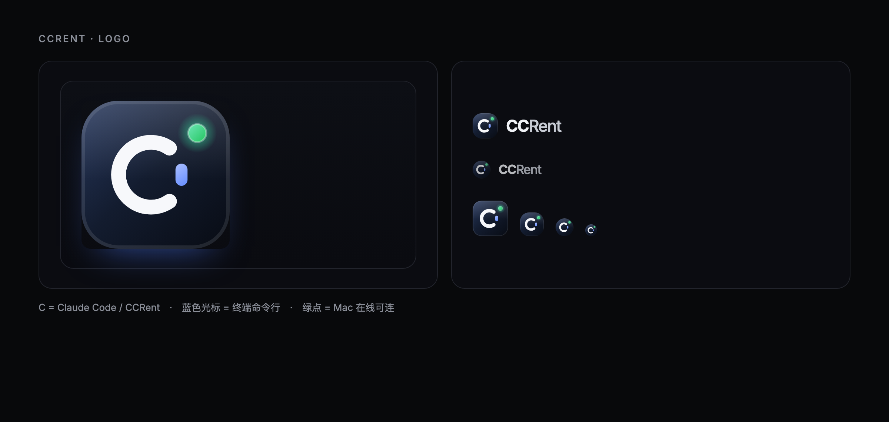

# CCRent · 暗色复刻版

对 [ccrent.org](https://ccrent.org/) 前端的 1:1 复刻，整体改为暗色调，并按业务要求改为**美国单地区、美国住宅 IP** 定位。原站是 Astro + Tailwind v4 的静态站点，这里输出为**零依赖静态站点**（原生 HTML / CSS / JS），可直接部署到任意静态托管。

当前套餐（原价 9 折）：仅 Mac **$143/月** · Claude Max **$324/月** · Claude Ultra **$466/月**。

## 线上地址

**https://ccrent.cc**（主域名，Cloudflare Registrar 注册，Pages 自定义域）

- 别名：https://ccrent-dark.pages.dev（Pages 默认域，内容相同，canonical 指向 ccrent.cc）
- 自定义域证书：Google Trust Services，自动续签
- DNS：`CNAME @ → ccrent-dark.pages.dev`（Proxied）

## 本地预览

```bash
cd ccrent-dark
npm start                     # → http://127.0.0.1:8899
# 或者
node tools/serve.mjs 8899
```

不要直接用 `file://` 打开：字体和弹层脚本在部分浏览器里会被本地文件的跨域策略限制。

## 部署

```bash
npm run build      # 生成可部署的 dist/（只含页面 + assets）
npm run deploy     # 构建并上传到 Cloudflare Pages（ccrent-dark）
```

首次部署需要先登录 Cloudflare：

```bash
npx wrangler@4 login          # 或 wrangler@4 login --device
```

部署产物：

- `dist/`：六个页面 + `assets/` + `_headers`（缓存与安全响应头）+ `404.html`
- 站内链接使用无扩展名地址（`/pricing`、`/help`），由 Pages 自动映射到 `*.html`
- 免费子域：`ccrent-dark.pages.dev`；绑定自有域名后可在 Pages 项目里加 Custom domain

## 内容与价格

所有可运营内容都集中在 **`tools/content.mjs`**，改完重新 build 即可全站生效：

| 配置 | 当前值 |
| --- | --- |
| 地区 | 美国（美国住宅 IP） |
| 仅 Mac | $143/月（原 $159，-10%） |
| Claude Max | $324/月（原 $360，-10%） |
| Claude Ultra | $466/月（原 $518，-10%） |
| 微信 / Telegram | yizhiquanbi / @AAAXieeeee |

`REPLACEMENTS` 里按顺序做全站文案替换（地区、住宅 IP、账号话术、价格、FAQ 等），`SITE` 控制域名 / 联系方式 / 价格 / IndexNow key。

## SEO

已做的全站 SEO：

- **基础**：每页独立 title / description、`lang="zh-CN"`、`robots` 指令、canonical、自引用 hreflang
- **社交分享**：Open Graph + Twitter Card（`og:image` 为自动生成的 `assets/img/og.png`，1200×630）
- **结构化数据**（JSON-LD `@graph`）：Organization、WebSite、WebPage、Service + Offer（三档价格、InStock、areaServed 美国）、FAQPage（首页 9 条 / 价格页 8 条，自动从页面 FAQ 抽取，保证与可见文案一致）、BreadcrumbList（内页）
- **站点文件**：`/sitemap.xml`、`/robots.txt`、`/site.webmanifest`、带 `noindex` 的 404
- **抓取与索引**：IndexNow key 文件 + `npm run seo:indexnow` 主动提交给 Bing / Yandex / Naver（Google 不吃 IndexNow，靠 sitemap + canonical）
- **长尾关键词**：每页独立 `meta keywords`；首页 FAQ 扩到 17 条、价格页 12 条（美国住宅 IP vs 机房 IP、Claude Code 是否必须美国 IP、Xcode 构建、支付宝付款、Max vs Ultra 等真实长尾问题），自动进入 FAQPage 结构化数据
- **AI 搜索优化**：`/llms.txt` 汇总服务、价格、页面与适用场景，方便 ChatGPT / Perplexity 等直接引用
- **性能/安全**：字体 preload、静态资源长期缓存、HSTS、X-Content-Type-Options / X-Frame-Options / Referrer-Policy
- **可访问性**：skip link、语义化 heading（每页唯一 h1）、图片 alt、弹层 aria/focus trap

```bash
npm run build         # 生成 dist/（含 sitemap/robots/manifest/OG）
npm run deploy        # 构建并发布
npm run seo:indexnow  # 部署后主动提交 URL
npm run analytics     # 今日流量数据（Cloudflare 边缘 + Web Analytics RUM）
```

## 包含的页面

| 文件 | 说明 |
| --- | --- |
| `index.html` | 首页（公告条、Hero macOS 桌面、地区地图、痛点卡片、对比表、配置卡、套餐、四步流程、FAQ、CTA、页脚） |
| `pricing.html` | 价格页（套餐卡、套餐对比表、计费说明、价格常见问题） |
| `help.html` | 帮助中心（目录 + 远程连接 / 使用帮助） |
| `terms.html` | 服务条款 |
| `refund.html` | 退款政策 |
| `privacy.html` | 隐私政策 |

## Logo



Logo 重新设计为「C + 终端光标 + 在线状态点」的组合：

- **标记**：深蓝渐变圆角方块，白色 C 代表 Claude Code / CCRent，右侧蓝色光标呼应终端命令行，右上角绿点表示 Mac 在线可连
- **字标**：`CC` 700 字重 + `Rent` 500 字重、收紧字距；暗色下 `Rent` 用略柔和的灰白，形成层次
- **资源**：`assets/img/logo-mark.svg`（页头/页脚，28/22px）、`favicon.svg`（小尺寸简化版）、`favicon-96x96.png`、`apple-touch-icon.png`、`favicon.ico`、512px 图标
- 页头悬停时标记有 1px 上浮 + 轻微放大

## 暗色方案

原站几乎所有颜色都走 CSS 变量，所以复刻采用「保留原始布局样式 + 覆盖主题变量」的方式：

- `assets/css/base.css`：原站编译后的 Tailwind 样式（仅把字体、地图资源路径改成相对路径）。
- `assets/css/theme-dark.css`：**暗色主题本体**。先把 shadcn 语义变量（`--background` / `--card` / `--muted` / `--border` …）和品牌变量（`--color-paper` / `--color-ink` / `--color-rule`）整体翻转为暗色，再逐块修复写死浅色的区域（header、卡片、对比表、价格卡、FAQ、CTA、页脚）。
- Hero 里的 macOS「截图」不是图片，而是原站用 div 拼出来的 1:1 场景。复刻把它改成了 macOS 深色模式 + Claude 深色主题 + 深色终端，对应样式集中在 `theme-dark.css` 的 `macOS mockup · dark mode` 段落。

想调整主色调，改 `theme-dark.css` 顶部 `:root` 里的 `--cr-*` 变量即可，例如：

```css
--cr-bg: #08090b;      /* 页面底色 */
--cr-surface: #121419; /* 卡片表面 */
--cr-accent: #8aa4ff;  /* 高亮/焦点色 */
```

## 交互

`assets/js/site.js` 用原生 DOM 重写了原站由 Astro/React islands 承担的交互：

- 顶部滚动进度条、吸顶导航、移动端菜单
- 公告条 → 现货弹层；页头「联系我们」/ 页脚 → 联系弹层
- 所有「现在预订 / 预订 *」→ 预订弹层（联动地区 + 套餐并生成预订摘要）
- 微信 / Telegram 一键复制 + toast
- FAQ 手风琴（同时只展开一项）
- Escape 关闭、点击遮罩关闭、焦点圈定、滚动锁定
- 页脚第三方徽章加载失败时自动隐藏，避免破图

## 目录结构

```
ccrent-dark/
├── index.html / pricing.html / help.html / terms.html / refund.html / privacy.html
├── assets/
│   ├── css/base.css          # 原始 Tailwind 样式（资源路径已本地化）
│   ├── css/theme-dark.css    # 暗色主题 + 弹层样式
│   ├── js/site.js            # 交互
│   ├── fonts/                # Inter Variable woff2
│   └── img/                  # favicon、点阵世界地图（已改为暗色点）
├── source/                   # 原站 HTML 快照（构建输入）
├── tools/build.mjs           # 从 source 重新生成六个页面 + SEO 注入
├── tools/content.mjs         # 全站内容 / 价格 / SEO 元数据配置
├── tools/og.mjs              # 生成社交分享图 og.png
├── tools/indexnow.mjs        # IndexNow 主动提交
├── tools/serve.mjs           # 本地静态服务器
└── package.json
```

## 重新构建

```bash
node tools/build.mjs   # 重新生成全部页面
```

构建脚本负责：去掉原站的 Astro 运行时 / 统计脚本、展开 islands、把 `/_astro` 资源改成本地路径、给 hero 场景换语义类名、补上静态弹层，以及修正站内跳转。

## 说明与边界

- 这是**前端视觉复刻**，不包含原站后端：登录、账户、下单、支付均为演示弹层，不会提交数据。
- 英文版（`/en/`）未复刻，切换链接打开原站并标记 `target="_blank"`。
- 页面文案、价格、图片素材版权归 CCRent 所有；本复刻仅用于设计与前端练习。
- 页脚收录徽章来自第三方目录站，需联网才会显示，加载失败的会自动隐藏。
