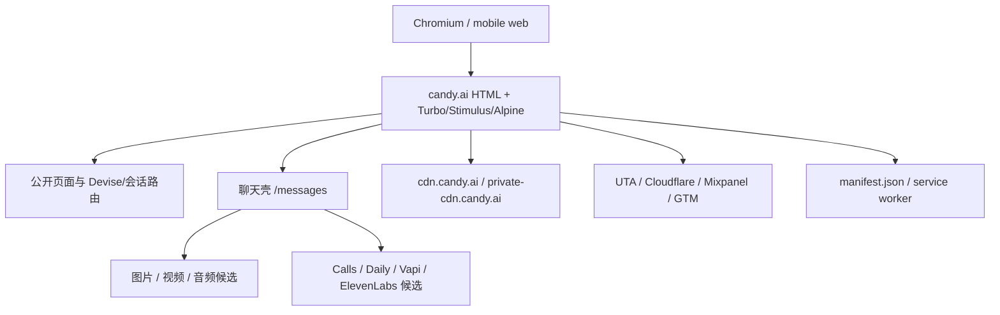

# candy.ai 公开面逆向报告（REA）

快照时间：2026-10-14（Asia/Shanghai）。目标是 `https://candy.ai/` 的公开、未登录面；没有提交登录、注册、聊天、生成、点赞、订阅或支付请求，也没有读取或回显 CSRF、Cookie、签名 CDN URL、UTA telemetry token 等值。

本轮针对消息、记忆和计费链路的增量分析见 [chat-memory-billing-deep-dive.md](/Users/pencil/Documents/IntVideoGameEditor/docs/candy-ai-chat-memory-billing-deep-dive.md)。

## 证据与方法

本次使用 REA 的受控浏览器和静态 JavaScript 工作流：

1. 用独立的 Chromium 155 profile 启动 `candy.ai`，通过显式 loopback CDP endpoint `http://127.0.0.1:9222` 绑定页面目标。
2. 对首页做 controlled replay，保留 URL、DOM、可访问性树、截图、网络事件和选定的响应字节（Evidence `ev_aace0fd5d6ff1d40961e17791ac0b19f25e904eba8953c430bf7d16ba6325048`）。
3. 用 `list_browser_targets`、`inspect_web_page` 和 `analyze_web_bundle` 做 CDP 被动观察和脚本静态分析（Evidence `ev_f5ef74fcb65419a669a7f1f9a0514906af97bbe5f2c5c3dfdb47de5c590173d0`, `ev_7834a63bf7068d0edd34494e7552ee0c6a7e030e412f273e55e818b38d1fc484`, `ev_53bceeb3abfd9c17d92634e4be698627f35844cc87e32e431009657a1e813f92`）。
4. 用 `export_web_scripts` 导出捕获到的脚本，再用 `analyze_javascript_application` 做本地静态图分析（Evidence `ev_a36bae12bdd61ecec57ed4e2590c2c3b08b768ce76f74c90336b5b39948ed745`, `ev_e558a0b0a77639a3d74feab7ba3b61ff518e5e3a488cdddc122ccbde6d8b96bf`）。
5. 用第二个短场景只执行 GET 导航，观察角色聊天壳和创建角色首屏（Evidence `ev_d9219842e2f984365cc5a9e445b6699d0331c789aa0c299750ad2e4893d04b6e`）。

可复核的完整证据包在 [evidence-bundle-with-trace-20261014.json](/Users/pencil/Documents/IntVideoGameEditor/output/rea-candy/evidence-bundle-with-trace-20261014.json)，脚本导出目录在 [scripts-20261014](/Users/pencil/Documents/IntVideoGameEditor/output/rea-candy/scripts-20261014)，首页截图在 [homepage.png](/Users/pencil/Documents/IntVideoGameEditor/output/rea-candy/homepage.png)。

## 已观察到的产品表面

首页是一个内容货架式入口。无登录状态下可看到：

- 侧栏入口：Home、Discover（`/feed/posts`）、Shorts（`/candy-shorts`）、Chat、Collection、Create Character、My AI、Private Content、Premium。
- 顶部类别：Girls、Anime、Guys；主页有搜索框和多组角色筛选器。
- 角色卡片：公开的 AI Girlfriend/Anime/Live Action 角色页，卡片携带年龄、系列、MPC、Live Action 等标记。
- Candy Experiences：视频创建、Private Content、Candy Cams、Candy Shorts、Live Action 等货架。
- FAQ 和长文案明确宣传记忆、个性化、聊天、图片、视频、语音和角色创建；这些是产品声明，不能单独证明后端实现。

首页 controlled replay 的可访问性树还保留了 Cookie consent 对话框、语言切换、Help Center、Discord 和法律页入口。首页单次受控加载共记录 155 个请求、154 个响应和 1 个失败请求；请求主要是 130 个图片、8 个脚本、5 个 fetch、4 个字体和 3 个样式/文档类资源。该统计包含页面依赖的第三方 origin，不能解释为 Candy 自有 API 数量。

## 角色聊天壳

公开角色页 [Helena](https://candy.ai/ai-girlfriend/helena-miller) 在未登录状态下仍返回一个完整聊天壳：

- 标题为 Helena，有一条初始角色消息和时间戳。
- 有 `Chat message` 文本框、`Image` 和 `Video` 操作、`Scroll to bottom`，以及角色简介和 About me 字段。
- 侧栏保留当前角色摘要和 profile 搜索框。
- 页面没有显示用户历史消息；本次没有填写文本框，因此没有验证消息发送、流式响应、上下文记忆或余额扣除。

辅助 GET/HTML 检查显示聊天表单的创建路径是 `/messages`，并携带 `message[profile_id]`、`conversation_id`、`body` 等字段；这属于页面声明，不能替代一次已授权的 POST 观察。HTML 还声明了 `/calls/eleven_labs/*`、`/audio_messages*`、`/gen_ai_suggestions/cached_prompts` 等辅助路径。

## 公开 GET 路由矩阵

| 路由 | 观察到的行为 | 证据边界 |
| --- | --- | --- |
| [`/feed/posts`](https://candy.ai/feed/posts) | Discover 页面入口；另有 [`/feed/posts.json`](https://candy.ai/feed/posts.json) 公开 JSON 货架数据 | 只做 GET；没有调用点赞写接口 |
| [`/candy-shorts`](https://candy.ai/candy-shorts) | Shorts 货架和 series 链接 | 没有播放、购买或解锁受限 series |
| [`/subscriptions`](https://candy.ai/subscriptions) | 公开套餐/权益说明页 | 没有点击 Get Started、支付或订阅 |
| [`/characters/new2`](https://candy.ai/characters/new2) | 角色创建入口，controlled replay 最终显示 `/characters/new4` 首屏 | 没有点击 Start 或提交 PATCH/POST |
| `/characters`、`/collection`、`/conversations/none` | 公开导航声明；未登录时部分入口会重定向或显示空壳 | 没有尝试绕过认证 |
| `/users/sign_in`、`/users/sign_up` | Devise 风格登录/注册表单 | 未填写、未提交，也没有使用 OAuth |

## 创建角色首屏

从 [创建角色入口](https://candy.ai/characters/new2) 做 GET 导航时，REA 场景最终落在 `/characters/new4`。首屏可访问性树显示：

- `Create your Dream AI Girl`。
- Girls / Trans 两个性别入口。
- Realistic / Anime 两个类别单选，Realistic 默认选中。
- `Start` 按钮。

没有点击 Start，也没有提交角色数据。页面声明的后续步骤、属性选择和生成接口仍属于待验证项。

## 脚本和网络结构

`analyze_web_bundle` 在首页捕获到 8 个 JavaScript source artifacts，完整解析 8 个脚本，没有 parse failure；主要脚本包括：

- `application-…js`：约 1.94 MB，主站交互和 Turbo/Stimulus 相关逻辑。
- `voice_call_addon-…js`：约 953 KB，语音/通话相关逻辑。
- `alpine-…js`：约 41.8 KB。
- CookieScript、Cloudflare Insights、Google Tag Manager、Google Identity 等第三方脚本。

静态 bundle 观察到了 `turbo-frame`、`turbo-stream`、`turbo-stream-source`、`turbo-cable-stream-source` 等自定义元素；结合 HTML 的 Turbo/Stimulus 数据属性，可高置信度推断这是服务端渲染 HTML + Turbo/Stimulus/Alpine 增强的应用形态。静态分析没有执行这些脚本，也没有证明任何模块在本次页面中实际运行。

首页网络中出现的 origin 包括 `candy.ai`、`cdn.candy.ai`、`private-cdn.candy.ai`、`uta.candy.ai`、Google Fonts、CookieScript、Cloudflare Insights、Mixpanel、GTM 和 Google Identity。REA 只保留了安全的 URL、类型、状态和经声明允许的响应字节；Cookie、Authorization、原始 WebSocket payload、存储值和结构化 JSON 值均被脱敏或不保留。CDP 被动检查只观察绑定之后的窗口，不能补回此前请求。

本次导出的脚本静态图共读取约 4.05 MB 文本，解析 7 个相关文件，产生 374 个 finding；语义图因资源预算和动态/未支持语义保持 partial，报告了 55,286 个 semantic unknowns。对 `/messages` 做语义追踪没有找到确定的 seed，状态为 partial（Evidence `ev_186d9542e6737c2d5da2bb84cf54005e65a7a75df8e52ce70a40d2274e51cce5`）；这说明当前静态图不足以把页面表单和某个已解析函数绑定起来，不能据此断言 endpoint 不存在。

## 静态接口候选

对主站 bundle 的字符串和页面数据属性做了辅助审计，候选包括：

- 聊天/会话：`/messages`、`/messages/check`、`/conversations/search`、`/conversations/regenerate_image`。
- 媒体：`/audio_messages`、`/audio_messages/completion`、`/image_to_video_generations/.../feedbacks/load_feedback_buttons`。
- 角色/内容：`/home/search`、`/feed/posts/<id>/like`、`/user_preferences/toggle`、`/user_notifications/mark_as_shown`。
- 计费/埋点：`/paywall_events/track_viewed_paywall`、`/user_purchases/live_actions`、`/user_feedbacks/live_actions`、`/api/v1/tracking/events`。
- 通话：`/calls`、`/calls/call_context`，以及语音 bundle 中的 Daily、Vapi、ElevenLabs 相关 host/path。

这些是静态字符串或 DOM 声明，不能证明当前版本都可调用，也不能证明前端绕过授权。没有对上述写操作、生成接口或通话接口发请求。

## 初步架构图

图中带“候选”的边来自静态代码或页面属性；真正的模型、记忆、队列、余额和授权实现位于服务端，当前证据没有覆盖。

## 未解决问题

- LLM、图像、视频和语音的实际 provider、模型、prompt 组装和记忆存储。
- `/messages` 的请求体、响应协议（HTML/Turbo、SSE、WebSocket 或 JSON）、流式分片和错误重试。
- 登录/注册后的会话、CSRF、余额/token 计费和订阅权限。
- `private-cdn.candy.ai` 的签名、过期和访问控制策略。
- Live Action、Cams、Shorts 的实际播放器和后端事件协议。
- 前端静态图中动态拼接、服务端渲染和未抓到的脚本模块。

要回答这些问题，需要用户明确提供可用的测试账号/授权范围，或给出本地 fixture；下一步应使用隔离 profile、最小化测试消息和 REA 的受控 scenario，仍然避免真实支付、真实用户内容和批量枚举。

## 结论

目前可以可靠重建的是公开信息架构和前端壳：Rails/Turbo 风格的服务端页面、角色/内容货架、公开角色聊天壳、创建角色入口、PWA 和多 CDN 媒体分层。不能从当前公开证据可靠重建的是 AI 后端、消息生成、记忆、余额、权限和付费流程。完整证据包保留了每条观察的 authority、confidence、coverage 和 limitations，适合作为后续授权测试或本地重建的基线。
