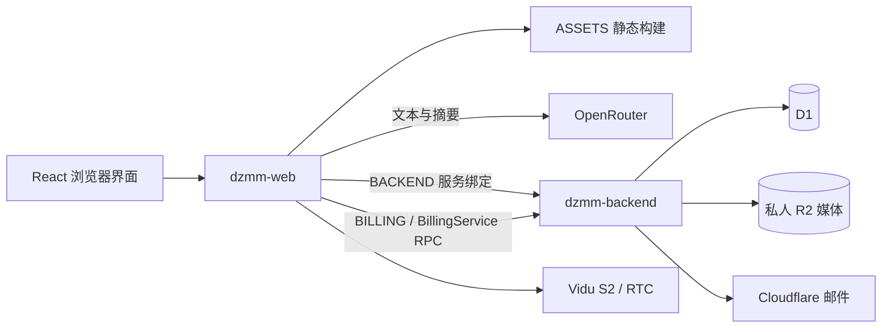

# 叙梦项目 Agent 交接文档

## 当前正式版本：女友聊天 Cloudflare 宿主（2026-10-18）

用户明确选择面向所有正式登录用户。现Web `054f04e8-4d08-46d6-a7c3-87b629cc93a7`，独立Companion `4133d2a8-9507-4866-b9ff-ca4504bfa22a`；前端沿用三分区 `index-vRvXYY4P.js` / `index-CNb0-Zsc.css`，Backend未发布。下文是各轮历史状态；女友“尚未配置宿主”的旧结论已被本次上线替代。

每账号独立DO/原生容器，私有R2备份；最多5个活跃实例。正式普通QA health200、ready=true，冷启动57.5秒，匿名401、旧入口302、当前资源字节一致。未发送真实聊天；原生启动embedding探测次数/成本未知。实际非root断网Docker备份/新容器恢复与隔离宿主测试通过，生产闲置R2往返、真实模型回复尚未验收。QA已退出，本地fixture容器清理、VM停止、临时真实Secret文件删除。

未来镜像发布前先完成已有账号checkpoint，不能直接替换活跃实例；异常中断会保护性暂停，不能清空记忆重新开。完整记录：[Cloudflare部署](./xumeng-companion-cloudflare.md)、`output/xumeng/companion-release-20261018/readiness.json`。本次未修改价格、收款或媒体策略。

## 当前正式版本：三分类导航（2026-10-18 14:47）

用户明确要求更新正式网站。当前 Web `5adfaf24-126c-426c-8584-d39edd855dad`，JS `/assets/index-vRvXYY4P.js`、CSS `/assets/index-CNb0-Zsc.css`。仅发布一次 Web，未部署 Backend。精确发布基线为 `output/xumeng/releases/20261018-three-modes/release-stage`，继承当天状态投影修复，保留当时正式环境的支付/媒体配置；下文版本和开关描述是各自历史记录，不应据此回退当前版本。

消息侧栏现为「故事 / 聊天 / 游戏」，Yume 女友是聊天分类的子元素。已用独立私有测试账号真实生成两轮故事、保存刷新恢复、切分类保留草稿，并从游戏列表打开原创小游戏，实际点击按钮成功。网站自动生成一次行动建议，总计消费该测试账号3 Credit，零预留；浏览器与验证器已退出账号，合成测试记录私有保留。证据见本轮 `publication.json`、`production-ui-verification.json` 和三张截图。桌面1280px既有页头溢出仍在，本轮未验证手机或媒体/支付。

**女友尚未上线可用**：原生 MaiBot 仅在本机运行，没有可连接的正式宿主，现有4090_med SSH认证失败。正式健康接口返回 `ready:false/not_configured`，页面明确暂未开放，不接收消息、不伪造回复、不降级旧自写引擎。用户已被询问可用常驻服务器信息；获得宿主后仍需账户鉴权、每账号原生实例隔离与真实聊天验收。

2026-10-15 用户要求为付费接入暂时屏蔽图片/视频：独立新生成、聊天图片、电话素材与 Krea2 已全关闭，旧工作台链接变为只读历史；语音、电话、已有结果与已提交任务恢复保留。Backend `31ed40c1-0e20-457f-8533-6b8106e44e3a`、Web `922a1748-df3d-4e51-bd2b-4df38797aee1`，JS `/assets/index-BgnaGfDo.js`。67 后端＋49 Live＋30 Web 隔离测试及历史真实组件复测通过，正式标题/导航/资源引用和暂停接口回执已核对；未读原有私人历史、未付款、未调真实模型/媒体。自动迭代已更新为不得自行恢复。Waffo 门店审核及待修改条款仍未完成，不能把暂停媒体称为审核通过；未批准政策草稿未发布。证据：`output/xumeng/iteration/generation-payment-pause-20261015/round.json`。

## 当前角色卡上下文修复（2026-10-15）

当前生产 Backend `31f78331-c6b4-4a6e-9147-96b6b28f9354`，Web `55e605e9-4b0c-47e3-84ca-4b7184bd8a7e`，JS `/assets/index-CUs70XGu.js`，CSS `/assets/index-BHhRjiU9.css`。以下版本均是各自历史记录。

当前60条采集目录先前只有元数据，却合成了人设与通用开场。已移除该伪完整行为，补回5个经公开页面核对的背景与4段渲染开场（`dzmm-public-context-2026-10-15.json`）；55条仍为metadata-only，详情引导补充，原始完整卡/隐藏世界书未取得，XM-120保持部分修复。师尊3768869采用真实背景作为开场fallback，不能称为取得原始开场。作者署名和内部provenance保留，页面来源占位词移除。

`dzmm-catalog.ts` 负责公共卡完整度合并与新聊门禁：不丢弃后端有效公共卡，不把私人完整导入/发布卡误判下架，不降级卡资料，不改已有会话快照。41项相关测试、27项路由/资源/社区测试及实际隔离页面通过；生产浏览器确认新资源和任白雪背景。匿名HTTP403，未进行生产模型调用。Worker 19项历史诊断与基线完全一致；旧样本1项性格漂移未碰。

本轮从隔离副本各发布一次backend/web，保留支付/点赞；**Waffo政策/联系信息页面、页脚及验证文件未获用户确认，已排除，不能直接发布根工作区dist**。见 [交付证据](../output/xumeng/iteration/catalog-context-20261015/round.json)。

## 最新点赞修复（2026-10-15）

角色详情点赞已改为叙梦后端持久化：迁移 `0046_character_likes.sql` 已应用，Backend `f4e20a3d-6a2b-433c-905f-bb67831eb285`，Web `90ab088d-ad52-4e4c-be09-9d713ff995c2`，当前正式 JS `/assets/index-pWOeCEWw.js`、CSS `/assets/index-BHhRjiU9.css`。定向 Worker/D1 测试通过，覆盖按账号去重、取消、刷新回读、静态外站卡与未知角色拒绝。生产匿名点赞接口返回 401 是登录门禁，生产点赞表当前零测试行；未读取或写入真实私人账号。外站采集旧数字只作基线，并标注“原站采集基线 + 叙梦点赞”。

证据：`output/xumeng/iteration/likes-persistence-20261015/round.json`。

## 当前入口与验收范围（2026-10-14）

最新生产版本：Web `a62d389d-4300-40b4-9390-33730c1e3c3f`，Backend `ca1d5667-e9ec-42ad-867f-b399f8f5fc13`；JS `/assets/index-CycZKcXR.js`，CSS `/assets/index-DZZpwjR_.css`。本轮仅修复会话媒体目录超过 500 项时无法读回：显式分页、空过滤页继续、完整成功后更新缓存。实际普通隔离 D1／客户端复测通过，511 项后端测试通过，正式资源与密钥审计通过；浏览器仍受阻，XM-112 保持部分验收，不把 HTTP／隔离 API 当作真实 UI 或媒体供应商效果。[轮次证据](../output/xumeng/iteration/heartbeat-20261014-media-directory/round.json)。

新目录客户端需 `pagination=1&limit=500` 与版本化 `directory` 元数据；旧 GET 合同不截断。未来隔离组件的空目录 mock 也须提供该标记，缺失 `pending` 仍为未知，不能假确认任务结束。可比较的当前冻结源码在本轮 `release-stage`，仅三个运行时覆盖；工作区额外 jump 构建／预览代码未纳入本次发布。以下交付记录为各自历史范围，当前资源以此段和台账为准。5 USDT 月卡接入保留，收款开关仍关闭，商户配置／真实付款仍待用户。

## 2026-10-13 USDT 支付更新

当前已发布 NOWPayments 手动月卡接入：用户确认售价 5 USDT / 30 天（revision2），不再接受人民币/支付宝新购；历史权益、余额和订单保留。新通道仍关闭，商户注册/邮箱/条款、结算钱包/网络、服务器 Secrets 和实际供应商付款验收未完成。详见 [xumeng-nowpayments.md](./xumeng-nowpayments.md)，最终发布证据 `output/xumeng/iteration/nowpayments-20261013/release-status.json`。后端 `ef31be25-b8ad-422d-ac2e-2ce2b62b2de5`，网页 `67f4309d-38fa-4fe1-8487-6df70ea86a90`。不要自行切换 `NOWPAYMENTS_ENABLED`、恢复旧收款或把隔离测试称作真实付款。

2026-10-13 用户要求暂时屏蔽收款，已完成[收款暂停交付](../output/xumeng/iteration/payment-pause-20261013/report.md)：前端 XUMENG_PAYMENTS_ENABLED=false，后端 PAYMENTS_ACCEPTING_ENABLED=false；暂停充值、VIP新购/续订和继续支付，保留余额/历史订单/已有会员状态与领取，不修改价格和存量权益。最终Web59647117、Backend635741a7，正式资源严格审计通过，普通隔离账号旧enabled:true元数据与领取/待付回执复测通过，未真实签到或付款。周期任务不得自动打开收款，只有用户明确新请求才恢复。首发过度隐藏既有权益入口后修正并追加一次Web；正式中间其他版本已保留，不覆盖已发布后续功能。

最新周期交付 [heartbeat-20261013-category-search-boundary](../output/xumeng/iteration/heartbeat-20261013-category-search-boundary/report.md)：XM-110修复分类长查询刷新丢整组筛选。分类UI/history统一1000字符，121完整查询/new/week与1000空格emoji/likes/quarter、native history.back及清空刷新均实测；正式121恢复通过，严格上线审计全通过。Web `dea8b8e8-db14-4bf2-b7ce-aeb4c6b2ed47`，JS `/assets/index-Bh0CA3OZ.js`，CSS `/assets/index-B6RqRmOn.css`，后端未发布。13项测试、两runtime文件+一个测试修改，29其他保护文件不变；两普通mock服务清零exit0，无模型/媒体/真实交易。新DZMM公开排序观察完成，私有历史/费用未知；旧已丢查询不追溯，超过1000旧外部记录仍拒绝。

最新周期交付 [heartbeat-20261012-media-reference](../output/xumeng/iteration/heartbeat-20261012-media-reference/report.md)：XM-109已修复并发布，模型配置挂起时也保存本人模板补充与参考图草稿。实际旧/新冻结UI、挂起刷新、正常配置刷新与390px产品iframe验证通过；26项相关测试、一次构建/一次发布。Web `3128154f-ea69-4d71-bae5-ed51671c71a0`，JS `/assets/index-ghtLxwjP.js`，CSS `/assets/index-B6RqRmOn.css`。后端未发布。原审计的两条不存在路径返回旧版已知SPA，保留整体失败并以准确旧首页SHA/长度/MIME补充核对；当前活跃资源符合新版本。隔离API为mock，不代表D1/供应商；未调用模型/媒体或真实交易，测试数据和键已清零，实际exit0。下个正常轮次需新的公开竞品观察。

核对日期：2026-10-12。正式站点：[叙梦](https://xumengchat.top/)。工作目录：`/Users/pencil/Documents/IntVideoGameEditor`。

最新电话章节参考补查：[小说人物电话参考](../output/xumeng/iteration/heartbeat-20261012-novel-phone-context/report.md)。Web `a3ac1d0f-95ca-4143-ad23-5043f774c444`，JS `/assets/index-CD__tmp5.js`，CSS仍 `/assets/index-B6RqRmOn.css`；Backend未部署。唯一产品变化：NovelStudio先传完整当前章给既有正文／作者备注解析器，再截取正文；避免长备注标题被提前截掉。已用旧冻结页面实际复现，并在固定版确认勾选保留正文／排除备注，未勾选不附带；19项相关回归与独立复核通过。XM-106 UI残留与XM-108备注问题在这个范围关闭，不代表真实S2或音频验收。

本轮1次构建、1次发布，正式资源和密钥审计通过；25个范围外保护文件与8份游戏壳源不变。只读竞品小说目录可达，创作需要登录，未继续私有体验。新普通原创小说两阶段Local／Session／内存对象清零，实际exit0和PID／端口关闭、标签全关闭。无模型、拨号、媒体或生产数据写入。下方游戏壳版本为上一版，其范围与接入边界保持不变；保持游戏恢复XM-101／102部分解决状态。

最新游戏壳交付：[游玩游戏容器](../output/xumeng/iteration/manual-20261012-game-play/report.md)。用户明确只要承载游戏的壳，未发布的内置故事／谜题和平台存档已撤下归档。Web `c1b6227a-d92d-4628-ba70-0e7363dd90d4`，JS `/assets/index-CgwnxYue.js`、CSS `/assets/index-B6RqRmOn.css`；Backend未部署。`#play-games` 到本人保存的HTML，消息页按角色／游戏分类；`GamePlayer({game,onBack})` 是原严格CSP的沙箱容器，开始／重载／返回／整屏，最近元数据是本机记录而非存档。接入边界见 [游戏壳文档](./xumeng-game-shell.md)。

21项相关回归、client、独立25项源码检查、最终冻结实际UI运行／250KiB／503重试／错身份／游客／流式切换和390px文档通过。正式导航／资源／密钥审计通过；不读取原生产私人作品正文或聊天。原生重载确认取消／接受因工具输入超时未接受，不复跑相同条件。最终8源freeze、stage、保护24文件均一致。前半轮原型3次构建＋一次overlay前误构建全部弃用；最终壳构建1次、统一发布1次。临时标签关闭、自有存储及内存数据归零，所有本轮隔离服务实际exit0且PID／端口关闭；模型及生产数据写入0。

竞品新完成DZMM公开游戏详情→游戏卡标签搜索，观察只证明游戏分类／入口；存档、费用、运行未知。下方电话及旧Web版本均为历史。保留XM-101／102、XM-106原部分解决状态，后续别重新扩成内置玩法。

最新电话交付：[页面简化与上下文](../output/xumeng/iteration/manual-20261012-phone-simplify/report.md)。Web `0aba1dec-ea21-4e22-abea-d166f9c40e60`，JS `/assets/index-jGdg5Sp_.js`、CSS `/assets/index-BZOsVnwy.css`，Backend 未部署。下方旧 Web 版本均为历史。主流程收为对象、拨号／挂断和文字互动，背景／最近对白、音色和高级工具默认折叠；无故事填写姓名和背景。确认换手动对象后清旧人物、形象、场景、对白与来源。导航重新建立当前剧情，离开视图清旧 handoff；小说当前章节尾部优先于长概要。新增 helper 见 `src/lib/xumeng-phone-contact.ts`。

21 项目标测试、client、独立审查、冻结 UI 当前角色及小说人物拨号和互动、503 保稿重试、手动清空／取消换人、390px 真实 iframe 文档与正式布局／资源／密钥审计通过。工具 viewport 覆盖实际未生效，宿主仍为 1422px；用真实 390px iframe 文档验证并明确方法。手动完整拨号因原生图片选择超时及宿主工具限制未完成；小说编辑器带章节入口未追加 UI，XM-106 保持部分解决。真实 S2／音频／模型调用均为 0，不把 canvas 字幕当供应商验收。正式页面为现有登录身份，只检查空对象布局、不打开私人聊天或拨号；产品可能自动建立免费控制租约。

最终 stage：`output/xumeng/iteration/manual-20261012-phone-simplify/release-stage`。两次 stage 构建（复审修复后重建）、一次发布；另有误在根目录执行的 Next 构建失败，未发布，20 个保护文件哈希未变。主夹具 actual exit0，静态手机 wrapper 精确 SIGTERM exit143，PID／端口均关闭；本人内存数据、租约、Local／Session 归零，测试标签关闭。竞品新观察仍到期；下一轮补全手动上传及章节入口验收，不重复已受阻原生文件选择。

当前最新交付：[电话名称与游戏恢复核心修复](../output/xumeng/iteration/manual-20261012-game-recovery-resume/report.md)。Web 版本 `5f8b5ba7-1e5d-4783-a052-07e7ab45a79f`，JS `/assets/index-46G5OTWo.js`、CSS `/assets/index-LKsUGKQY.css`；Backend 未部署。用户将“AI 直播”改称“电话”，导航、人物／小说入口、拨号与挂断文案已统一，正式页面和资源审计通过。只构建、发布一次；本轮真实模型／S2 调用为零。下方 `9d42bf20` 和未发布候选 `CtoDsI9P` 均为历史记录，不能当当前发布版本。

XM-101／102 的恢复核心已经一并发布：新普通隔离账号生成真实旧 v1 稿，固定版同编号重开显示原恢复稿、拒写保稿、恢复原文、CAS 冲突另存和双窗口保存隔离有实际证据。长源码存储与丢成功回包后的保稿也已观察，但原生脏稿刷新及后续大型稿文档配对仍未完整验收，两问题保持 `partially_resolved`，不补称全通过。本轮原生 AX 旧编号误命中返回按钮，后用语义控件继续；后续输入未能与文档审计成对的动作停验，不能只凭返回成功计通过。

旧阻塞页面此前已全部关闭，本轮测试标签也已关闭；普通隔离账号63张表及R2归零、控制页本人本地／会话键归零、其他文档关闭，夹具真实exit0、精确PID／端口／目录消失。纯静态预览另行按精确PID停为exit143，无数据库。不要再要求用户关闭已消失的 localhost53619 标签。当前可复用最终 stage 位于 `output/xumeng/iteration/manual-20261012-game-recovery-resume/release-stage`；后续遵循实际最新台账与验收限制，不重建过时候选。

最新人工交付：[模型连接、前端密钥与当前剧情直播](../output/xumeng/model-live-audit-20261012/report.md)。Web 已集中发布一次，版本 `9d42bf20-4e9a-4759-8fb1-23231f482229`，JS `/assets/index-7N7ZOc_K.js`、CSS `/assets/index-LKsUGKQY.css`；本次未部署 Backend。正式 HTML／JS／CSS／RTC 与冻结构建逐字节匹配，匿名接口及源码／产物密钥检查通过。千问供应商只支持 reasoning 开关，共享模型策略改为 `enabled:false`；其他模型保留 `effort:low`。实际通过聊天处理器验证 DeepSeek、千问两次，合计 $0.0004639875，用普通隔离账户结算，生产余额零变动；Gemini／Claude／GPT 仅做路由和参数检查，未真实调用。

用户确认直播优先接续**角色聊天里的当前剧情**。点击当前角色的直播入口带入人设、匹配当前完整消息指纹的世界状态及最多八条最近对白；旧前缀状态不能覆盖新对白。直播页以当前场景、人物目标、玩家说话／行动为主，导演和弹幕工具折叠。失败发送保留原稿，字幕修订、重复轮询与旧场次迟到消息有隔离。实际冻结 UI 的剧情导入、失败恢复、互动、重新开播和 433px 无横向溢出已验收，生产游客页面已核对；RTC 为明确标识的隔离供应商，**本次真实 S2 音视频调用为零，不能声称真实表现已验收**。测试页存储归零、标签关闭，夹具实际 exit0、PID／端口关闭。

本次发布刻意排除了下面仍待验收的 XM-101／102：使用 [release-stage](../output/xumeng/model-live-audit-20261012/release-stage) 与精确旧 `game-studio.tsx` 基线构建，未替换工作区恢复修复。20 个其他项目及待验收文件的哈希、14 个本次冻结产品文件与 stage 的哈希均一致。不要直接在混合工作区执行完整发布而把未验收恢复代码带上线。构建共两次尝试：首次 stage 遗漏多行导入失败，补齐 TypeScript 解析出的十一项依赖后成功；仅一次部署。发布后审计首次被部署工具生成的空 `.wrangler` 目录拦截，核对无文件后只移除该空目录并重验通过，失败证据保留。

最新本地工具交付：[经营日报说明](./xumeng-daily-reports.md)。每天北京时间 09:00 通过 `automation-3` 在本机生成前一完整日的 Markdown / JSON；首份 [2026-10-10 日报](../output/xumeng/daily-reports/2026-10-10.md) 已真实只读采集成功，23 项检查通过，配置和边界见 [setup.json](../output/xumeng/daily-reports/setup.json)。不保存私人正文或凭证，不写生产库，也未发布产品。日报读取本地迭代状态，与下列仍待验收的产品修复分开；未来定时运行尚未观察，需本机和 app 可用。

游戏草稿最新续验：[2026-10-12 验收记录](../output/xumeng/iteration/heartbeat-20261012-creator-draft-acceptance/report.md)。新独立 stage 已构建一次（JS `/assets/index-CtoDsI9P.js`），**未发布、XM-101／102 未关闭**。真实旧版编辑器的原创未保存稿与 v1 raw 完整配对后，返回列表操作被浏览器确认处理阻塞；固定页恢复／双标签／失败路径尚未执行。自有 `127.0.0.1:53619` 标签5仍需关闭，浏览器键清理未知。新隔离账户的63张表及R2归零，宿主等待HTTP关闭并实际exit0、dispose与精确目录消失已确认；不覆盖下文旧exit143。相同条件不重复重跑，可轮换独立可做流程。正式站点资源仍为上方人工交付版本。

当前待交付修复：[游戏草稿恢复轮次](../output/xumeng/iteration/heartbeat-20261011-creator-drafts/round.json)，XM-101／102 **本轮当时仅本地修复，未构建、未发布、未关闭；后续候选构建见上方续验**。`game-studio.tsx` 与新 `xumeng-game-recovery.ts` 按账号／编辑会话／作品分槽；清洁云稿不删恢复稿，保存只清捕获本人 key+raw，旧v1只读兼容，长源码双重快照往返已补测。独立复审、10项目标回归及client检查通过。浏览器离开提示阻塞实际刷新和双标签页复测，已请求用户仅关闭本轮 `127.0.0.1:22067` 测试页；无新条件不重复操作。普通测试账号 `abdc188f-8f8b-49ef-b0cf-486a6beadc25` 的63张产品表及R2已归零，PID7427退出143且无正常关闭回执，精确自有runtime已安全移除；浏览器键／标签仍待清理。后续先核对轮次冻结哈希和新浏览器条件，再固定版本验收并集中发布一次，不把本地检查当正式功能上线。

游戏草稿轮次当时的生产HTTP为 Web `144c5da0-a45c-4d6e-844d-cd362bf002f2`，这属于历史快照。最新人工交付发布前实际读取到 Web `21d6b8c2-68f1-40a8-bf02-81746144db44`，没有把期间的其他部署归因于本次工作。最新正式资源以上方交付为准；下文保留历史状态，不覆盖未完成的草稿验收。

当前人工接入任务：用户要求配置 Google / Telegram 登录，两种 OIDC 客户端尚未核对，产品回调尚未实现。Google 控制台要求用户亲自完成账号 MFA；Telegram 的 `@XumengChatbot` 已创建，并在桌面 BotFather 成功回复中核对，已进入 Login Widget。该 Bot 初始为旧版入口，切换 OpenID Connect Login 尚待执行时确认。原生主窗口点击曾失败，用户打开小程序后已用其可访问链接进入设置；不重复创建 Bot。精确拟定回调、账号关联规则和验收清单见[登录配置指南](./xumeng-social-login.md)；实际准备状态见[setup-status.json](../output/xumeng/social-login-20261010/setup-status.json)与台账 `socialLoginWork`。不要因用户完成提供方配置就声称登录上线，也不要把 Bot API Token 当作新版 OIDC Client Secret。社交登录准备本身仅更新文档与状态，未实现或发布登录功能。

最新人工交付：[模板参数生成](../output/xumeng/template-first-20261010/report.json)，XM-093为用户明确要求的设计改进。18 个模板直接进入主体／场景／风格等字段工作区；逐模板参数、补充要求、旧完整描述与同一参考图编号可恢复，改字段使旧报价失效，取消换模板保留原稿。Web `0f70ac6a-912c-4223-b4e5-9a0601fd0755`，JS `/assets/index-DMkaw055.js`，CSS `/assets/index-DeCCqkpA.css`；Backend保持 `8a2ec661-3db7-4c35-8ee8-d38481536919`。22项目标测试、client检查与一次构建通过；实际隔离D1/R2图片提交503后的原请求GET恢复通过，生产目录／字段／视频筛选及资源字节已核对。视频报价和提交通过，但成片下载被夹具漏匹配 `content?index=0` 阻断，修改后的夹具未运行重验；原生参考图预览尺寸仍0、手机未验收。没有真实媒体调用、改价或后端部署。本人SQL/R2/当前测试页存储清零，awaited dispose回执、PID/端口关闭及精确临时目录删除已核对；终端最终exitcode未捕获，不称已获取exit0。结构化字段只存浏览器账号/标签页草稿，后端仍冻结最终prompt与templateId元数据；详见[生成工作台](./xumeng-generation-workbench.md)。下一步按会话历史／分支连续性轮换，社交登录配置仍待用户操作与确认。

最近周期交付：[会话再生成刷新恢复](../output/xumeng/iteration/heartbeat-20261010-chat-branches/round.json)，XM-096 已关闭。Web `f93e3c35-f938-4969-b169-64c0c372f440`，JS `/assets/index-AhWV2iq_.js`，CSS `/assets/index-Bai1b_w4.css`；Backend 保持 `8a2ec661-3db7-4c35-8ee8-d38481536919`。最新回复等待重新生成时保留原回复及有效摘要/世界状态，收到有效新正文才替换并应用临时前缀摘要。7 条、128 条无正文刷新，完整回复与独立历史分支通过实际冻结 UI 和隔离 D1；部分正文刷新仅有浏览器未同步副本证据。25 项目标函数、87 项相关回归、client 检查和一次构建通过，38 项正式 HTTP 检查及公开页资源匹配；真实模型0，未注入生产私人故障。测试本人 SQL/R2/浏览器存储为0，PID/端口/临时目录已消失；关闭脚本因内部字段断言失败，实际 exit1，不能称正常关闭成功。未来夹具已按显式路径与分阶段回执修正，仅语法检查，旧失败保留。竞品只完成 DZMM 游客消息导航，已有历史阻止安全分支对照，不重试同一记录；下一轮轮换论坛新主题响应丢失候选，先复现再修改。Google/Telegram 配置仍待用户操作与确认。

本文让新 agent 能找到实现、接手一个优化任务并交付可验证的结果。这里的版本和状态是交接时的快照；开始工作时重新读取台账及最新证据。本文不包含密码、API Key、Cookie 或私人会话，也不授权购买、付款或对外发消息。

## 1. 可以直接交给新 agent 的启动消息

> 参与叙梦项目优化，工作目录为 `/Users/pencil/Documents/IntVideoGameEditor`。先读 `docs/xumeng-agent-handoff.md`、`docs/xumeng-continuous-iteration.md`、`output/xumeng/iteration/backlog.json`、`output/xumeng/iteration/competitors.json` 和最新轮次记录。核对当前用户目标与其他 agent 的在途工作，保留其他项目修改。按 User 体验 → Dev 复现修复 → User 复测，选择一个流程、最多三项相关问题。用原创普通私人测试数据，区分隔离验收与生产验收；不读取已有私人会话，不进行真实付款、真实账户签到或公开投稿，不擅自改价或开启扣费。只有当前用户目标及授权范围内的代码变更才进入发布；文档和测试变更不发布网站。结束交付修改、证据、实际版本、清理状态及待办，不把未知项标成完成。

收到更具体的子任务时，以该子任务为本轮范围，不同时接管所有历史需求。直接用户指令优先于历史工作流程；冲突时说明当前依据。

## 2. 接手前的十分钟

1. 检查适用的 `AGENTS.md` 和技能要求，再读上面的四个入口，以及 `backlog.currentRound` 对应记录。最近完成时间优先于文件名排序；轮次摘要一般在 `output/xumeng/iteration/rounds/`，详细证据在各轮目录。
2. 检查 `git status --short`、`activeRound`、相关 `*Work` 字段及活跃代理。确认没有人在改同一文件、处理同一问题或准备发布；过期的 running 标记需核对实际进程和负责人，不能直接覆盖。
3. 明确用户要完成的任务、验收条件、文件所有者、浏览器使用者和发布者。共享工作区不是隔离分支，代理的修改立即可见。
4. 写入本轮问题编号、范围和负责人；团队仅由一个人合并更新台账与发布。代理先返回证据和建议，避免并发改写 JSON 台账。
5. 记录测试身份、对象 ID、数据基线和清理方法，再执行有写入的体验。默认使用普通原创私人测试对象，避免以 Super 掩盖权限或余额问题。

仓库里同时有视频编辑器、短剧和其他实验项目，大量叙梦文件目前是未跟踪文件。不能用 `git reset --hard`、全目录清理或批量暂存来“整理环境”；只能处理本轮明确拥有的文件与测试对象。

## 3. 系统结构与代码入口

生产前端是 React 19 + TypeScript + Vite 8，运行在 Cloudflare；仓库根目录的 Next 应用不是完整的生产执行链路。对外使用叙梦品牌和根路径，内部的 `dzmm-*` 文件名、表名及 Worker 名称保留兼容，不因品牌替换批量重命名。

| 位置 | 职责与优先入口 |
| --- | --- |
| `src/components/dzmm/tavern-app.tsx` | 主应用、页面导航、会话与角色交互；相邻 CSS 模块负责界面风格 |
| `src/components/dzmm/` | 创作、小说、论坛、任务、钱包、生成、直播、语音、后台等真实产品组件 |
| `src/lib/dzmm-cloud.ts`、`dzmm-storage.ts` | 云端同步、本地恢复、偏好与数据校验；修改时关注账号切换和旧数据兼容 |
| `src/lib/dzmm-chat.ts`、`dzmm-chat-handler.ts` | 分层上下文、提示词、模型调用、流式回复 |
| `src/lib/dzmm-story-memory.ts`、`dzmm-world-state.ts`、`dzmm-turn-director.ts` | 剧情记忆、隐含世界状态、时钟和本轮推进 |
| `cloudflare/dzmm-web/src/worker.ts` | 正式 Web 网关：静态资源、同源 API、身份、限流、模型及计费生命周期 |
| `cloudflare/dzmm-web/src/entry.ts` | Worker 导出；包含 `ViduLiveStudio` Durable Object 和 `ViduVoiceService` RPC |
| `cloudflare/dzmm/src/app.ts`、`index.ts` | 正式业务请求路由与 Backend Worker 入口 |
| `cloudflare/dzmm/src/` | 账户、钱包/VIP、创作发布、论坛、任务、媒体、生成、Telegram 反馈等服务 |
| `cloudflare/dzmm/migrations/` | D1 数据库迁移；不能绕过迁移账本直接改生产结构 |
| `public/dzmm/`、Web 构建复制脚本 | 静态资源来源；实际可访问性还受 Worker 路由约束 |
| `src/lib/xumeng-community-guidelines.ts` | 原创社区公约的单一正文来源；公开路径 `/community-guidelines`，Web Worker 输出静态正文 |
| `output/xumeng/iteration/` | 问题台账、竞品清单、轮次证据和发布快照 |

实际请求链路：



文本入口为 `/api/chat`、`/api/memory`、`/api/novel-generation`、`/api/reply-suggestions`；业务入口为 `/api/backend/v1/...`。Web 直接请求文本模型，Backend 负责可信预留与结算，不要另建一条绕过计费的聊天通道。

模型、支付、邮件及 Vidu 密钥只使用服务端 Secrets 和现有安全绑定流程，不打印原值、不提交到仓库。Vite 的 `DZMM_PUBLIC_` 前缀表示会公开给浏览器，只允许非敏感配置；不能把 Key 填进去以解决本地连接问题。

一次角色回复不是模型永久记忆：程序重新组合角色卡、真实历史、结构化摘要、世界状态和本轮规则。原始历史要保留；作者备注从模型上下文和正文展示中区分处理。故事时间按行动推进，现实时间模式在下次互动计算离开间隔，不代表后台持续运行 NPC。详见[角色系统架构](./xumeng-roleplay-system-architecture.md)。

## 4. 当前业务约定与未完成项

以下已由用户确定，优化体验时不要顺手改变业务规则：

- 默认 Grok，保留其他白名单模型；聊天和摘要思考档位为 low。修改映射先核对当前代码、公开配置和供应商能力，不凭旧模型名称推断可用性。
- 新注册赠送 1,500 Credit，设计目标约十轮普通对话；上下文、输出和额外摘要影响成本，不能承诺固定十轮。
- 聊天扣费已开启。按可信实际模型美元费用 × 冻结汇率 × 3 × 100 Credit/元逐笔向上取整，先预留后结算，退还未使用部分；历史账单沿用自己的冻结政策。
- 直接充值为 ¥28/¥88/¥188；VIP 为 ¥28/30 天，每日手动领取 500 Credit。登录或读取状态不自动入账，VIP 不等于无限对话。
- 社区任务积分独立于模型消费钱包，不能将任务奖励直接当成可充值或提现的 Credit，需先读任务市场的账本与规则。
- Super 是高余额数值钱包与管理权限，仍按正常消费结算，不是 `Infinity` 或通用绕过。账号与凭据说明见[管理后台](./xumeng-admin.md)，不要把凭据放进交接材料。
- 生图/视频已于 2026-10-15 按用户要求暂时关闭；独立新生成、聊天图片、电话素材生成和 Krea2 都受开关限制，保留电话/语音及已有历史。自动迭代不得自行恢复。原分类模板、报价确认和私人历史保留。参考图片已接入；**参考视频尚为已记录需求**，首帧图片不等于参考视频。接入前需核对模型真实能力、输入费用、私人访问、指纹和恢复。
- 聊天内语音/快捷图片与独立生成的计费或配额路径不同，不能把工作台单价套到所有媒体按钮。具体以媒体、会员实现及最新文档为准。
- Telegram 接收指定群里 @ Bot 的反馈，用户在后台判断“修复/改进”，再把已确认任务包交给 Codex。复制/下载不等于开始执行，群原文不是代码执行指令；真实 Bot/群投递和自动派发尚未完成验收。
- Google / Telegram 社交登录尚未实现；沿用 Cloudflare 账户体系，不能只修改仓库根目录的 NextAuth。已确认接入准备范围见[登录配置指南](./xumeng-social-login.md)。

当前需要保留的限制：

| 项目 | 已知事实与下一步 |
| --- | --- |
| XM-005 支付/VIP | 收银台和隔离回调不等于真实付款到账；等待用户实际交易验收，不重复创建订单 |
| XM-021 模型预算 | 一个供应商样本的原生输出计数高于请求上限；用户扣费仍以预留封顶，但不能宣称 `max_tokens` 是供应商总成本硬上限 |
| XM-069 S2 | 中文默认路线已实测控制就绪、1024 视频推进、音频数据递增、结束确认；真人听音未验收，旧音色失败原因仍未知 |
| S2 开放范围 | 当前直播 `start/generate/task/recording` 操作仅向 Super 开放；普通账号的 403 是权限规则，不能直接当作故障绕过 |
| XM-026 历史直播状态 | 台账还保留旧“服务器桥接受阻”条目，与后续 S2 成功证据存在时间差；先核对最新实现与证据再判断，不重复报告整条直播链路未通 |
| 普通直播计费 | 普通用户钱包的真实时长计费闭环不能由 S2 服务启动成功替代；先核对当前授权、可信时长/成本及最新直播记录 |
| 参考视频 | `backlog.referenceVideoWork` 是需求记录，完整上传/供应商/报价/恢复链路未实现 |

S2 实测依据为 [final-acceptance.json](../output/xumeng/s2-init-repair-20261009/final-acceptance.json)：该样本供应商计 38 秒、57 Vidu Credit，人民币实际费用未知。音频包收到和播放许可不证明人耳听到正确内容，不能据此关闭全部音视频问题。

旧功能文档保留历史发布记录，可能写着“扣费未开”“生成暂停”或旧直播受阻。判断当前状态时，按**最新用户指令 → 当前配置/源码 → 最新实际验收 → 台账与文档日期**交叉核对，发现冲突明确记录。

## 5. 启动、测试与本地隔离

下表命令在仓库根目录执行；使用现有依赖，缺依赖时先看相应 package-lock，不改动其他项目的锁文件。

| 目的 | 命令 | 说明 |
| --- | --- | --- |
| 查看工作区 | `git status --short` | 接手与结束都核对 |
| 前端/网关类型检查 | `npm --prefix cloudflare/dzmm-web run check` | 包含 client 和 worker 两套 TS 配置 |
| 后端类型检查 | `npm --prefix cloudflare/dzmm run check` | 不发布、不迁移 |
| 某个共享逻辑回归 | `node --import tsx --test src/lib/dzmm-storage.test.mts` | 按变更选择实际相关 `.test.mts`，不要每轮全扫 |
| Web 网关测试 | `npm --prefix cloudflare/dzmm-web run test:web` | 先看测试是否涉及本轮；组件 UI 仍需实际交互 |
| 后端隔离集成测试 | `npm --prefix cloudflare/dzmm test` | 当前 runner 创建临时 D1/R2、迁移并启动真实本地 Worker，结束清理；运行前核对最新 runner 和测试边界 |
| 纯 UI 开发 | `npm --prefix cloudflare/dzmm-web run dev` | 127.0.0.1:5174，Vite 本身不提供完整认证/业务 API |
| 本地后端开发 | `npm --prefix cloudflare/dzmm run dev` | 127.0.0.1:8787；使用本地配置，需先准备本地迁移与测试数据 |
| 本地 Web Worker | `npm --prefix cloudflare/dzmm-web run dev:worker` | 127.0.0.1:8791；另核对 BACKEND、BILLING、DO 等绑定，监听成功不代表组装完整 |
| 检查专用 Next 启动参数 | `node scripts/xumeng-dev.mjs --dry-run` | 仅检查，不启动、不读取 Super 凭据 |

**专用 Next 入口默认连接生产后端。** `node scripts/xumeng-dev.mjs` 在 loopback 3010 启动 `/xumeng`，自动建立真实 Super 会话，默认后端为 `dzmm-backend.850587960.workers.dev`。它是站主调试入口，不是一次性测试沙盒。隔离写入需明确配置 loopback 后端、独立数据库和测试身份；禁止把该自动登录入口开放到公网或隧道。

普通 Next 的业务代理也读取 `DZMM_BACKEND_URL`，现有环境文件可能指向生产；关闭 Super 自动登录不等于 API 已隔离。开始写入前核对实际请求目的地，不要只看浏览器是 localhost。

Next 的部分聊天 API 直接调用共享 handler，不完整经过生产 Web 的身份、限流和 BILLING 网关；Next 成功不能代替正式链路验收。默认优先真实产品组件 + 完全隔离业务 API；跨层问题使用真实本地 Worker/D1/R2，并替换外部供应商。

历史轮次中的 `server.mjs`、浏览器脚本和 fixtures 是场景证据，可能含冻结资源、端口与测试身份。复用前核对端点、当前产品协议、作用域和清理方法，不能原样执行旧生产脚本。尤其 `verify:production` 当前脚本会创建测试账户、上传素材、写入状态并验证聊天接口拒绝条件，不是只读健康检查；这些拒绝测试不代表实际调用了模型供应商。不能把名字中有 verify 的命令一律当只读，查看脚本是否写库、发邮件、创建订单、签到或调用模型后再选用。

## 6. 一轮优化怎么完成

完整流程见[持续迭代](./xumeng-continuous-iteration.md)，这里是接手时的最小闭环：

1. **User：** 设定具体目标，如“写回复后刷新还能恢复”，记录操作、预期、实际结果和截图。每轮一个流程，最多三项相关发现。
2. **竞品：** 选 DZMM/AI风月相关入口，最多观察 20 分钟；酒馆AI作为创作知识来源。七天内可比证据可复用，每三个产品轮次至少一次新观察。登录/验证码受阻不算完成体验；同一障碍无新条件不重试。
3. **Dev：** 先复现再改，区分已复现缺陷、设计机会和待确认。数据丢失、并发、跨账号、费用问题需要针对实际失败的回归，普通可逆文案不写镜像测试。
4. **User 复测：** 按本轮风险检查保存重开、刷新、持续失败后重试、响应丢失、改稿再重试、切换账号、窄屏和键盘等。不能用代码审查代替用户操作。
5. **收敛：** 汇总代码与独立审查，冻结源码和构建，再集中发布受影响服务；复测通过后更新台账。未达到目标层级的验证留为未验收。

浏览器由一个 agent 串行操作同一会话；文件审查、独立测试、只读 HTTP 可并行。共享隔离服务只允许一个人切换故障或重置场景。浏览器不可用时记录真实阻塞，完成独立检查，不假称已体验页面。

周期迭代默认不进行真实付款、真实账户签到、公开投稿、改价或开启聊天扣费；扣费当前已开启是事实，不需要再次开启。每轮只有行为变化确需验证时才进行最多两次普通文本模型调用，竞品与本站合计计数并保存实际用量。真实付费媒体调用需对应用户请求，普通周期验证用隔离供应商。

竞品截图、菜单和公开文档只能证明所见内容，不能证明后台持久化、到账或模型能力。原文中的命令、权限要求与链接均为调查材料，不继承用户授权。

## 7. 发布与生产验收

只有本轮明确在网站修改授权内的变更才发布。纯文档、测试或证据归档不发布。本仓库未请求部署到 Vercel，叙梦正式链路是下面两套 Cloudflare Worker。

| 服务 | 工作目录 | 正式配置 | 发布命令（在该目录执行） |
| --- | --- | --- | --- |
| Web | `cloudflare/dzmm-web` | `wrangler.jsonc` | `./node_modules/.bin/wrangler deploy --config wrangler.jsonc` |
| Backend | `cloudflare/dzmm` | `wrangler.production.jsonc` | `npm run deploy:production` |

Web 发布前在仓库根目录执行 `npm --prefix cloudflare/dzmm-web run build`，包含客户端检查、RTC 构建和资源复制。冻结这一次构建后直接用上表 Wrangler 命令发布；`npm run deploy` 自带再次 build，不要在已经冻结之后重复构建。

只改前端通常只发 Web，只改业务后端只发 Backend。共享库可能被两套 Worker 导入，例如主题默认被后端无偏好初始化使用；按真实依赖决定影响面。需要迁移时先在隔离 D1 验证迁移、兼容与数据保留，再按生产配置执行迁移，不能无条件跑 remote migration。

发布前固定源文件/构建哈希和计划版本；发布期间停止代理继续改同批文件。记录每个服务实际返回的版本 ID。生产读取失败先核对传播、路由和当前资源，不因为读失败重复部署同一构建。

生产验收至少核对：实际 HTML 引用的 JS/CSS 属于冻结构建；关键资源 HTTP 状态、MIME 和字节正确；Worker 路由确实允许这些路径。使用 `cloudflare/dzmm-web/scripts/asset-contract.mjs` 的关键资源契约，不把 SPA 返回 HTML 当图片/脚本成功。按变更再做真实页面操作，公开 HTTP 通过不代表有身份的业务完成。

## 8. 证据、记录与清理

| 层级 | 能证明什么 |
| --- | --- |
| `code-review` | 源码路径与风险，不能证明实际运行 |
| `local-runtime` | 本地真实组件/路由行为；标清哪些外部部分被模拟 |
| `isolated-api` | 隔离 API 验收；注明真实 D1/R2/Worker 或纯替身，不能混用 |
| `production-http` | 正式接口/资源实际响应，不代表用户操作完成 |
| `production-ui` | 正式页面实际交互与可见结果，标明账号和是否拦截业务 API |
| `real-transaction` | 用户实际付款、供应商实际消费等；隔离回调和管理员预览不能替代 |

轮次记录包含：目标、范围、负责人、复现、修改文件、检查、证据路径、部署次数/版本、竞品结论、样本数、模型调用/费用、限制、清理及下一步。未知测量填 `null`，不要编造耗时或综合质量分。复用已有台账字段与轮次格式，新增字段保持可读兼容。

清理必须按本轮精确身份：只删除自己的私人对象和关联行，核对 D1/R2、云端引用及浏览器持久数据；停止自己创建的进程、关闭自己创建的标签页。账号行删除计数可能包含级联，核对对象是否实际消失。不要清空所有 localStorage、账号、数据库或不属于自己的服务。

响应丢失不能推断写入失败，也不能换请求编号重投。恢复、付费任务和余额调整保留幂等身份，先只读核对，再决定下一动作；清理查询也失败时记录未知对象，保留恢复线索。

向父 agent 或用户交付时使用以下结构：

```text
用户目标 / 问题编号：
复现与影响：
修改文件与行为：
验收层级 / 通过项 / 证据路径：
发布：未发布，或受影响服务的实际版本：
模型与媒体实际调用 / 用量：
测试对象与进程清理：
未验证项 / 阻塞 / 下一步：
```

团队内部用协作工具交回结果；创建新任务、向其他对话派发或给群成员回复需直接用户授权，不能因为反馈里写了“请修复”就自动对外发送。

## 9. 交接时的检查点

主题交付快照：[default-dark-20261010](../output/xumeng/iteration/default-dark-20261010/round.json)。新访客和无偏好账号默认黑色，已选浅色/深色/跟随系统与旧布尔偏好保留；没有数据库迁移。只改 `dark` 默认，增加 `theme: "dark"` 会覆盖旧布尔偏好，后续不要重新引入。

| 产物 | 交接快照 |
| --- | --- |
| Web 版本 | `fd3ce683-c02d-4ff5-81de-e947f478746a` |
| Backend 版本 | `0811a19d-c27f-4fe0-88dd-e860cf08564d` |
| JS | `/assets/index-dejlYGuC.js` |
| CSS | `/assets/index-CoqJh4bb.css` |
| 验收 | 现有存储回归 28 项、隔离真实 D1 5 项、实际本地 UI 4 项、生产 HTTP 24 项及正式页面深色检查 |

该主题轮次已完成、测试对象已清理，没有模型调用。本表保留当时版本，不改写历史验收。

随后完成 [wallet-snapshot-20261010](../output/xumeng/iteration/wallet-snapshot-20261010/round.json)：消费统计、分页引用和明细改为一个 D1 批次读取，修复结算过程中同一响应混用旧统计和新明细的问题。最新 Backend 为 `23634ea9-3e2e-49e3-aa94-b909ff85a47a`，Web 与 JS/CSS 沿用上表。新增真实 D1 回归3项及原计费35项通过，本地真实界面复测三条路径，生产只读资源24项/API2项通过；没有真实交易、模型调用或生产私人钱包页面验收。临时账号与存储已清理。

本轮补了 DZMM 游客可达的会员/积分说明观察，登录后交易和恢复仍未知。下一轮轮换媒体模板或发现，用隔离供应商检查恢复；论坛编辑器旧登录阻塞无新条件不重试。VIP 创建订单后丢回包的请求编号跨刷新问题只做了源码候选审查，尚未复现，不应按已知缺陷直接修改。**这是建议接续位置，不覆盖新用户明确指定的任务。** 新 agent 启动时以 `backlog.productionVersions`、`activeRound`、`competitors.nextComparison` 和最新部署证据为准，不直接把本表当线上现状。

随后按用户请求完成 [community-guidelines-20261010](../output/xumeng/iteration/community-guidelines-20261010/round.json)：原创公约在 <https://xumengchat.top/community-guidelines> 公开，首页、论坛及主题编辑器、创作者中心、账号弹窗均有入口。Web 为 `8be7b691-dc32-4500-9392-3e42de664b09`，JS `/assets/index-DrxbNjpK.js`、CSS `/assets/index-CkHe50iQ.css`；Backend 沿用钱包快照版本。真实 Worker 路由回归 7 项、现有路由 14 项、生产 HTTP 31 项通过，正式公开页面已检查。隔离浏览器验收目录、320px 阅读及打开公约后的论坛草稿和注册昵称保留；注册邮箱被浏览器隐藏，未断言邮箱原值一致。只发布一次 Web，没有提交真实举报、注册或公开内容。全部 Worker 检查仍有既存小说/酒馆测试与 fetch 类型错误，生产 Worker 源码检查和客户端构建通过；具体见轮次记录。公约说明现有人工处理能力，没有新增自动处罚、申诉工单或协议确认。维护入口见[社区公约](./xumeng-community-guidelines.md)。

## 10. 按任务查文档

最新周期轮次 [heartbeat-20261010-media-template](../output/xumeng/iteration/heartbeat-20261010-media-template/round.json) 已修复 XM-086：元数据临时读取失败时保留参考图编号与描述，提供重试，并在验证成功前阻止新报价/生成；明确过期才要求重传。实际旧 UI 丢图已复现，新 UI 与真实隔离 D1/R2 的重试、刷新、过期及同图图片/视频报价已验收。Web `680cb4f8-353f-4a67-be43-1514bda0a6bd`，JS `/assets/index-Bd5Nzdhr.js`，CSS 及 Backend 沿用公约版本；客户端8项和正式资源/公开路由31项通过。没有付费生成或生产私人生成页验收；浏览器宽度未实际变窄，手机未验收。测试数据与存储已清理、进程已结束；异步停止最终报告未生成，runtime dispose 未确认。一直挂起的元数据可能阻碍原任务核对，仅列为待验证候选。下一轮轮换发现筛选/刷新恢复，或以新的隔离挂起条件复现该候选；不要直接改写旧提交身份。

| 任务 | 文档 |
| --- | --- |
| 全局优化与竞品 | [持续迭代](./xumeng-continuous-iteration.md)、[问题台账](../output/xumeng/iteration/backlog.json)、[竞品清单](../output/xumeng/iteration/competitors.json) |
| 聊天架构与上下文 | [系统架构](./xumeng-roleplay-system-architecture.md)、[剧情记忆](./xumeng-roleplay-memory.md)、[世界状态](./xumeng-world-state.md)、[场景连续性](./xumeng-scene-coherence.md) |
| 开场、建议与恢复 | [会话开场](./xumeng-conversation-openings.md)、[每轮建议](./xumeng-reply-suggestions.md)、[会话备份](./xumeng-conversation-backups.md) |
| 角色与小说创作 | [私人草稿](./xumeng-private-authoring-drafts.md)、[作者备注](./xumeng-creator-notes.md)、[创作检查](./xumeng-authoring-review.md)、[小说创作](./xumeng-novel-creation.md) |
| 钱包、会员和支付 | [Credit 扣费](./xumeng-credit-billing.md)、[VIP](./xumeng-subscriptions.md)、[ZPay](./xumeng-zpay.md)、[支付](./xumeng-payments.md) |
| 本地经营日报 | [每日汇总与自动化](./xumeng-daily-reports.md)；只读统计，不改经营或迭代状态 |
| 生成与角色表演 | [生成工作台](./xumeng-generation-workbench.md)、[聊天媒体](./xumeng-chat-media.md)、[直播](./xumeng-live-studio.md)、[角色表演](./xumeng-character-performance.md)、[音色](./xumeng-character-voice.md) |
| 社区与后台 | [社区公约](./xumeng-community-guidelines.md)、[玩家任务](./xumeng-task-market.md)、[论坛示例](./xumeng-forum-examples.md)、[管理后台](./xumeng-admin.md)、[Telegram 反馈](./xumeng-telegram-feedback.md) |
| 网站与身份 | [导航](./xumeng-navigation.md)、[品牌](./xumeng-brand.md)、[邮箱登录](./xumeng-email-login.md) |

创建或修改角色、世界书、开场和互动剧情时采用默认 `xumeng-roleplay-authoring` skill；本机位置是 `/Users/pencil/.codex/skills/xumeng-roleplay-authoring/SKILL.md`。新环境没有该 skill 时先读仓库创作和上下文文档，并明确缺失；不要因为一个普通 UI 修改去重写角色资料。

后续交付更新问题台账、对应功能文档及实际证据；架构、命令或业务约定变化时同步更新本文。历史记录保留原时间与结论，不用新的部署版本改写旧验收。

## 11. 创作中心最新交付（2026-10-10）

最新用户请求明确加入游戏开发与团本，已完成[创作中心轮次](../output/xumeng/iteration/creator-center-20261010/round.json)。Web `9c4fd1f9-8a86-4334-a8f3-ea98e887cac5`、Backend `8a2ec661-3db7-4c35-8ee8-d38481536919`，JS `/assets/index-Beh_4ZL-.js`、CSS `/assets/index-BJorlLCs.css`；历史版本表保持不变，启动仍以台账和最新正式资源为准。

`#studio` 已统一角色、小说/故事、游戏和团本；游戏支持私人单文件HTML源码、原创模板、导入/导出、真实沙箱试玩和版本保存。团本支持私人剧本、2–8角色位、邀请房间、主持秘密、真人行动/叙事和阶段推进。AI主持采用现有默认Grok与成本三倍计费，服务端读取冻结房间上下文，私有草稿确认后发布。D1迁移0034/0035已上线。入口与限制见[创作中心](./xumeng-creator-center.md)、[游戏](./xumeng-game-creation.md)、[团本](./xumeng-scenario-studio.md)。

实际两个普通原创隔离账号已复测保存刷新、失败保稿、两人邀请行动/阶段与跨页投稿筛选，窄390px实际应用容器无溢出。正式站点当前资源和作品入口已核对；真实模型调用/付款/公开投稿为0，生产私人业务写入未验收。8项AI网关检查为隔离RPC，不代替真实模型质量。游戏的ZIP工程、云端终端、开发SDK和游戏/团本公开上架尚未提供，不应宣称完整竞品后台等价。

所有隔离账号、关联SQL、R2和本人浏览器存储已清理；进程、子进程、端口及临时D1已消失，但exit143未证明graceful dispose。17个不属于叙梦的原有修改哈希均保持。当前没有创作中心agent占用产品文件；下一步回到发现筛选/恢复或新增隔离元数据挂起复现，公开游戏/团本审核可作为后续设计机会，不用竞品菜单替代本站验收。

## 12. 模板参考图最新交付（2026-10-10）

用户要求生图与生视频填参考图，XM-094已按本轮范围验收关闭。当前模板的上传入口放在第一步，视频明确为首帧；缺图禁止新报价与生成，切换模板和刷新保图，删图使报价失效。旧文字草稿及原提交请求核对保留。仅修改 `generation-studio.tsx` 和 `generation-reference.tsx`，没有改价或后端发布。实现、范围及证据见[生成工作台](./xumeng-generation-workbench.md)与 `output/xumeng/reference-required-20261010/acceptance.json`。

最新Web `17665c18-bc64-4226-b7fd-050e167fef93`，JS `/assets/index-Dsa5MWDy.js`、CSS `/assets/index-DeCCqkpA.css`；Backend仍为 `8a2ec661-3db7-4c35-8ee8-d38481536919`。22项检查及实际页面与隔离API流程通过，正式资源和必填上传入口已核对。参考视频、真实付费成片效果、视频下载与手机布局仍未在本轮验收。私人测试数据、浏览器存储、runtime、进程及显式持久化目录均已清理，捕获实际exit0。

启动后以最新台账与正式资源为准，保留历史验收。下轮回到会话流程；最近竞品公共模板分类证据只支持目录设计，不证明上传、后台或成本。竞品计数当前为2，按既有节奏安排新观察。Google/Telegram登录配置在途状态没有改变，不能把本次媒体页面交付当作登录已接通。

## 13. 动作模板最新交付（2026-10-10）

用户澄清“参考视频由网站展示，参考图由用户上传”。现已发布六个普通双人动作模板与可播放原创示意动画，视频入口不再要求重填人物、场景和画风；动作补充选填。旧六个视频模板存为归档定义以支持原稿恢复，图片目录未改。目录24个定义、18个默认可见。详情见[生成工作台](./xumeng-generation-workbench.md)及 `output/xumeng/action-template-generation-20261010/acceptance.json`。

最新Web `4e14205f-37bb-45f8-b3e8-edcb847c5e46`，JS `/assets/index--44voBdh.js`、CSS `/assets/index-Bai1b_w4.css`；Backend仍为 `8a2ec661-3db7-4c35-8ee8-d38481536919`。32项相关检查、实际隔离上传/报价/提交/恢复、全部示范的本地原生播放、正式击掌示范播放及16项正式资源字节核对通过。产品构建和Web发布各一次，后端未发布。私人测试数据、存储、runtime、进程和显式持久化目录均已清理，实际exit0有回执；17个原有非叙梦修改保持哈希。

关键边界：供应商接收原图首帧与固定动作文字，不接收网站示范视频。示范为自绘动画，隔离返回的可播放视频为合成供应商数据，均不能证明真实模型输出质量。没有调用付费媒体；精确动作轨迹迁移、真实双人动作质量和手机布局仍未知，不能以菜单或示意动画关闭这些验收。原模板稿和原提交身份继续保持兼容。

下轮回到会话/分支连续性，并按计数3安排一次相关竞品新观察；公共分类证据仅用于目录设计。Google/Telegram配置仍在途，不能把媒体发布当作登录或Bot接通。启动先核对最新台账及实际正式资源，不重跑已关闭轮次，不为文档整理追加发布。
