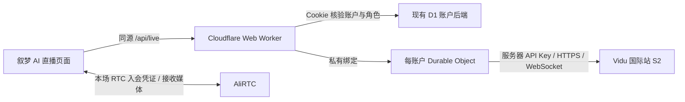

# 叙梦 AI 直播：Vidu S2 接入与运维

> 当前开关（2026-10-15 用户指令）：新图片/视频生成暂时关闭，自动迭代不得自行重开。独立工作台、聊天生图、电话独立素材生成、Krea2 均暂停；语音、电话、已有结果和旧任务恢复保留。验收与版本见 `output/xumeng/iteration/generation-payment-pause-20261015/round.json`。历史实现说明保留，不代表当前开放状态。

更新：2026-10-10。入口为 <https://xumengchat.top/#live>。正式站使用 Cloudflare Worker + 按账户隔离的 Durable Object 直接连接 Vidu，不依赖原 GPU 服务器的 SSH 或临时隧道。区域为国际站 `global`，API 来源为 `https://api.vidu.com`。

## 开放范围与计费

2026-10-09：页面和新建接口只提供真实 Vidu S2 直播，移除演练入口与模式切换；非 `real` 开播请求在网关和 Durable Object 两层拒绝。旧演练租约仅保留结束和清理兼容，不再创建。真实 S2 直播、素材生成和录像查询暂限 Super 内测。真实直播和素材按 Vidu 账户结算，目前没有叙梦 Credit 预留或扣费，也没有开放普通账号付费直播。

页面按主播设置、直播画面、直播互动组织。设置区展示图片与设定是否齐备，图片区直接预览上传形象，互动区提供打招呼、介绍物品、回答弹幕、切换场景等可编辑指令。开始／停止与当前阶段常显；平台控制就绪与实际首帧分开显示。素材生成功能收进补充素材区。

主播图片为 PNG/JPEG/WebP，前端限制单张 5 MB、至少 128 × 128，长宽比介于 1:4 与 4:1。页面默认国际站 Doubao 中文音色 `zh_female_liuchangnv_uranus_bigtts`（流畅女声），保留 Tina／Qwen 选项，并加入御姐 Katerina、软萌 Momo、邻家 Sunnybobi、温柔 Liora Mira、低沉 Harvey、阳光 Ethan、清爽 Evan、清亮 Raymond，模型固定 `vidu-s2`。导演指令分别填写回应方向、情绪、动作，发送给主播组织表达；支持弹幕、打断和最多三张物品／服装／背景参考图。素材入口沿用 Q2 图片与 Q3 Turbo 视频，真实素材验收另行记录。

开播请求显式传入 `voiceProvider` 与 `voice`。服务器按共享注册表 `src/lib/xumeng-voices.ts` 接受一组 Doubao 默认值与九个 Qwen 官方 S2 音色 ID，非法线路或错配音色在供应商创建请求前返回 400。发往 Vidu 的 JSON 顶层分别包含 `voice_model: { provider: "doubao", doubao: { voice } }` 或 `voice_model: { provider: "qwen_omni", qwen: { voice } }`；Qwen 分支名是 `qwen`，`avatar.voice` 同时保持匹配。不带 `voiceProvider` 的旧 Tina 请求继续按 Qwen 处理；该兼容规则不改变页面默认中文线路。线路在创建时确定，不在已创建场次中切换，也不因线路失败自动新建付费场次。

每个工作台租约固定最多 10 分钟；真实会话连续 60 秒没有平台认可的用户输入会结束。浏览器心跳只是维持工作台连接，不能代替用户输入，也不能承诺平台不会主动结束场次。平台当前说明以每 2 秒 3 平台积分计量；人民币费用和账户余额应以站主 Vidu 账单为准。接口返回的 `billed_seconds`、`credits_cost` 单独记录，不与本站 Credit 混淆。

## 请求与媒体路径



API Key 仅保存在 Worker secret `VIDU_API_KEY`，不写入前端、源码、D1 或接口响应。浏览器收到的是本人创建场次的短期 RTC 凭证，不是 API Key。客户端不能自报 Super 权限，所有操作重新经过账户服务核验。上游错误、字幕、ID 和媒体链接会去除或拒绝反射密钥。

播放器真实开播时延迟加载 `/assets/xumeng/live/rtc.js`，使用固定 AliRTC 7.3.4。每场创建独立实例，不发布本机麦克风或摄像头。旧播放器退出并销毁后才创建新实例；回调同时检查账户、租约和场次归属。RTC 断开或 60 秒未收到首帧会请求结束，平台最终状态仍需单独确认。

## 当前剧情中的人物互动（2026-10-12）

工作台以人物为中心。角色聊天点击「当前角色去直播」，携带人物稳定设定、当前剧情快照和最近实际对白；当前地点、目标、关系依据、已确认事实和已结束事项单独展示并可修改。只有覆盖完整当前会话、指纹匹配的世界快照可以提供当前事实；旧前缀快照不覆盖新对白。不编造玩家已完成行动，也不因礼物或跳时自动提高亲密关系。作者备注、玩法和台词示例不作为发生过的对白。

主操作是「对角色说话」与「做一个行动」，通过认证网关提交给当前 S2 控制连接。S2 已包含对话与音视频链路，此处不另外串接 OpenRouter。导演要求和弹幕控制保留在高级设置。发送成功只表示控制内容送达连接；人物回应只根据实际收到的字幕记录，不生成假回应。失败保留输入原稿，重复供应商字幕应幂等，旧场字幕不得写入新场。人物与场景选择不会自动创建收费直播。

人物选择器还可使用本人小说的人物及章节参考。游戏概要仅供手动参考，尚未读取 HTML 游戏运行时事件。场景事实由导入和用户编辑维护，直播字幕只追加实际对白，不自动推断客观状态。Super 权限、租约、费用与结束确认逻辑保持不变。

本轮验收采用隔离 API / 模拟 RTC，不调用收费 S2；需要另行区分真实控制就绪、收到视频、收到声音及人物演绎效果的实测结果。

## 三层就绪与结束确认

1. `POST /live/s_avatar/realtime` 创建场次并返回 live ID、RTC 凭证。
2. DO 建立控制 WebSocket，发送 `type=1` 初始化，只有 `type=2` 成功回执后才显示控制就绪。`NOT_READY` 最多重试 25 次，初始化总期限 60 秒，浏览器心跳不会延长该期限。
3. 浏览器等控制成功后仅加入一次 RTC，实际收到视频／声音才构成媒体验收。HTTP 创建成功和控制就绪不能证明这一步。

导演意图／弹幕使用 `type=99`，打断使用 `type=7`；这两类没有独立平台业务回执，页面“已发送”不能解读为已表演。参考图使用 `type=11`，显示 `type=12` 应用回执。

手动停止、断线、心跳超时或租约到期会发送 `type=5` 结束请求并关闭工作台控制连接。只有平台 `type=6`，或查询本人明确 live ID 得到 `status=ended`，才记录 `providerTermination=confirmed`。`requested` 表示请求已发送，`unknown` 表示结果未确认，均不能作为停止计费的证据。未确认期间阻止继续新建真实直播，后台只针对同一 live ID 有限重试结束／状态核对，最多六次，不自动新建场次。

`type=6` 从 `payload.hangup.hangup_reason` 读取结束原因，允许官方列出的 13 个安全枚举：`user_end`、`timeout`、`audit_violation`、`credit_insufficient`、`sip_closed`、`provider_closed`、`sip_reconnect_timeout`、`client_reconnect_timeout`、`prepared_sip_disconnected`、`owner_taken_over`、`owner_lease_lost`、`ai_output_closed`、`external`。其中 `prepared_sip_disconnected`、`owner_taken_over`、`owner_lease_lost`、`ai_output_closed` 四项准备／节点／输出异常原因已补入识别表。缺失或未识别原因明确显示未知，不能推断为 Qwen 故障或余额不足。

挂断帧不包含最终用量。收到 `type=6` 后仍对同一 live ID 查询状态与最终收据；同场并发查询合并，返回 ID 必须匹配，晚到的旧场回包不能更新新场。费用字段接受有限合法数字或数字字符串；缺失值不写成零。平台 metadata 暂时仍为 `on_live`、返回不完整或查询失败时，仅延后收据核对，不撤销已有挂断确认，也不重连已结束场次。新场创建成功后清空旧场状态与费用，避免把上场消费显示为本场消费。

创建请求超时、无效响应或网络结果不明时，不自动重复付费 POST。工作台返回需要站主核对平台记录的错误；没有 live ID 时不能假装已清理未知场次。

## 生命周期与存储

每个账户使用一个 DO，最多同时打开两个租约。租约 ID 含账户哈希前缀，网关先核验前缀归属；访问他人租约返回 404。每个租约返回 256 位随机 `cleanupToken`，页面只放内存，DO 仅保存哈希。注销、离开或账户切换时，清理令牌只能 DELETE 其对应租约，不能读取或控制直播。

DO 持久化账户归属、租约期限、清理令牌哈希、场次 ID、控制序号、结束核对状态与有限诊断。诊断保留经验证的初始化错误码、平台结束原因枚举、WebSocket 数字关闭码和固定解释，并可保存最多 400 字符的脱敏供应商错误摘要与最多 128 字符、严格格式校验的 trace ID。摘要在截断前先移除本场内容、Key、RTC 凭据、URL 和常见认证值；无法安全识别的凭据格式直接舍弃。依赖错误分类必须来自实际错误摘要匹配，单凭 `LIVE_CONN_INIT_FAILED` 或未知挂断原因不能归因于 Qwen。不保存上游原始消息或 `close.reason`。主播图片、设定、RTC 凭证、字幕／事件、素材任务和 API Key 不持久化到 DO；内存事件最多 150 条、素材最多 100 个。DO 重启后不会恢复媒体或隐式创建替代场次，只尝试结束已知旧场次。因此重启后的媒体与素材列表不能承诺恢复；原素材应另存，录像按平台就绪时间查询。

页面每 2 秒读状态，每 8 秒发心跳；35 秒没有浏览器心跳会请求结束。DO alarm 提供页面关闭后的恢复清理。Cloudflare 对已接受的出站 WebSocket 处理协议 ping/pong；这类出站连接不使用入站 WebSocket 的休眠 API，可能产生 DO 活跃时长费用。

控制 WebSocket 的 20 秒期限只用于 HTTP 握手：创建独立 `AbortController`，升级请求完成后在 `finally` 清除定时器并移出待取消集合。旧实现的 `AbortSignal.timeout(20_000)` 在 101 升级后仍关联连接，隔离 workerd 实验确认它会在握手开始后约 20 秒中止已经建立的 WebSocket，表现为 1006。修复后真实 Miniflare SQLite DO 回归等待 21.1 秒，连接仍为 ready、协议 ping/pong 正常且还能发送弹幕控制，再完成同场停止与费用核对。该运行时证明不代替真实 Vidu 持续媒体验收；没有为此添加未被官方定义的 JSON 心跳类型。

属于当前租约与命令版本的状态 GET 返回合法 404 时，页面显示连接已失效，停止本地 RTC 与轮询，保留主播图片、参考图和填写内容。用户可点“重新连接”申请工作台；这一步不自动开播，也不代表平台已确认结束，服务端仍拦截未确认的旧场次。401／403／503、网络错误和畸形响应不会被当成到期。账号切换和晚到回包继续使用 epoch／账号／租约／命令版本守卫。

开始和导演控制按租约串行；停止、心跳、素材与录像不排在长时生成后。慢平台结束查询有限超时，并由后台继续核对。`stop`、`heartbeat`、`execute`、`danmaku`、`interrupt`、`references` 都要求当前场次 `id`，旧场次请求返回 409。

## 接口与配置

| 浏览器接口 | 用途 |
| --- | --- |
| `GET /api/live/status` | 账户权限、配置存在与工作台连接能力；不创建 Vidu 场次 |
| `POST /api/live/leases` | 创建本人工作台 |
| `GET /api/live/leases/{id}/status` | 本场状态、内存事件／任务、开播错误、平台结束状态与用量 |
| `POST /api/live/leases/{id}/{action}` | 开播、停止、心跳、导演、弹幕、打断、参考图、素材、录像 |
| `DELETE /api/live/leases/{id}` | 关闭工作台；`ended:true` 表示租约已关闭，平台结束看另一个字段 |

非 GET 要求同源 Origin，拒绝跨站、额外查询参数、未列路由和非 JSON。正文最多 20 MB，匿名清理最多 1 KB。创建工作台、开播、生成素材共用每账号每分钟 8 次限制；心跳与停止不受该限流。

| 配置 | 位置与用途 |
| --- | --- |
| `VIDU_API_KEY` | `dzmm-web` Worker secret，仅服务端 |
| `VIDU_REGION=global` | `wrangler.jsonc`；国际站密钥须用国际 API |
| `LIVE_STUDIOS` | 私有 DO 绑定，类 `ViduLiveStudio` |
| `live-studio-v1` | SQLite DO 类迁移；不能随意删除现有迁移历史 |
| `BACKEND` | 已有账户后端 service binding |

当原生绑定或 Key 缺失时，旧 HMAC Node 桥接代码仍可作为另行配置的后备；没有配置桥接时返回未连接。旧 `4090_med` SSH 仍受登录拒绝阻塞，未修改该服务器。本次上线不依赖它。

```sh
cd cloudflare/dzmm-web
npm run check
npm run test:web
npm run build
./node_modules/.bin/wrangler deploy --dry-run --config wrangler.jsonc
./node_modules/.bin/wrangler deploy --config wrangler.jsonc
```

不要在命令行、日志或文档打印 Key、Cookie、RTC 凭证或完整上游响应。发布后核对正式 HTML 引用的当前 JS/CSS、SDK 内容以及工作台状态；回滚前先核对新增场次已经结束。

## 验收证据

证据目录为 `output/xumeng/live-cloudflare-20261009/`。自动测试包括模拟 provider/账户的权限、生命周期、响应脱敏和真实 Miniflare SQLite DO + 本地出站 WebSocket 协议 ping/pong；它们不构成真实 Vidu 音视频证明。生产验收脚本仅创建自己的临时 QA 身份与原创头像，最多一次短时真实 S2 创建，结束后清理 QA 账户、会话与租约，不读取原有私人数据。脚本记录控制就绪、平台结束确认、实际平台用量；RTC 首帧和声音需另外由页面真实操作证实。

正式结果、部署版本和限制以同目录 `implementation.json` 与 `real-provider-control.json` 为准，不将缺失用量写成零费用。

2026-10-09 第一次真实 S2 验收中，国际站认证和场次创建成功，并返回 RTC 凭证；控制通道在约 2.63 秒后结束，未到达就绪。平台最终确认 `status=ended`、`billed_seconds=0`、`credits_cost=0`。RTC 视频和声音均未验收，人民币账单没有证据。首次脚本未保留初始化错误，因此具体原因未知；后续诊断修复已覆盖错误码与结束原因，不能反推首次失败原因。没有为诊断重复真实创建。全部临时 QA 账户、会话与租约已清理。

接口字段、初始化和录像依据 [Vidu 国际站 S2 参数文档](https://platform.vidu.com/vidu-stream/doc/s2-avatar/realtime/parameters)，出站连接依据 [Cloudflare WebSocket 文档](https://developers.cloudflare.com/workers/runtime-apis/websockets/)。

2026-10-09 用户流程改版验收：`output/xumeng/media-reference-live-20261009/`。实际本地组件与隔离 API 验证普通账号权限提示、固定 real 模式、原创图片准备和控制失败后的保稿；网关/DO 33 项隔离测试与 Web 144 项测试通过。此轮没有新的真实 S2 创建；既有控制初始化问题仍待真实供应商证据，不能用 UI 改版关闭。


2026-10-09 第二次真实验收（用户新授权，证据 `output/xumeng/s2-real-acceptance-20261009/`）：创建成功并收到初始化失败回执 `LIVE_CONN_INIT_FAILED`，未达到 ready，因此没有加入 RTC、没有视频首帧或音频。平台确认 ended，用量 0 秒、0 平台积分；人民币账单未知。临时账号、会话和租约已清理，真实供应商故障仍待平台日志，XM-069 保持开放。前端修正为控制 ready 后唯一入会、兼容相机及屏幕轨，音频订阅、实际收包与播放许可分别呈现；不能将该失败样本算作真实音视频接收成功。

2026-10-10 修复回归（证据 `output/xumeng/s2-init-repair-20261009/`）：本轮 153 项自动回归通过，覆盖匹配音色线路与零创建负例、安全诊断、挂断原因、同场最终收据、跨场费用清空及升级连接超过 20 秒存活；另有独立隔离实验复现旧 timeout 信号中止已升级连接。默认中文线路和握手期限修复已落实源码。最终第三次真实回归已完成：当前正式 JS/CSS 经本人临时 QA 认证代理连接生产 Cloudflare 与真实 Vidu，控制 ready；1024 × 1024 视频 currentTime 从 10.57 增至 28.09 秒，音频从 473 增至 1374 包，并已允许播放。页面 32 秒仍在直播，超过旧 20 秒断点；39 秒手动停止。发送一次普通中文指令后，实际主播字幕欢迎叙梦观众并介绍小林，与请求一致。Vidu 最终确认 ended，账单为 38 秒、57 平台积分。测试账户、会话、租约及本地代理均已清理。人工听感、十分钟稳定性和人民币账单未验收；Tina/Qwen 早期失败原因仍未知，XM-069 部分解决，已独立实证的 20 秒断连问题 XM-075 关闭。此前失败样本仍保留，不反推其原因；本轮此前另有 18 积分用量和一场未知用量，因此 75 平台积分只是已知小计。详情以本轮 implementation.json 为准。


2026-10-10 角色音色目录：共十个直播选项，按自然中文、女声、男声分组，人物可保存并导入选定 ID。国际站默认 Doubao 流畅中文保留；公开中国站 Doubao 音色不能直接当作国际站可用项。Qwen 名称按[官方 S2 音色目录](https://platform.vidu.cn/vidu-stream/doc/voice-list)核对；`Liora Mira` 的空格也是 ID 的一部分。选择器名称是便于使用的风格说明，不能等同于本人账户已实测听感。参数匹配、拒绝错配及导入使用隔离供应商验收，此轮未新增真实直播；此前默认中文真实验收仍有效，但不推广成新增九个 Qwen 音色均已成功。独立朗读使用另一套 Vidu TTS ID，详见[角色朗读](xumeng-character-voice.md)。
