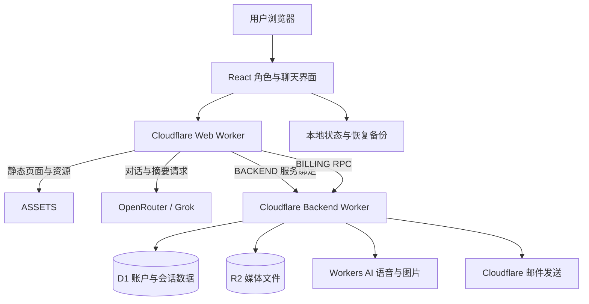
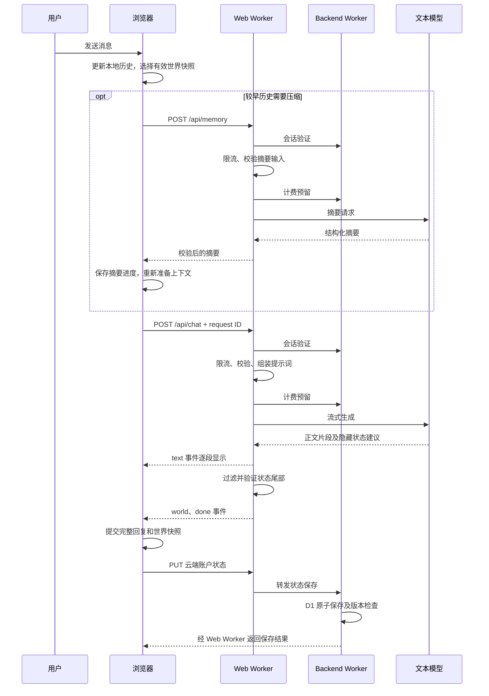

# 叙梦角色对话系统技术文档

2026-10-08 更新：新注册一次赠送 1,500 Credit，目标约 10 轮普通 Grok 对话及每轮建议；默认 Grok 并提供六模型。独立图/视频使用同一余额及单独任务账本，聊天内 VIP 媒体配额保留。当前数值、多模型策略和新生成接口以[积分与生成工作台](xumeng-generation-workbench.md)为准。

核实日期：2026-10-07。适用站点：[叙梦](https://xumengchat.top/)。本文依据当前工作区源码、最近发布记录和当日公开配置接口整理，描述已经实现的系统；建议和未解决问题另行标注。

## 1. 系统概览

叙梦的一次角色回复，由**角色卡、分层提示词、真实对话历史、压缩剧情记忆、隐藏世界状态和本轮推进规则**共同生成。模型负责叙事、旧历史摘要和状态变更建议；程序负责上下文装配、时钟计算、格式与来源校验、流式传输以及数据保存。

模型每次请求接收的是程序重新整理的 messages，而不是依靠模型服务永久记住上一轮。完整原始对话保存在叙梦自己的会话数据里，超过请求预算后，较早部分以结构化摘要参与后续生成。

当前配置核实结果：

| 项目 | 当前状态 |
| --- | --- |
| 站点前端 | React 19、TypeScript、Vite 8，部署在 Cloudflare Web Worker |
| 对话提供商 | OpenRouter，使用兼容 Chat Completions 的接口 |
| 模型 | 默认 Grok 4.6；Gemini、Claude、GPT、DeepSeek、Qwen 六模型白名单；旧三档继续兼容 |
| 思考参数 | 聊天、摘要、小说和行动建议共用能力映射：五型号 reasoning.effort=low，Qwen reasoning.enabled=false |
| 剧情提示词版本 | 2026-10-06-scene-v4 |
| 会话持久化 | 浏览器本地恢复数据 + Cloudflare D1 云端数据 |
| 时间模式 | story：按剧情行动推进；realtime：在下一次互动时计算现实时间间隔 |
| 聊天 Credit 扣费 | **开启**；可信实际模型美元成本 × 冻结汇率6.704588 ×3 ×100，逐笔向上取整 |

模型映射和扣费开关在当日通过 GET /api/chat、GET /api/backend/v1/billing/config 核实。这些结果不代表已经测试本轮的模型速度、剧情质量或真实支付到账。

## 2. 部署架构与职责



**浏览器**维护正在编辑的内容、当前会话和流式回复，选择开场，准备本轮历史与记忆，接收最终世界状态，再触发云同步。

**Web Worker**提供网页资源、同源 API 入口、会话验证、限流、计费生命周期和文本模型请求。它直接调用 OpenRouter；文本生成没有先绕到 Backend Worker 的另一个聊天接口。

**Backend Worker**负责账户、会话持久化、钱包、VIP、媒体、创作与发布等业务。Web Worker 通过 BACKEND 服务绑定调用它，通过命名的 BillingService RPC 预留及结算模型费用。

**D1**保存结构化业务数据，**R2**保存生成的媒体文件，**Workers AI**处理语音与图片。每分钟定时任务负责计费预留清理和用量恢复，不负责离线生成 NPC 剧情。

当前生产网页是 cloudflare/dzmm-web 的 Vite 构建。仓库还保留旧 Next.js API 包装器，但它们没有当前 Worker 网关的完整鉴权、限流和计费选项，不能当作等价部署入口。源码中的 dzmm 文件名是内部兼容命名，站点品牌和主页面路由已使用叙梦及根路径。

## 3. 核心数据：角色、会话、记忆和世界

### 3.1 角色卡

| 字段 | 用途 |
| --- | --- |
| name | 角色名；也可能是故事标题 |
| description | 人物背景、身份和已知资料 |
| personality | 性格、表达与行为特点 |
| scenario | 初始场景、世界条件与互动关系 |
| firstMessage / openingMessages | 主开场文本或多条初始消息 |
| alternateGreetings | 可选择的备选开场 |
| systemPrompt | 作者补充的角色系统设定 |
| postHistoryInstructions | 放在真实历史之后的作者指令 |
| messageExamples | 用于模仿语气的示例对话 |
| characterBook | 按关键词激活的世界书 |
| introduction / cover / gallery / tags | 介绍与发现页面展示资料 |

展示介绍、相册、标签和 suggestedReplies 不会直接作为角色提示词字段发给模型。建议回复进入输入框后，仍由用户确认发送。角色运行资料采用明确字段白名单。

支持普通 JSON 和 chara_card_v2 角色卡导入。未完成的世界书词条保存在私人 authoringDraft 中，其他内容仍在角色字段或编辑草稿中；世界书不完整时可以保存草稿，但不能直接试聊或开始正式对话，避免运行时静默丢弃未完成设定。

公开来源目录中，一些角色只有可观察的介绍、标题和展示资料，运行人设和开场可能是本地重写。**不能把这些公开资料视为来源站完整隐藏角色卡。**

### 3.2 会话

一段会话保存以下信息：

```text
Conversation
├─ id / characterId / title / updatedAt
├─ messages[]             完整 user / assistant 原始消息
├─ opening                本会话选中的开场快照
├─ storyMemory            较早历史的结构化摘要及覆盖指纹
├─ worldState             隐藏世界状态的快照日志
└─ worldClockMode          story 或 realtime
```

消息包含 id、role、content。消息 ID 不进入模型正文，但参与摘要和世界快照的历史一致性检查。会话 ID 用于叙梦存储，不能代替实际 messages 让提供商自动恢复全部历史。

### 3.3 剧情记忆与隐藏世界状态的区别

| 数据 | 解决的问题 | 产生方式 |
| --- | --- | --- |
| 原始 messages | 实际说过什么、发生过什么 | 用户输入和模型可见回复 |
| storyMemory | 较早历史太长，后续仍需保留关键事实 | 单独的摘要模型请求 |
| worldState | 当前时间、地点、关系和未完成事项需要持续维护 | 程序计算 + 正文模型的隐藏更新建议 |

摘要偏向“过去发生了什么”；世界状态偏向“现在处于什么状态”。它们都不能替代完整原文，也不能保证模型每轮判断正确。

## 4. 开启对话：为什么应当自带上文

创建新会话时，程序选择当前开场并直接写入消息列表，不需要等待模型生成第一段：

1. 已选择备选开场时使用该开场。
2. 否则使用主 openingMessages 或 firstMessage。
3. 作者没有开场时，以 scenario / description 作为背景回退；仍没有资料时使用欢迎语。

选定开场会保存为本会话的 opening 快照。以后修改角色卡，不会自动替换旧会话的开场，避免旧剧情被新模板重置。

默认开启已有角色对话会继续已有会话，显式创建新会话才重新选择开场。恢复时，如果开场前缀已被改变，程序将它视为真实历史，不把旧模板强行插回来。模板快照与近期消息在发送前去重，减少开场重复。

## 5. 一次发送的完整流程



浏览器在发送期间锁定重复发送，使用 AbortController 支持停止。首次没有收到正文而请求失败时，普通发送恢复原历史和输入草稿；重生成失败则恢复旧回复。已经收到的部分正文会保留并提示中断，但未完成的世界状态不作为成功快照提交。

发送和重生成前，浏览器先确认已经读到服务器的收费配置；配置读取失败时提示刷新，避免在费率未知时继续生成。扣费开启时，游客会先看到登录提示；聊天或摘要返回 402 时，输入框旁展示预留余额不足和充值入口。每次实际进入生成流程后，无论完成、失败还是停止，都会更新余额刷新标记；收费开启时才据此读取本人余额。正式收费已在第十二轮按站主授权开启，隔离账务已验证；本轮未执行真实模型扣款。

**模型生成和 D1 保存不是同一个事务。**回复先出现在浏览器，再由云同步写入数据库；正在生成时不会每个 Token 都保存一次 D1。同步失败会保留本地恢复数据并展示状态，不能把屏幕上出现回复等同于已经云端保存。

## 6. 提示词如何组装

buildDzmmPromptPlan 为每次正文请求构建一份有来源标记的 messages。以下顺序来自当前实现，空层会跳过：

| 顺序 | 层 | 实际内容 |
| --- | --- | --- |
| 1 | rules-and-character | 默认互动规则、角色描述/性格/场景、作者 systemPrompt、用户身份、叙事预设 |
| 2 | worldbook | 本轮命中的世界书参考词条 |
| 3 | dialogue examples | 示例边界、示例 user/assistant 对话、结束边界；不支持的格式回退为参考文本 |
| 4 | opening | 本会话保存的开场 |
| 5 | story-memory | 较早真实历史摘要，并声明后续真实消息优先 |
| 6 | recent-history | 近期真实 user / assistant 原文 |
| 7 | author-post-history | 作者后置指令 |
| 8 | living-world | 当前隐藏状态、时钟与更新协议 |
| 9 | round-reminder | 通用本轮提醒 + 本地剧情推进提示 |

这些层在**同一次正文模型请求**中提交。不存在“每一层各调用一次模型”的流程。示例仅示范风格，开场仅定义原始起点；更晚的实际事件应更新这些早期资料。

默认规则要求角色接住当前输入、让 NPC 在自己的能力范围内行动、完成的事项及时收束、避免循环描写，同时保留用户对台词、决定和感情的自主权。用户要求暂停或慢节奏时，应尊重该要求；推进不等于每轮插入危机或强行转场。

### 6.1 宏和示例

支持 {{char}}、{{user}}、{{original}}，分别代表角色名、用户称呼和默认互动规则。替换只展开一次，未知宏保留原文；不执行脚本或状态计算公式。

角色模板和开场可以展开宏，**真实对话历史不做宏替换**，避免用户原文被意外改写。示例支持按 <START> 分块及可识别的说话标签，最多保留 8 个完整块、合计 6,000 字符；其事件不被当作当前会话事实。

### 6.2 世界书

世界书是一组可触发的背景资料：

- 默认检查传入开场与近期历史合并后的最后 10 条消息，可配置 scanDepth 为 1–40。
- enabled=false 的词条不参与；constant=true 的词条直接加入。
- 普通词条需要命中一个主关键词；selective 开启时还需要命中一个次关键词。
- 使用文本子串匹配，默认忽略大小写；按 insertionOrder 升序加入。

当前没有向量数据库、语义检索、递归激活或独立世界书 Token 配额。摘要不参与关键词扫描。世界书与其他提示词共享输入预算；过长的常驻词条会增加延迟并挤占真实历史空间。

### 6.3 本地剧情推进规则

turn-director 不调用另一个模型。它用本地规则识别暂停、持续日常概述、明确时间跳跃和普通场景，向本轮提示加入相应节奏要求。

它还检查最近助手回复中反复出现的中文片段，把统计结果作为写作提醒。它不会删除原始消息、禁止某个词或直接修改关系分数。“硬座票”等旧物件和只适用于旧场景的约定不应机械重复；仍有效的边界需要保留，在实际触及时自然表达。能否自然做到，仍取决于模型实际回应。

## 7. 长对话：保留原文，按需压缩请求

### 7.1 摘要结构

storyMemory 的状态包含六项：

| 字段 | 内容 |
| --- | --- |
| summary | 关键事件总览 |
| scene | 摘要覆盖位置时的场景 |
| completed | 已完成事项 |
| pending | 未完成事项 |
| relationships | 已表达、已发生的关系事实 |
| items | 后续仍相关的物品或资源 |

另外保存 sourceCount 和 sourceFingerprint，说明摘要覆盖原历史的哪个前缀。指纹包含消息 ID、顺序、角色和内容，用于一致性检测；它不是密码学身份认证。

### 7.2 何时摘要

普通请求最多选择 40 条近期原文。当未摘要的原文超过 40 条时，整理目标通常是保留最近 28 条；摘要按每批最多 24 条、24,000 字符提交，重新计算后实际尾部可能为 28–40 条。

例如 62 条尚未整理的消息，第一次整理较早 24 条后剩余 38 条，可能已满足下一次请求，不必继续精确整理到只剩 28 条。若固定设定与近期原文仍超输入预算，则需要整理更多被移出的前缀。

一次发送最多串行进行 12 批摘要。每批成功即保存进度；摘要失败、取消或达到批次数上限时，中止本轮正文请求并保留原文与已完成进度，下次可以继续。不会把尚未整理的空缺当作“已经记住”。

摘要提示要求分清发生的事件与愿望、计划，更新当前场景，移出已完成或过期事项。事实提取由模型完成，程序只验证输出格式、大小和来源前缀，因此仍可能遗漏或误解。

### 7.3 编辑、导入与恢复

覆盖前缀改变时，旧摘要失效，需要从真实历史重新整理；只改变未覆盖尾部时，前缀摘要仍可使用。复制分支、导入备份会创建新消息 ID，并重新绑定仍然有效的摘要和世界快照指纹。

聊天消息现在提供右键菜单，也可以点击“更多”或使用键盘菜单键、Shift+F10 打开。菜单包括选择文字、复制和编辑；助手消息另有重新生成，以及语音、图片入口。按住 Shift 右键可以使用浏览器原生菜单。生成期间禁用编辑、重生成和媒体生成，复制与文字选择仍可使用。

“选择文字”打开只读的原文文本框，可以局部选取或复制整条消息，保留换行、空格和格式标记。“编辑”适用于用户与助手消息：保存非空、最多 12,000 字符的原文，保留消息 ID、角色和后续全部聊天原文；受修改影响的摘要和世界快照通过历史指纹检查清理，仍匹配的较早快照保留。编辑开场时协调会话开场快照，使修改后的历史优先，避免原模板再次插回。编辑本身不调用模型，也不会自动改写后续事件来修复语义矛盾。

末条助手消息紧邻前一条用户输入时，在原会话重新生成；其他存在前置用户输入的助手回复会创建独立的“重生成分支”。新分支保留到目标回复之前最近一条用户消息，重新绑定有效的摘要与世界快照，再请求新的回复；原会话及其后续消息完整保留。没有前置用户输入的助手开场不能重新生成。每次重生成是新的模型请求，收费开启后仍按请求实际用量结算。

损坏的可选记忆元数据可以被忽略，而有效原始消息应继续恢复。完整会话导入、复制分支与删除会话仍使用各自入口；时间模式记录的独立保存与回退处理见第8.4节。

## 8. 隐藏世界：时间、关系和未完成事项

### 8.1 世界状态字段

| 字段 | 维护内容 |
| --- | --- |
| clock | 累计故事分钟、第几天、可选日内时间、日历标签、毫秒余数 |
| location | 当前地点 |
| relationships | 最多 4 位非用户角色的 affinity、trust、tension 及说明 |
| threads | 最多 6 项目标、承诺或日程及其状态 |
| facts | 最多 6 条仍然相关的事实 |

初始时钟为第 1 天、累计 0 分钟；未设定具体钟点时 minuteOfDay 为 null，不凭空指定“上午九点”。

好感 affinity 和信任 trust 范围为 -100 至 100，紧张 tension 为 0 至 100。普通单次变更最多 ±3，显著事件最多 ±8。这些指标描述非用户角色对用户的状态；数值不能自动证明恋爱、同意或用户自己的感情。

### 8.2 两种时间模式

| 模式 | 时间推进方式 | 离开网站后的处理 |
| --- | --- | --- |
| story | 根据行动或明确的用户时间跳跃推进 | 墙上时间经过不会直接让剧情时钟增加 |
| realtime | 在下一次互动时从有效剧情快照起，按独立模式记录分段累计现实间隔 | 补入处于现实模式的间隔，排除剧情模式的暂停区间 |

系统提供 UTC 和 Asia/Shanghai 的真实时间参考，但不要求虚构世界的日期与现实日期相同。明确的“三年后”等时间跳跃会先由程序识别，避免同一轮又被隐藏建议重复累加。重生成先恢复较早的有效剧情时钟，再将这次用户的明确跳时应用一次；独立时间模式记录不保存已完成回复的未来剧情时刻，避免“半小时后”变成一小时或“三年后”变成六年。

**realtime 当前不是全天运行的模拟世界。**没有用户互动时，不会持续调用模型写日常，也不会因时间经过自动赠送好感、完成承诺或推进所有任务。日程如何落实，仍需后续实际叙事证据。

### 8.3 同一轮回复中的状态更新协议

模型在可见正文后追加隐藏 JSON 建议。例如，以下是普通原创场景的协议示意：

```text
林舟把修好的台灯放回书店柜台，打开了门口的小灯。
<xumeng-state>{"version":1,"changes":[{"type":"location","value":"书店柜台","from":"assistant","quote":"林舟把修好的台灯放回书店柜台"}]}</xumeng-state>
```

这是增量变更，不是完整状态快照。正文模型在同一次请求里给出建议，**没有额外一次“维护状态”的模型调用**。

服务器先计算基础时钟，再检查模型补丁。每项变更必须附当前轮 user 或 assistant 原文中的连续引用；还检查字段、类型、整数范围和重复目标。补丁无效时整体不应用，已经生成的正文仍可显示，基础时钟仍可能推进。

引用检查证明“这段文字来自当前轮”，不能完全证明“这段文字在语义上足以支持好感变化”。目前的规则限制了错误传播范围，但不是完整的因果推理验证器。

### 8.4 快照与重生成

每个叙事快照记录历史前缀指纹、记录时间、模式和状态；日志最多保留8个快照。正常回退选择与当前消息前缀匹配的快照，地点、关系、事实、事项及剧情跳时随失效快照一起回退，分支和导入重新绑定有效记录。停止或断流时不会提交半截状态；尚未收到正文就重生成失败时，恢复原有回复和世界日志。

`worldState`另有可选`modeChanges:[{recordedAt,clockMode}]`，记录从某个真实时刻开始使用的新模式，与消息前缀和叙事快照独立。它不存绝对剧情时钟或未来叙事事实。`resolveDzmmWorldRuntime`从合法快照的时钟出发，按模式记录切分到当前时刻之间的区间，只累计其中的realtime时长，然后返回已推进的状态及当前记录时刻。聊天请求使用这个运行态，准备请求期间新增的真实间隔仍可由服务器计算；完整时间线不进入正文模型的角色卡或提示词字段。

模式记录最多128条，时刻严格递增，同一时刻的连续切换合并为最终模式；日志总JSON仍限制为40000字符。严格早于最早保留快照记录时刻的已消费记录可压缩，等时切换保留。仍影响回退的暂停记录无法安全压缩时，切换会明确失败并显示错误，不截去有用记录。异常倒退的时钟不倒扣时间，也不累计未来区间。

若原文变化使所有叙事快照失效，合法时间线仍可保留为timeline-only日志。没有有效叙事时钟起点时，运行态使用空世界与所选模式，不虚构旧剧情时刻或现实累计时间。无时间线的旧日志沿用原有模式匹配规则，普通读取、剪枝、分支不会补造历史暂停；首次实际切换才建立模式记录。刷新、分支、导入和云端同步会保留合法时间线。

“隐藏”只表示不在聊天正文展示；世界数据仍属于用户自己的会话数据，可以存在浏览器、云端和导出文件中。

**XM-011已修复并发布核对：**原先realtime → story暂停 → realtime后重生成会把11分钟算成1451分钟。2026-10-07的修复将模式记录独立保存，本地真实页面与隔离请求验证重复重生成仍为11分钟；再加本轮用户明确半小时跳时则为41分钟，重复重生成仍为41分钟。共享客户端相关106项检查及后端14项隔离D1/API检查通过。正式站另已核对HTTP、当前资源与公开页面；本轮未调用真实模型或在正式站执行重生成，不能将上述时间结果描述为生产模型验收。发布版本与验证范围见第14节及[第十轮记录](/Users/pencil/Documents/IntVideoGameEditor/output/xumeng/iteration/rounds/round10-20261007.json)。

## 9. 云端保存、并发与恢复

浏览器启动后验证会话，必要时创建有效游客账户，再读取账户状态和角色目录。每次本地改变都会维护当前状态与本地恢复数据，云端写入通常经过 800ms 防抖；生成期间暂缓同步，完成后再保存。

云端保存的是账户状态，PUT 请求包含 accountId、账户 revision 和 state。注意两个不同的版本：

- state.version = 1 是备份数据格式版本。
- 云端 envelope.version 是账户修订号，用于并发保存检查。

D1 的主要映射：

| 表或字段 | 保存内容 |
| --- | --- |
| users / sessions | 账户、会话及账户版本 |
| characters / context_json | 角色基本字段、扩展提示词和私人创作草稿 |
| conversations | 会话标题、角色关联与更新时间 |
| opening_json / story_memory_json / world_state_json / world_clock_mode | 开场、摘要、世界日志和模式 |
| messages | 按 position 排序的完整消息；属于指定账户和会话 |
| favorites / preferences | 收藏与用户偏好 |

保存计算差异，按 JSON 块组织数据库操作，并在同一个 D1 batch 中检查修订号和写入数据。版本冲突返回 409，避免把两个页面的历史交叉混写。当前没有自动 CRDT 合并；冲突、离线或失败时保留恢复数据，让用户重新取得云端状态或使用自己的备份。

客户端同时防止旧的异步保存结果覆盖更晚的编辑，账户切换也有隔离检查。界面区分待同步、同步中、已同步、离线、冲突和错误；本地保存不能冒充云端保存。

时间线还有旧客户端保护：省略整个世界日志时，在模式未改变的条件下保留服务器仍匹配的快照与模式记录；提交旧格式日志却省略`modeChanges`时，只有模式不变且快照与服务器剪枝后的记录完全一致才允许合并。缺少模式记录却改模式或覆盖快照会返回400，要求刷新；原文改变仍会让叙事快照失效。会话PATCH的`worldState:null`可显式清除，整体同步的`{version:1,snapshots:[],modeChanges:[]}`可明确清除两类记录。

聊天备份文件最大 2,000,000 UTF-8 字节，没有原来的 200 条消息限制。账户状态 PUT 仍有 **2 MiB 总请求限制**；单个文件合规，不保证导入到一个已经积累大量历史的账户后仍可同步。超限应明确失败并保留本地数据。目前全量账户状态同步的容量仍是长历史扩展瓶颈。

## 10. 模型参数、流式输出与首帧速度

### 10.1 当前请求参数

| 参数 | 正文聊天 | 剧情摘要 |
| --- | --- | --- |
| model | 六模型白名单，默认 x-ai/grok-4.6 | 使用当前所选模型 |
| stream | true | false |
| reasoning | 五型号 effort=low；Qwen enabled=false | 同正文模型能力 |
| temperature | GPT/Claude 省略；其他 0.75，旧 story 请求保留 0.9 | GPT/Claude 省略；其他 0.15 |
| max_tokens | 默认 2,048，可设置 128–4,096 | 2,048 |
| 超时 | 90 秒 | 45 秒 |

新模型选项映射到不同供应商型号；旧 fast/balanced/story 兼容既有服务端配置。五型号发送 effort=low，Qwen 3.6 Flash 的 Alibaba 供应商只支持思考开关，因此发送 enabled=false；仍要求供应商支持实际请求参数。low 不表示没有思考 Token。2026-10-12 通过实际聊天 handler 验证了 DeepSeek 与修复后的 Qwen；Gemini、Claude、GPT 此轮仅完成参数和路由检查，不能由目录可用性推断实际调用成功。

### 10.2 流式协议

服务器解析提供商 SSE 的正文 delta，过滤可能跨片段出现的隐藏状态尾部。启用世界状态时，向浏览器发送叙梦自己的 SSE 事件：

| 事件 | 用途 |
| --- | --- |
| text | 可立即显示的正文片段 |
| world | 校验后的完整世界状态结果 |
| done | 本轮流完整结束 |
| error | 流中的失败说明 |

浏览器只有完整收到 done，才把世界结果作为可提交的快照。提供商的 usage 留在服务端结算流程，不会原样作为用量事件传给浏览器。未启用 world 的兼容请求使用流式纯文本。

服务器读到首段非空可见正文后才返回成功响应头，因此状态码 200 不会提前掩盖空回复；随后正文逐段显示，并不等整篇生成结束。

### 10.3 首帧慢可能发生在哪

```text
用户发送到首段可见文字
≈ 必要的串行摘要时间
 + 会话验证、限流、计费预留和网络时间
 + 提供商排队及首段正文生成时间
```

长角色卡、常驻世界书和过多真实历史还会增加输入处理负担。隐藏状态通常位于正文尾部，不是首次显示前额外执行的状态请求；但会占用这次回复的输出预算。

可继续评估的优化是记录各阶段耗时、压缩冗余固定设定、降低不必要的回复长度，以及按实际延迟选择 Gemini、DeepSeek 或 Qwen。模型切换已实现；尚未逐型号进行真实速度比较。

## 11. 接口、限制与身份边界

### 11.1 主要接口

以下为浏览器同源路径，/api/backend 前缀由 Web Worker 转发给 Backend Worker：

| 方法与路径 | 用途 |
| --- | --- |
| GET /api/chat | 查询文本模型是否配置及模型映射 |
| POST /api/chat | 流式角色回复 |
| POST /api/memory | 非流式剧情摘要 |
| GET /api/backend/v1/session | 查询当前登录或游客会话 |
| POST /api/backend/v1/auth/guest | 创建有效游客会话 |
| GET /api/backend/v1/state | 读取当前账户状态 |
| PUT /api/backend/v1/state | 带修订号保存账户状态 |
| GET /api/backend/v1/billing/config | 查询当前 Credit 扣费开关与费率 |
| GET /api/backend/v1/billing/usage | 读取当前正式账户的可用余额、预留和分页消费记录 |

以下是同源、已有有效会话的浏览器可以提交给 POST /api/chat 的简化 JSON。实际请求还带 Content-Type: application/json 和 UUID 格式的 X-Xumeng-Request-Id；已有剧情会携带选中的摘要与世界状态。

```json
{
  "character": {
    "name": "林舟",
    "personality": "细心，语气平和，习惯先把手头的事做好。",
    "scenario": "傍晚的小书店，顾客送来了一盏坏台灯。",
    "firstMessage": "林舟把工具放上柜台：台灯是什么时候开始不亮的？"
  },
  "messages": [
    {"role": "assistant", "content": "林舟把工具放上柜台：台灯是什么时候开始不亮的？"},
    {"role": "user", "content": "昨天搬家以后就不亮了，能帮我检查一下吗？"}
  ],
  "userName": "顾客",
  "model": "grok",
  "maxTokens": 1024,
  "world": {"clockMode": "story"}
}
```

这里提交的是本轮上下文投影，不是整个 Conversation 存储对象：消息不带 id，storyMemory 只带摘要状态，world 只带选出的当前状态及时间信息。历史指纹、多快照日志和独立模式时间线留在会话管理层。浏览器不能在这里指定服务器密钥、任意提供商地址或结算金额。

### 11.2 请求边界

| 边界 | 当前值 | 含义 |
| --- | --- | --- |
| 聊天请求体 | 180,000 UTF-8 字节 | 不是模型 Token 数 |
| 提示词上下文 | 80,000 JavaScript 字符单位 | 不等于 80,000 Token |
| API 历史消息 | 1–60 条，末条须为 user | 客户端通常只选最多 40 条近期原文 |
| 单条运行消息 | 12,000 字符单位 | 原文导入也逐条校验 |
| 世界书 | 最多 200 词条，每条 8,000 字符 | 仍共享整个请求预算 |
| 聊天限流 | IP 与账户分别 6 次 / 60 秒 | 边缘限流，不能当作全局强一致额度 |
| 摘要限流 | IP 与账户分别 12 次 / 60 秒 | 与聊天使用独立限流器 |

上下文超预算时，准备器会从本轮请求尾部窗口的队首移出旧消息并补齐必要摘要，重新计算世界书。不会删掉存储的原文；连固定设定与最后用户输入都放不下时明确报错。

API 修改请求进行浏览器来源检查；聊天与摘要在调用模型前验证 Backend 会话，有效游客也属于账户。Cookie 为 HttpOnly、SameSite=Lax，HTTPS 下设置 Secure，默认 30 天；数据库保存会话 Token 的哈希。密码登录使用 scrypt。

服务端数据库操作按当前登录 userId 检查归属，不把浏览器提交的 accountId 当作身份凭证。模型密钥只在服务端绑定中使用，公开配置查询不返回密钥。这些是现有机制，不代表本文完成了全面安全审计。

## 12. VIP、Credit 与媒体如何接在对话旁边

### 12.1 VIP 和 Credit

当前产品设置是 VIP ¥28 / 30 天，有效 VIP 每日手动领取 500 Credit；也可以直接购买 Credit。它们由独立的订阅、钱包和领取记录维护，不属于故事世界的好感度。

**正式聊天扣费已开启。**按可信 OpenRouter 实际美元费用 × 请求冻结的汇率 ×3 ×100，合并向上取整为 Credit。摘要是独立计费请求；缓存、供应商和思考费用以实际成本为准。标准 Token 价格仅作参考；旧请求保留原冻结 Token 费率。新增成本政策和美元费用通过0020迁移保存；没有费用资料时核对后再结算，过期返还，不按参考价格猜扣。成本口径和费用限制详见[Credit账单文档](/Users/pencil/Documents/IntVideoGameEditor/docs/xumeng-credit-billing.md)。

开启后的设计包含 request ID 防重复、余额预留、实际用量结算与缺失用量的待确认处理。没有有效正文时释放预留；有部分正文并取得可验证用量时，停止或失败也可能结算，不能承诺“所有失败都免费”。

客户端余额状态只在服务器收费配置开启时显示。正式账户读取本人可用 Credit、预留与欠额；游客显示登录入口，不查询消费记录。账户或刷新键变化后隐藏旧结果，读取失败清空旧余额并提供重试，401／403 另提供重新登录入口。读到未到期预留或待核对记录后，最多在 2 秒后补读一次；仍未结算时提示手动刷新，不持续轮询，也不把预留冒充实际扣费。

预留按输入字节的保守上界和最大输出 Token 计算，可能高于实际消费；余额足够支付最终费用，也可能暂时不足整次预留。摘要是独立模型请求，已成功整理的摘要不会因为后续正文失败而一并退款。消费明细与完整规则见 [Credit 计费文档](/Users/pencil/Documents/IntVideoGameEditor/docs/xumeng-credit-billing.md)。

VIP 不是聊天网关的无限 Token 开关。站点未扣 Credit 也不代表提供商没有实际模型成本。真实支付闭环仍需要真实交易验收，本文没有进行付款。

### 12.2 语音与剧情图片

媒体生成走 Backend Worker 的 Workers AI，不走正文 Grok 请求。用户明确点击自己会话内的助手消息后才生成；先确认消息已云端保存，再以账户、会话、消息 ID 和类型查找源正文。

| 功能 | 当前模型与行为 |
| --- | --- |
| 语音 | @cf/myshell-ai/melotts；中文；清理标记后最多 800 个 Unicode 字符；每天最多 20 次生成 |
| 剧情图片 | @cf/black-forest-labs/flux-1-schnell；4 steps；本地规则整理场景元素；每天最多 5 次生成 |

生成需要有效 VIP，或正式非游客管理员的预览权限。缓存使用账户、消息、类型和正文哈希区分，文件保存在 R2，读取检查归属；过期 VIP 仍可读取自己的既有缓存。当前没有专门的角色身份一致性训练或参考图流水线，不能保证每张图的人物外观稳定。

## 13. 创作流程与质量指标的位置

默认的 xumeng-roleplay-authoring Skill 是**创作方法**：帮助定义人物动机、边界、场景入口、可推进的线索以及可观察的质量指标。创作审查界面使用相应检查项引导作者，而不是自动调用模型给所有卡片评分。

运行时 Worker 不会自动读取本机 SKILL.md。创作结果必须落到模型可见的角色字段、世界书、开场或后置指令，才参与真实对话。角色的数字指标写在说明里，也不会自动变成隐藏世界关系表的初始数值配置。

这区分了两类指标：

- **创作质量指标**：场景能否开始、动机是否清楚、回应是否具体、关系变化是否有原因等，用于创作与验收。
- **会话状态指标**：时间、信任、好感、紧张、任务状态等，用于当前故事的持续记录。

后续若增加可配置的数值成长、任务条件或初始关系面板，应新增明确的数据结构、校验与运行规则，不能只依靠作者在文字里写一套公式。

## 14. 验证范围、开放问题和开发入口

最近发布记录 round8-20261007 对长历史备份、D1 原子保存和手机导航进行了测试；记录包含 78 项 Web 检查、54 项生产 HTTP 检查及 8 项本地真实组件 UI 任务。本地组件使用隔离 API，数据库持久化另有实际隔离 HTTP / D1 验证。

这些证据支持对应数据流程，不证明当前模型每轮都能自然推进。该轮没有调用真实模型、生成媒体、付款或领取真实账户每日额度。本文整理也没有部署产品变更。

2026-10-07 随后发布消息菜单、原文选择与编辑、历史重生成分支和聊天余额状态，Web 版本为 2172bbc5-b1fb-48bd-afc4-a09656bef909。13 项界面任务使用真实组件与完全隔离的模拟接口；正式站另外验证了普通原创私人角色的右键菜单、原文选择、编辑后刷新恢复，并清理测试数据。正式收费配置仍为 enabled:false、输入与输出费率 null，等待站主选择正式费率；这次验证不构成真实模型扣费、真实付款到账或模型剧情质量验收。详见 [第九轮记录](/Users/pencil/Documents/IntVideoGameEditor/output/xumeng/iteration/rounds/round9-20261007.json)。

2026-10-07 第十轮发布XM-011时间模式回退修复，Web版本为`d1ee83a5-c06a-4590-8eaa-1d0cbaf6d214`，Backend版本为`4d2662b4-5c9c-49a1-83cf-ad288ff43c4d`，当前网页资源为`/assets/index-qw3722Ob.js`。7项本地真实组件界面验收、106项共享客户端检查及14项隔离D1/API检查通过；时间结果11分钟、明确跳时后的41分钟及重复重生成稳定性来自隔离模拟，导入、刷新和复制分支后均保留41分钟。正式站54项只读HTTP检查、当前JS/CSS字节和公开页面加载另已核对，没有读取原有私人聊天。此次没有调用真实模型、在正式站执行重生成或付款，聊天计费仍为`enabled:false`、输入与输出费率`null`。详见[第十轮记录](/Users/pencil/Documents/IntVideoGameEditor/output/xumeng/iteration/rounds/round10-20261007.json)。

后续事项与本轮修复状态：

| 项目 | 状态与后续方向 |
| --- | --- |
| XM-011 模式切换后重生成的时间锚 | 已修复并发布；时间行为由本地真实页面和隔离D1/API验证，正式HTTP与资源另已核对 |
| XM-005 真实付款到账 | 尚无本次真实交易验收证据 |
| 摘要和状态的语义准确性 | 已有格式与来源校验；仍需原创普通剧情的实际模型验收 |
| 长历史容量 | 账户全量状态请求上限仍为 2 MiB；可评估分页读取和增量保存接口 |
| 首帧性能 | 可记录摘要、鉴权、上游首段等阶段；当前不含新的速度基准 |

### 14.1 源码导航

| 模块 | 文件 |
| --- | --- |
| 聊天界面、发送与重生成 | [tavern-app.tsx](/Users/pencil/Documents/IntVideoGameEditor/src/components/dzmm/tavern-app.tsx) |
| 消息菜单、原文选择与编辑 | [chat-message-media.tsx](/Users/pencil/Documents/IntVideoGameEditor/src/components/dzmm/chat-message-media.tsx)、[chat-message-editor.tsx](/Users/pencil/Documents/IntVideoGameEditor/src/components/dzmm/chat-message-editor.tsx)、[dzmm-message-actions.ts](/Users/pencil/Documents/IntVideoGameEditor/src/lib/dzmm-message-actions.ts) |
| 角色创作界面 | [character-studio.tsx](/Users/pencil/Documents/IntVideoGameEditor/src/components/dzmm/character-studio.tsx) |
| 角色卡与扩展字段 | [dzmm-characters.ts](/Users/pencil/Documents/IntVideoGameEditor/src/lib/dzmm-characters.ts)、[dzmm-character-context.ts](/Users/pencil/Documents/IntVideoGameEditor/src/lib/dzmm-character-context.ts) |
| 提示词分层及模型参数 | [dzmm-chat.ts](/Users/pencil/Documents/IntVideoGameEditor/src/lib/dzmm-chat.ts) |
| 单次请求准备与预算 | [dzmm-context.ts](/Users/pencil/Documents/IntVideoGameEditor/src/lib/dzmm-context.ts) |
| 开场保存与协调 | [dzmm-conversation-context.ts](/Users/pencil/Documents/IntVideoGameEditor/src/lib/dzmm-conversation-context.ts) |
| 本轮剧情推进规则 | [dzmm-turn-director.ts](/Users/pencil/Documents/IntVideoGameEditor/src/lib/dzmm-turn-director.ts) |
| 剧情记忆结构与调度 | [dzmm-story-memory.ts](/Users/pencil/Documents/IntVideoGameEditor/src/lib/dzmm-story-memory.ts)、[dzmm-memory-client.ts](/Users/pencil/Documents/IntVideoGameEditor/src/lib/dzmm-memory-client.ts) |
| 摘要模型请求 | [dzmm-memory-handler.ts](/Users/pencil/Documents/IntVideoGameEditor/src/lib/dzmm-memory-handler.ts) |
| 世界状态、时钟与补丁 | [dzmm-world-state.ts](/Users/pencil/Documents/IntVideoGameEditor/src/lib/dzmm-world-state.ts) |
| 流式正文与世界事件 | [dzmm-chat-handler.ts](/Users/pencil/Documents/IntVideoGameEditor/src/lib/dzmm-chat-handler.ts)、[dzmm-world-stream.ts](/Users/pencil/Documents/IntVideoGameEditor/src/lib/dzmm-world-stream.ts) |
| 本地状态与云同步 | [dzmm-storage.ts](/Users/pencil/Documents/IntVideoGameEditor/src/lib/dzmm-storage.ts)、[dzmm-cloud.ts](/Users/pencil/Documents/IntVideoGameEditor/src/lib/dzmm-cloud.ts) |
| 会话备份导入 | [dzmm-conversation-backup.ts](/Users/pencil/Documents/IntVideoGameEditor/src/lib/dzmm-conversation-backup.ts) |
| 生产 Web 网关 | [worker.ts](/Users/pencil/Documents/IntVideoGameEditor/cloudflare/dzmm-web/src/worker.ts) |
| Backend 路由与数据保存 | [app.ts](/Users/pencil/Documents/IntVideoGameEditor/cloudflare/dzmm/src/app.ts)、[data.ts](/Users/pencil/Documents/IntVideoGameEditor/cloudflare/dzmm/src/data.ts) |
| 模型 Credit 结算 | [credit-usage.ts](/Users/pencil/Documents/IntVideoGameEditor/cloudflare/dzmm/src/credit-usage.ts) |
| 聊天余额读取与账户隔离 | [chat-billing-status.tsx](/Users/pencil/Documents/IntVideoGameEditor/src/components/dzmm/chat-billing-status.tsx)、[dzmm-billing-client.ts](/Users/pencil/Documents/IntVideoGameEditor/src/lib/dzmm-billing-client.ts) |
| 语音与图片生成 | [chat-media.ts](/Users/pencil/Documents/IntVideoGameEditor/cloudflare/dzmm/src/chat-media.ts) |

### 14.2 相关设计和验收资料

- [剧情记忆设计](/Users/pencil/Documents/IntVideoGameEditor/docs/xumeng-roleplay-memory.md)
- [隐藏世界状态设计](/Users/pencil/Documents/IntVideoGameEditor/docs/xumeng-world-state.md)
- [开场连续性](/Users/pencil/Documents/IntVideoGameEditor/docs/xumeng-conversation-openings.md)
- [长会话备份与容量](/Users/pencil/Documents/IntVideoGameEditor/docs/xumeng-conversation-backups.md)
- [创作审查与质量指标](/Users/pencil/Documents/IntVideoGameEditor/docs/xumeng-authoring-review.md)
- [语音与图片](/Users/pencil/Documents/IntVideoGameEditor/docs/xumeng-chat-media.md)
- [Credit 计费设计](/Users/pencil/Documents/IntVideoGameEditor/docs/xumeng-credit-billing.md)
- [默认角色创作 Skill](/Users/pencil/.codex/skills/xumeng-roleplay-authoring/SKILL.md)
- [最近发布与分层验证记录](/Users/pencil/Documents/IntVideoGameEditor/output/xumeng/iteration/rounds/round8-20261007.json)
- [开放问题台账](/Users/pencil/Documents/IntVideoGameEditor/output/xumeng/iteration/backlog.json)
- [本文初次整理时的模型配置与扣费接口快照](/Users/pencil/Documents/IntVideoGameEditor/output/xumeng/architecture-live-config-20261007.json)
- [本次模型与网关源码复核](/Users/pencil/Documents/IntVideoGameEditor/output/xumeng/architecture-review-model.md)
- [本次角色与上下文源码复核](/Users/pencil/Documents/IntVideoGameEditor/output/xumeng/architecture-review-context.md)

旧设计文档含历史版本记录；遇到实现差异，应以本文日期对应的源码和具体发布证据为准。最近发布记录的Web版本为`d1ee83a5-c06a-4590-8eaa-1d0cbaf6d214`，Backend版本为`4d2662b4-5c9c-49a1-83cf-ad288ff43c4d`；后续代码与配置变化需要同步更新本文。

2026-10-07 第十二轮由站主明确授权按模型实际接口成本3倍收费，Backend `b0099699-c57a-4661-a49e-d8d724b94161`、Web `61d2746f-e3d2-46f1-b758-981551984266` 已发布。公开配置、正式充值页和新构建资源核实通过；25项隔离D1/RPC、60项共享客户端与85项网页检查通过。真实模型扣款及付款仍未执行。详见[第十二轮记录](/Users/pencil/Documents/IntVideoGameEditor/output/xumeng/iteration/rounds/round12-20261007.json)。

2026-10-07 第十三轮修复分类详情返回时清空关键词、排序和时间范围的问题：筛选状态由 TavernApp 在内存中维护，经受控参数传给分类组件；查看详情导致组件卸载时不再丢失状态。切换分类仍清关键词，完整刷新仍使用默认条件，不增加账户存储字段。Web `24d8cd73-1157-4319-8c35-df7ee4df39fe`、资源 `/assets/index-C05yJhxQ.js` 已发布；正式按钮返回、分类hash路由恢复、切换分类与刷新复测通过，原生浏览器后退快捷键没有成功触发，未声称其操作验收通过。详见[第十三轮记录](/Users/pencil/Documents/IntVideoGameEditor/output/xumeng/iteration/rounds/round13-20261007.json)。

2026-10-07 第十四轮修复素材生成期间失败文件重试静默无效：全局媒体生成状态传给语音、缩略图和图片预览，错误区生成期间禁用重载并显示等待，完成后允许原有只读恢复。Web `01c27328-caab-4029-a2b6-7220a698c73e`、JS `/assets/index-Ciew5R1W.js` 已发布，Backend和成本×3政策保持不变。真实组件本地故障复测、正式资源54项及新JS/CSS字节核对通过，未消耗真实账户额度。详见[第十四轮记录](/Users/pencil/Documents/IntVideoGameEditor/output/xumeng/iteration/rounds/round14-20261007.json)。

## 小说工作台（2026-10-07）

小说与独立故事使用独立的 D1 作品/章节表，整稿原子保存和 version CAS，读取按账号归属隔离；不增加角色聊天 state 的大小。入口是 `#novels`，创作者中心也提供「小说与故事」。支持章节编辑、排序、阅读以及 TXT/JSON 备份和导入。

小说 AI 使用独立写作提示词，`POST /api/novel-generation` 复用现有认证、限流、钱包预留、可信实际成本乘三、取消与退款；底层账目暂仍归 chat operation。输出先进入预览，作者确认后追加或替换。续写上下文是当前章末12000字和前两章各末3000字，结合大纲和指令，不声称具有整本书的长期记忆。

研究、实现范围、限制和验收层级见 `docs/xumeng-novel-creation.md`；本轮接口与隔离检查不能替代实际模型质量或生产页面交互验收。

## 每条角色回复的行动建议（2026-10-08）

每次完整成功的新回复和新建开场结束后，自动展开交流了解、行动探索、调整节奏三个不同方向。沿用现有 fast 模型，low / 512 Token 上限；后台建议请求不阻塞正文，使用账号和前缀缓存避免刷新重复调用，旧历史按需生成。停止或空回复不自动触发。生成仅参考真实前缀和有效世界快照，不写入正文或推进世界；点击填入原输入，历史选项建立独立私人分支。建议复用实际成本三倍的 chat 结算，完整三项验证失败时释放预留。设计和分层证据见 [行动建议文档](/Users/pencil/Documents/IntVideoGameEditor/docs/xumeng-reply-suggestions.md)。


## 2026-10-08 作者备注与正文投影

新增展示字段 `creatorNotes`（标准角色卡别名 `creator_notes`），与对话设定分离。混合简介与开场使用保守识别派生正文，原始资料及历史保持完整；摘要覆盖依旧基于原始索引和指纹。纯备注不触发额外摘要。详见 [角色正文与作者备注](./xumeng-creator-notes.md)。
