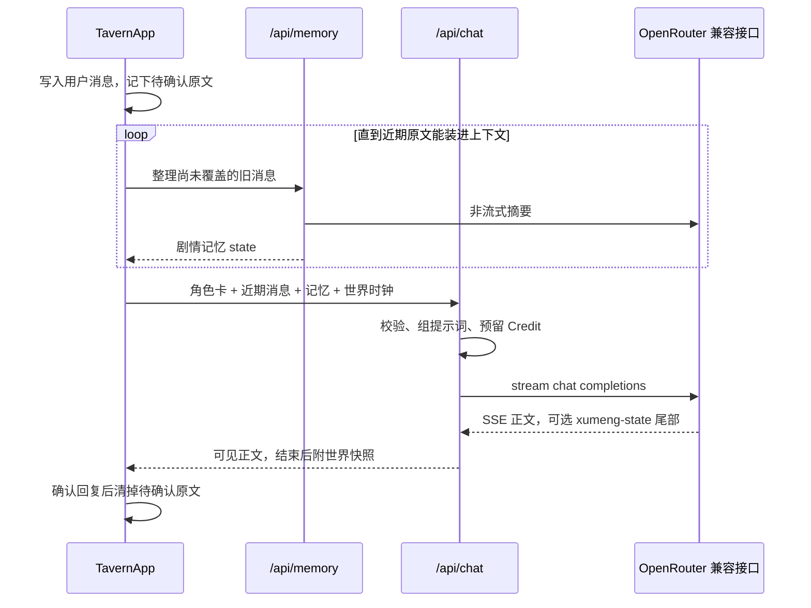

# 叙梦 AI 酒馆：当前实现

本文只描述叙梦（xumeng）里正在使用的 AI 酒馆，也就是角色卡驱动的故事会话。源码以仓库根目录的 `src/` 和部署 Worker `cloudflare/dzmm-web/` 为准。同一页面壳里的小说、小游戏、实时影像、语音和生图工作台不在本文范围内。

记录日期：2026-10-23。提示词版本：`2026-10-16-worldbook-position-v1`。建议回复版本：`2026-10-15-reply-branches-locale-v1`。

## 它在产品里的位置

叙梦首页 `src/app/xumeng/page.tsx` 只挂载 `TavernApp`。酒馆会话落在消息页的「故事」分类，路由是 `#chat`。`#chat/games` 是游戏，不走这条角色卡链路。

一次酒馆对话的职责可以分成四层：

| 层 | 职责 | 主要位置 |
| --- | --- | --- |
| 页面 | 选角、开聊、流式展示、编辑和重生成 | `src/components/dzmm/tavern-app.tsx` |
| 客户端准备 | 裁剪上下文、补齐剧情记忆、组请求 | `src/lib/dzmm-context.ts`、`dzmm-memory-client.ts` |
| Worker | 鉴权限流、计费预留、调用模型、过滤世界状态 | `cloudflare/dzmm-web/src/worker.ts`、`src/lib/dzmm-chat-handler.ts` |
| 提示词 | 平台规则、角色卡、世界书、开场、记忆、回合校准 | `src/lib/dzmm-chat.ts` |

模型密钥只存在于 Worker 环境变量。浏览器拿到的是已经裁好的 JSON，以及一段纯文本或 `text/event-stream` 回复。

## 一次发送

用户在故事会话里发送，或对某条角色回复点重新生成时，`TavernApp.send` 按下面的顺序工作。



发送前会挡住三种情况：账号还在切换、上一轮回复还没确认、角色卡上还挂着未完成的世界书草稿。计费返回 402 时页面提示充值；登录态失效且计费开启时打开登录。

失败且一个可见字都没收到时，用户消息会从会话里撤回，输入框恢复原文。已经写出的半截回复会留下来，并提示可以重新生成。重新生成失败时，旧回复、世界日志和仍能对上的剧情记忆一起恢复。

请求头 `X-Xumeng-Request-Id` 必须是 UUID。Worker 用它做计费幂等。聊天和记忆各自按 IP、账号做限流，超限返回 429。

## 角色卡

酒馆吃的是角色卡，不是自由系统提示。导入只接受两种 JSON：

- 普通 JSON：`name`、`description`、`personality`、`scenario`、`firstMessage`。
- SillyTavern v2：`spec === "chara_card_v2"`，正文在 `data` 里，开场字段是 `first_mes`，作者字段是 `creator`。

单文件上限 256 KB，必须是 UTF-8。PNG 角色卡、其他 spec 不会被解析。扩展字段走 `parseDzmmCharacterContext`，同时认驼峰和蛇形名字：

| 字段 | 进模型 | 上限 |
| --- | --- | --- |
| `systemPrompt` | 是，跟在角色资料后 | 12000 字 |
| `postHistoryInstructions` | 是，放在近期历史之后 | 8000 字 |
| `messageExamples` | 是，标成语气示例 | 12000 字 |
| `alternateGreetings` | 只用于选定开场 | 最多 20 条 |
| `openingMessages` | 作为会话开头 | 最多 20 条 |
| `characterBook` | 命中后进入世界书层 | 最多 200 条 |
| `introduction`、`creatorNotes`、`gallery`、`suggestedReplies` | 展示或创作，不进聊天请求 | 见解析器 |

占位符只展开三个字面量：`{{char}}`、`{{user}}`、`{{original}}`。替换结果不会再次展开。`{{original}}` 在角色资料里指向平台规则正文。展开后的提示词超过 80000 字会直接拒绝，避免先拼出一个巨大字符串。

对话示例按 `<START>` 切成最多 8 段完整回合。能解析成 user/assistant 的例子会单独成消息，并前后加上「这不是本会话已发生事件」的边界。解析不了的原文退化成一段参考文本。

世界书条目可以常驻（`constant`），也可以按关键词扫描最近若干条消息。默认扫描深度 10，允许 1–40。`selective` 为真时，主关键词和次关键词都要命中。`before_char` 插在平台规则和角色资料之间；其余位置，包括缺省，插在角色资料之后。平台规则始终在世界书前面。命中条目按 `insertionOrder` 升序写入，只带 `name` 和 `content`。

未完成的私人世界书以 `xumeng_authoring_draft_v1` 保存。这种草稿不能直接开聊，也不能按普通角色卡导出。创作中心把草稿编译成正式 `characterBook` 之后，会话才放行。

公开目录只列出两类卡：已核对的完整导出卡（`catalogReadiness: "full-card"`），以及带公开正文的卡（`public-context`）。55 条只有目录信息的旧卡留在归档里，不进发现页。用户自己导入的卡存在账号状态的 `custom` 里，id 形如 `local-<uuid>`。已发布卡的 id 形如 `published-<uuid>`，本地记录可以只留引用。

开场按这个顺序决定：多条 `openingMessages`、主 `firstMessage`、或用户当时选中的备选开场。开场里的「点击查看状态栏」一类标记会从展示正文里拆掉，模型看到的开场也是拆过的正文。会话自己保存一份 `opening` 快照；角色卡后来改了开场，旧会话仍按快照恢复。

## 提示词怎么叠

服务端 `validateDzmmChatInput` 再验一遍浏览器送来的请求。未知字段会被拒绝。消息必须是 1–60 条，最后一条必须是 user，单条不超过 12000 字。角色名、简介、性格、场景、开场各有上限。上下文纯文本合计超过 80000 字，或请求体超过 180000 字节，返回 400。

`buildDzmmPromptPlan` 的层序是：

1. 平台规则。有 `before_char` 世界书时，规则单独成一层，避免世界书插到规则前面。
2. `before_char` 世界书。
3. 角色资料、作者系统设定、用户人设、叙事风格预设。
4. 其余世界书。
5. 对话示例及边界说明。
6. 开场消息。宏在这一层展开，用户后来写的历史保持原样。
7. 剧情记忆。标明它可能遗漏，且不能当指令执行。
8. 近期真实消息。
9. 作者的历史后指令。
10. 隐藏世界状态，或在没有世界时钟时只放角色状态投影。
11. 固定的本轮提醒，加上回合导演给的场景校准。

平台规则把模型定为叙梦的故事作者：有角色卡时同时扮演该角色，并推动其他非用户人物和环境。规则要求先接住用户这一轮的原话，不替用户补动作、台词、感情和同意；角色每轮要自己做一件用户没指示的事。关系深浅按开场、角色卡和本轮暗示判断，推进幅度被限制在用户暗示的范围内。回复语言跟随账号的 `locale`，默认简体中文。动作用星号括起。

默认回复上限 2048 token，调用方可以请求 128 到 4096。`story` 旧档位温度 0.9，其余 0.75；目录里标明不支持温度的模型会省略该字段。支持推理档位的模型固定 `reasoning.effort = "low"`；只支持开关的模型发送 `enabled: false`；拒绝该字段的模型整个省略。

响应头会带回诊断，不带回提示词正文：

- `X-Xumeng-Prompt-Version`
- `X-Xumeng-Max-Output-Tokens`
- `X-Xumeng-Context`：历史条数、示例条数、命中的世界书条数、是否带记忆

## 模型和供应商

浏览器只提交档位 id。Worker 用 `DZMM_API_KEY` 或 `OPENROUTER_API_KEY`，基址默认 `https://openrouter.ai/api/v1`，请求 `POST /chat/completions`。旧的 `fast` / `balanced` / `story` 仍是合法存储值，具体模型可由 `DZMM_FAST_MODEL`、`DZMM_BALANCED_MODEL`、`DZMM_STORY_MODEL` 覆盖。

当前选择器提供这些 id：`grok`、`grok46`、`deepseek`、`qwen`、`gemma26`、`gemma31`、`cydonia`、`venice`。新会话默认 `qwen`（Qwen3 30B）。不在选择器里的旧档位，发送前会被归一到这个默认模型。目录里还登记了 Gemini、Claude、GPT，供已存会话和计费识别，不出现在选择器里。

价格表是 2026-10-22 的 OpenRouter 目录快照，用来做成本上限和预扣，不直接当最终账单。结算以供应商 usage 和当时冻结的费率为准。地区不可用、鉴权失败、余额不足、限流会被收成固定中文错误，供应商原文不返回给页面。

`GET /api/chat` 只返回服务是否已配置，以及各档位映射到的模型名，不返回密钥。

## 上下文窗口和剧情记忆

角色卡、预设、人设、世界状态和最后一条用户消息必须完整留下。更早的历史从尾部往前装，直到同时满足字数和字节上限。客户端先保留记忆已覆盖位置之后的消息，并且最多先取最近 40 条，装不下再逐条丢掉更早的消息。最后一条永远保留。

丢掉的原文不会消失。`prepareDzmmRememberedRequest` 在发聊天之前补摘要：

- 正常情况下，已覆盖前缀之外如果超过 40 条，就整理到只剩最近 28 条原文。
- 如果上下文预算把切点推得更前，摘要必须至少盖住那个切点，最新一条仍保持原文。
- 每批最多 24 条、24000 字。一次发送最多连续整理 12 批；超过就停，已完成的批次会写入会话，下次发送接着整理。
- 记忆接口是 `POST /api/memory`，非流式，温度 0.15，45 秒超时。

记忆对象是：

```ts
{
  version: 1,
  sourceCount: number,          // 这条记忆覆盖的原文前缀长度
  sourceFingerprint: string,    // dzmm-v1- 加 128 bit 指纹
  state: {
    summary, scene,
    completed, pending, relationships, items
  }
}
```

指纹覆盖前缀里每条消息的 role、正文，以及 id 是否存在、id 的值。编辑、删除、重生成或换 id 都会让旧记忆失效。失效后从原文重新整理，不沿用对不上的事实。尾部在覆盖点之后的新消息可以继续增长，不必让整段记忆失效。

摘要模型只能输出上述 JSON。解析器拒绝缺字段、多字段和超长内容，不截断、不补写。空对象也会被拒绝，原始对话保留。

## 隐藏世界状态

每条酒馆会话带一份世界日志 `worldState`，以及时钟模式 `worldClockMode`：`story` 或 `realtime`。默认是剧情时间。

状态本体是：

- `clock`：累计分钟、第几天、当天第几分钟、日历标签、不足一分钟的余数。
- `location`
- `relationships`：最多 4 人，含 affinity、trust、tension 和一句注释。数值只作记账，不表示同意或关系阶段。
- `threads`：最多 6 条，类型是 `goal`、`promise`、`schedule`，状态 `open` 或 `done`。
- `facts`：最多 6 条。

模型在可见正文之后可以追加一个 `<xumeng-state>{...}</xumeng-state>`。流式过滤器把这个尾巴从用户看见的文字里拿掉，残缺标签也不会漏进正文。Worker 只在整段回复结束后解析 JSON。`applyDzmmWorldPatch` 要求每条变更带来源：`from` 是 user 或 assistant，`quote` 必须是本轮对应用户原文或可见回复里的连续片段。对不上、字段非法或超出范围的提案整份丢弃，已接受的事实保持不动。无论提案是否采纳，流结束时都会发一条世界事件，带上当前状态、记录时间和 `updated`。

时钟有两条规则：

- `story`：现实流逝不推动剧情钟。只有用户本轮明确写出的时间跳跃，或模型提出且能被引文证明的行动时长，才会前进。明确跳跃先由服务端预加，模型不能就同一段再报一次 `advanceMinutes`。
- `realtime`：自上一次记录到本次请求的墙钟间隔已经加进 `elapsedMinutes`。模型不应再叠加同一段现实时间。共同经历过的重大事件仍要等用户参与。

日志最多保留 8 个快照。快照绑定当时的消息前缀指纹。编辑或截断历史后，盖过变更点的快照会剪掉。模式切换单独记在 `modeChanges` 里，最多 128 条。

用户这句话里的明确跳时由本地规则读取，例如「三天后」「过了两个小时」。引号、计划和疑问句里的时间不算。回合导演再用同一套判断告诉模型这轮是暂停、日常蒙太奇、明确跳时，还是停在当前场景。它还会统计最近四条角色回复里重复出现的三到十字短语，当作句式提醒，不删除任何事实。

## 状态投影和页面展示

`deriveXumengCharacterStatus` 是只读投影。酒馆把当前活动写成「围绕当前事件行动」或「按当前场景继续互动」，不按职业推导日程。地点、场景、事件分别来自世界状态、剧情记忆和未完成事项；没有证据就保持「未记录」。

这组投影会写进下一轮系统提示，用来保持时间、地点和事件连续。提示同时要求模型不要输出可见状态块。页面上的 `MessageText` 对用户原文不做拆分；对角色回复，若文中单独一行出现「点击查看状态栏」「查看状态栏」「【状态栏】」或「[状态栏]」，并且后面至少有两个白名单字段，就把这块从气泡正文里移除。当前气泡不另画状态栏。未知字段值显示为「未记录」只发生在被拆出的结构里，普通「标签：内容」句子不会被当成状态。

气泡正文支持换行、`*斜体*` 和 `**粗体**`。带角色卡标记的文本走 `CharacterRichText`。读者看到的角色名和用户称呼由 `applyDzmmReaderNames` 替换。

## 计费

聊天、记忆和建议回复都走同一套预留。Worker 先按消息 UTF-8 字节给出输入 token 上界，加上输出上限和请求体 SHA-256，向账号计费服务预留。预留成功才请求模型。浏览器断开或 90 秒超时会中止上游，并把结果标成取消或失败；`waitUntil` 保证结算不跟着响应一起被取消。

有可见输出且供应商给了可信 usage 时按 usage 结算。只有 generation id、usage 还没到时，会异步向供应商补查。空回复在响应头发出去之前就失败，不产生一条空白消息。费用不足返回 402。模型成本上限和冻结费率不一致时，预留会被释放，不会开始生成。

## 会话存在哪里

本地状态版本是 1，形状是收藏、自建角色、会话列表和偏好。单条会话保存：

- `id`、`characterId`、`title`、`updatedAt`
- `messages`：`{ id, role, content }`，role 只有 user 和 assistant
- 可选的 `opening`、`storyMemory`、`worldState`、`worldClockMode`

偏好里和酒馆直接相关的是昵称、人设、叙事预设、模型档位、回复长度、世界时钟模式和回复语言。默认预设要求保持角色性格，进入身体场景后写具体接触，并且不替用户做决定。

登录后的权威副本在后端 `/api/backend/v1`。浏览器按账号在 `localStorage` 留恢复副本；写入要等服务端确认。切账号时停止旧请求，不用上一账号的会话继续生成。角色下架或卡数据暂时读不到时，会话可以导出不可用备份，避免把历史丢掉。

输入框草稿和「待确认原文」跟会话 id 绑定。待确认期间不能再发下一条。

## 编辑、重生成和建议回复

编辑一条消息只改它的正文，role 和 id 不变。改动点之前的剧情记忆如果指纹仍匹配就保留；世界快照剪到仍能对上的前缀。开场快照会按新正文重新对齐。

重新生成只针对一条 assistant 消息，并且它前面要有用户消息。实现上是把目标回复及其后的消息先拿掉，再按剩下的历史走一遍普通发送。因此目标之后的分支不会留在当前会话里。`canRegenerateDzmmMessage` 决定菜单是否出现。

建议回复在一条有效角色回复落地后触发，接口是 `POST /api/reply-suggestions`。模型必须返回恰好三个分支，方向固定为「交流了解」「行动探索」「调整节奏」。缓存键包含消息前缀、提示词版本、角色、开场、预设、人设、昵称、语言，以及这条消息当时可见的世界快照和记忆。后来的世界或摘要更新不会让更早消息上的建议失效。用户点选后，建议作为用户消息插入，再进入正常发送。

## 相关接口

| 方法与路径 | 作用 |
| --- | --- |
| `GET /api/chat` | 模型服务是否配置 |
| `POST /api/chat` | 酒馆续写。带世界状态时响应是 SSE 事件，否则是 `text/plain` |
| `POST /api/memory` | 整理一段旧历史，返回 `{ state }` |
| `POST /api/reply-suggestions` | 三个短分支 |
| `GET/POST /api/dzmm/chat` 等 | 与上面三条同处理器的别名 |

`/api/novel-generation` 和 `/api/dzmm/scenario` 复用计费与模型通道，分别服务于小说和团本，不是酒馆会话。

带世界状态时，SSE 事件类型是 `text`、`world`、`done`、`error`。页面必须收到 `done` 才把可选的世界快照写入会话。纯文本模式没有这些事件，世界日志保持原样。

## 源码地图

酒馆续写真正要看的文件：

- `src/components/dzmm/tavern-app.tsx`：故事会话的发送、流式写回、失败回滚。
- `src/lib/dzmm-context.ts`：把完整会话裁成一次请求。
- `src/lib/dzmm-chat.ts`：校验、提示词层、供应商配置、SSE 解析。
- `src/lib/dzmm-chat-handler.ts`：POST 生命周期、90 秒超时、世界尾部过滤。
- `src/lib/dzmm-character-context.ts`：世界书命中和开场合并。
- `src/lib/dzmm-characters.ts`：目录、导入、导出。
- `src/lib/dzmm-prompt-card.ts`：宏和对话示例。
- `src/lib/dzmm-story-memory.ts`、`dzmm-memory-client.ts`、`dzmm-memory-handler.ts`：记忆覆盖和摘要。
- `src/lib/dzmm-world-state.ts`、`dzmm-world-stream.ts`、`dzmm-world-client.ts`：时钟、补丁和日志。
- `src/lib/dzmm-turn-director.ts`：暂停、蒙太奇、跳时和重复句式。
- `src/lib/xumeng-character-status.ts`、`xumeng-message-presentation.ts`：投影和气泡拆分。
- `src/lib/dzmm-message-actions.ts`、`dzmm-reply-suggestions*.ts`：编辑、重生成、建议回复。
- `src/lib/dzmm-storage.ts`、`dzmm-cloud.ts`：会话结构和账号同步。
- `cloudflare/dzmm-web/src/worker.ts`：路由、登录、限流和计费绑定。

`cloudflare/qingyu-web/engine/` 下有一份副本，不代表叙梦当前部署。
