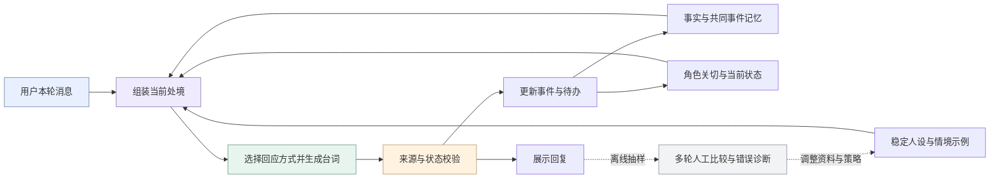

# 大模型角色对话：让多轮交流有“活人感”的技术路线

调研日期：2026-10-07。范围：纯文字角色对话、长期记忆、动态人物状态、角色训练与评测。资料来自论文原文、作者项目和产品官方博客。

**我的判断：值得优先验证的是“情境化人设 + 共同经历 + 有因果的状态变化 + 灵活的对话策略 + 多轮人工评测”。** 模型选型和训练也有作用，但需要通过同一组对话任务比较。下面将来源已经公开的方法与我对当前原型的工程建议分开说明。这些资料不能确认 nariyume 使用了哪些模型或私有提示词。

## 先把“活人感”拆成可观察的行为

| 希望获得的体验 | 可以观察的行为 | 主要技术抓手 |
| --- | --- | --- |
| 对方有具体性格 | 在失落、被夸、误会、意见冲突中作出符合角色的不同选择 | 情境化角色卡、相关对白示例 |
| 对方在听我说话 | 接住这轮的新信息；误会时澄清；允许一句话回应 | 对话策略、上下文理解、长度适配 |
| 我们有共同经历 | 回忆聊天里确实发生过的事，能处理后续变化 | 带来源的事件记忆、时间与状态 |
| 对方会变化 | 同样的事件在不同熟悉程度下产生不同反应 | 稳定身份、持续关切、短期情绪分层 |
| 对方有自己的近况 | 有未完成的小目标，也有进展和收尾 | 角色目标、虚构世界时间线 |
| 对话有新意 | 不反复使用同一套开头、动作、问句和旧剧情 | 结构多样性、话题生命周期 |
| 多聊仍然自然 | 20–30 轮后仍能区分人物、记忆和动机 | 多轮盲评、矛盾与重复诊断 |

以上是本报告的产品分析框架，不是某篇论文定义的统一“活人感指标”。记忆问答答对、角色知识丰富、用户愿意继续聊，是不同的结果，不能彼此替代。

## 优先读的论文与报告

### 1. ChatHaruhi 与 RoleLLM：用对白教角色怎样反应

[ChatHaruhi（2023，技术报告）](https://arxiv.org/html/2308.09597) 将角色描述、检索到的相关原作对白和近期聊天组合起来。可借鉴的是用情境相似的对白提供语气和反应方式；它不是完整的长期陪伴验证。作者提供了[开源实现](https://github.com/LC1332/Chat-Haruhi-Suzumiya)。

[RoleLLM（Findings ACL 2024）](https://aclanthology.org/2024.findings-acl.878/) 区分角色知识与说话方式：Context-Instruct 从角色资料构造知识训练样本，RoleGPT 用人设和检索的对白示范风格，随后做角色条件微调。[全文附录 I.1](https://arxiv.org/html/2310.00746) 有提示模板。

**对原型的建议：** 为每个原创角色写一组不同情境的短对白，例如被夸、失败、忙碌、产生误会、修复冲突。先尝试每轮按情境选择 2–4 组作为示例，数量通过实验调整。示例应注明“风格示范”，不能让模型误以为是当前用户已经经历过的历史。以后有足够好样本，再考虑监督微调（SFT）。

### 2. MRPrompt：把形容词改成有触发条件的人物反应

[Memory-Driven Role-Playing（2026-03，预印本）](https://arxiv.org/html/2603.19313v1) 将人设组织为整体概述、核心特质和情境侧面；侧面包含触发线索、行为方式及知识边界。生成时依次锚定身份、选取相关侧面、约束可知信息、写出角色回应。该方法只改提示词，不要求训练或外部检索；附录 O.3 公开模板。

这里的“长期记忆”主要是预先提供的人物资料，不等于自动维护多年用户记忆。实验也不能直接证明长期陪伴体验。

**对原型的建议：** 将“开朗、嘴硬、体贴”具体化，例如：

- 陌生人夸奖时，会轻松接住，但不马上分享最私密的烦恼。
- 熟人明确说心情不好时，会先回应具体遭遇，暂时收起玩笑。
- 自己比赛输了时，会不甘心，也会复盘；经过交流后可以接受安慰。

这些是本项目的创作示例，不是论文原文。人物可以有情境差异，不能只剩一个不断放大的特征。

### 3. Generative Agents：记忆会改变下一步的行为

[Generative Agents（UIST 2023）](https://arxiv.org/html/2304.03442v2) 的关键组成是经历记录、按相关性/新近性/重要性检索、从经历形成反思、制定并调整计划。其小镇模拟和人类评价支持这些组件对可置信行为的作用；并未验证数月真实用户陪伴。

**对原型的建议：** 除了“用户喜欢某类游戏”，还记录“这次交流里发生了什么、哪些事情还没结束”。关系变化应有事件依据。推断性反思可以存为可修正的解释，例如“这次他似乎更希望我认真听”，不能把它写成永恒的用户事实。

### 4. 动态人物一致性：稳定性格与短期情绪可以并存

[Beyond Static Persona Consistency: Dynamic Persona Coherence in LLM Role-Playing（ACL 2026）](https://aclanthology.org/2026.acl-long.1336/) 区分长期身份、中期累积状态和短期情绪；结合人物一致性检查、相关纠错案例检索与修正。它处理的核心是人物变化有没有事件和历史支撑。文中的自动一致性收益不能当作用户“活人感”的同比提升。

**对原型的建议：** 别让一个 `mood` 字段同时承担性格、关系和情绪。先分别保存稳定价值观、持续关切、当前反应，并记录变化的证据。检查器先用于离线诊断；只有明确矛盾的回复才考虑在线重生成，避免每轮额外调用。

### 5. CoSER：角色有经历、动机和当下处境

[CoSER（ICML 2025）](https://proceedings.mlr.press/v267/wang25dk.html) 基于文学角色构建包含对白、经历、内在思考等信息的数据，以给定处境下的表演训练和评估模型。[作者项目](https://github.com/Neph0s/CoSER) 开放数据与模型。文学人物评测不等于开放式陪伴体验，而且部分内在信息经过模型加工。

**对原型的建议：** 在人物设定里补“现在在意什么”“想完成什么”“此刻为何愿意聊这个”。例如作业进度、比赛失利后的复盘或一次出行计划。这些关切要有进展与结束条件，不能每轮都重新声明。

### 6. HER：角色判断、训练偏好与结构多样性

[HER（Findings ACL 2026）](https://aclanthology.org/2026.findings-acl.1283/) 区分角色第一人称思考与模型第三人称控制，构造推理增强数据，再做 SFT 和偏好强化学习。[全文](https://arxiv.org/html/2601.21459) 也研究了训练后回复结构塌缩，并通过多种有效结构的数据改写维持多样性。

**对原型的建议：** 可以借鉴“先选择本轮回应方式，再写台词”的控制思路，尝试很短的结构化字段：当前目标、是否需要澄清、采用什么对话动作。无需显示大段分析或把它加入长期聊天记录。单靠增加这段提示，不能视为复现 HER 的训练效果。

### 7. LongMemEval：把记忆失效拆成几类问题

[LongMemEval（ICLR 2025）](https://arxiv.org/html/2410.10813v2) 评测事实提取、跨会话推理、时间推理、知识更新及不知道时不编造，并分析索引、检索、读取三个环节。其工程方法包括合适的记忆粒度、扩展检索键和时间过滤。

**对原型的建议：** 不只测“记住了名字”，还测搬家后的旧住址、改期的计划、用户手动纠正的偏好、从未说过的信息。当前检索是字符片段与常见跨语言词映射；先用失败样本确认瓶颈，再决定是否加语义检索。记忆答题准确率衡量记忆能力，不能代替聊天自然度。

## 工业界公开了哪些做法

### Character.AI：写作质量、偏好训练与重复问题

[Evaluating Our Models Using Principles of Compelling Writing（2025-06-12）](https://blog.character.ai/evaluating-our-models-using-principles-of-compelling-writing/) 描述了与专业写作者合作，拆解对白质量、节奏和人物等维度；由写作者制作标注数据，结合模型评审，支持训练方案比较。博客没有公开全部评分细则。

[Reducing Repetition（2025-01-31）](https://blog.character.ai/reducing-repetition-in-character-conversations/) 明确将重复分为反复用词和停在同一情境，并称通过模型对齐改善重复与推进。它没有提供可独立复现的指标和完整训练配方。因此，不能把其改善数字直接用作我们的效果预期。

[Inside Kaiju（2025-11-07）](https://blog.character.ai/inside-kaiju-building-conversational-models-at-scale/) 公开了其自研模型的部分架构、面向聊天体验的数据选择，以及 SFT、基于用户切换候选回复和反馈的 modified online DPO。文章也提到转向开源模型的方向；它是当时的技术披露，不能据此断言 2026 年所有请求使用同一模型。

**对原型的建议：** 同一上下文生成两种候选，让人选择更想继续聊的一种，并注明原因。优先积累“为什么 B 比 A 好”的具体判断，而不是只收集点赞。词汇多样、回应结构多样和情境推进需要分别看。

### Character.AI 与 Nomi：记忆需要可检查、可更正

[Character.AI Memory（2026-05-21）](https://blog.character.ai/memory/) 介绍固定的重要故事片段、可编辑事实，以及用户/角色/配角等记忆分类。[Nomi MindMap 2.0（2025-10-09）](https://nomi.ai/updates/mind-map-2-0-bringing-nomi-memory-into-view/) 介绍详细记忆、身份概览与关联浏览，并允许用户修正。两者是产品公开说明，未披露完整后台算法；MindMap 的名称也不能证明其数据库实现。

**对原型的建议：** 保留现有记忆可编辑和来源展示，再将用户明确事实、聊天事件、角色设定、模型推断分开。重要事件可以固定，概览不能覆盖原始证据。

## 补充阅读：按具体问题选

| 遇到的问题 | 资料 | 可借鉴的方法及边界 |
| --- | --- | --- |
| 如何维护记忆写入与更新 | [Mem0（2025，厂商技术报告）](https://arxiv.org/html/2504.19413v1) | 提取候选事实，再与已有记忆比较，执行新增/更新/删除/不操作。实验主要是记忆问答和成本，不能证明情感陪伴效果。 |
| 历史信息何时仍有效 | [Zep（2025，厂商技术报告）](https://arxiv.org/html/2501.13956v1) | 区分事件有效时间与入库时间，保留来源和失效信息；原型也能用普通表实现，不必马上引入图数据库。 |
| 长对话如何制造连续经历 | [LoCoMo / Evaluating Very Long-Term Conversational Memory of LLM Agents（ACL 2024）](https://aclanthology.org/2024.acl-long.747/) | 会话观察、摘要及会话间有时间和因果关系的生活事件。数据经过生成与人工修订，不是真实长期关系实验。 |
| 如何管理上下文空间 | [MemGPT（2023，技术报告）](https://arxiv.org/html/2310.08560v2) | 工作上下文、外部记忆与按需读写；解决上下文管理，不自动带来角色魅力。 |
| 如何评估人物是否有区别 | [InCharacter（ACL 2024）](https://aclanthology.org/2024.acl-long.102/) | 用开放式访谈与人物决策测人格一致性。量表成绩不等于人类真实感。 |
| 如何平衡倾听、共情、知识与主动性 | [Recipes for Building an Open-Domain Chatbot（2020）](https://arxiv.org/html/2004.13637v2) | 组合多种对话技能并做多轮人类比较；回复长度影响互动，旧模型的解码参数不能直接照搬。 |
| 什么时候该追问 | [Navigating Rifts in Human-LLM Grounding（ACL 2025）](https://aclanthology.org/2025.acl-long.1016/) | 研究共同理解和澄清的缺失。助手对话结论迁移到角色场景还需验证；少套路问句不等于取消必要澄清。 |

## 我建议的轻量核心架构

以下是结合上述资料为当前 chat-only 原型提出的方案，不是任何论文或产品的原样架构，也不是 nariyume 后台的事实描述。



先保留每轮一次主生成。将语言、明确的话题关闭、时间和记忆覆盖优先级交给程序处理；模型负责情境判断和台词表达。事件整理和反思可以在话题结束或若干轮后执行，频率由成本和质量实验决定。

**把信息分成四类：**

```json
{
  "persona": {
    "identity": "稳定背景与价值观",
    "facets": ["触发情境 → 典型反应与例外"],
    "examples": ["按情境检索的原创对白"]
  },
  "state": {
    "concerns": ["当前在意的事及其进展"],
    "mood": {"value": "concerned", "causeEventIds": ["ev_012"]},
    "relationship": {"description": "渐渐熟悉", "evidenceIds": ["ev_008"]}
  },
  "memory": {
    "facts": ["用户明确陈述，附原话与消息编号"],
    "episodes": ["聊天里确实发生的共同事件，附参与者与时间"],
    "reflections": ["可修正的解释，附依据，标为推断"]
  },
  "threads": [
    {"topic": "考试准备", "status": "resolved", "evidenceIds": ["ev_012"]}
  ]
}
```

这份结构是设计示意，尚未写入代码。用户事实、角色虚构设定和模型推断必须有不同来源类型。角色在会话之间的新近况属于虚构剧情，不应被写成用户已参与的共同经历。

**对话策略可以很小：** 根据当前内容选择接住情绪、澄清、分享、开玩笑、表达分歧、推进或自然收尾中的合适动作，允许组合。不要强制轮流切换，也不必每轮输出新目标或问句。回复长度由这轮内容决定；确认可以很短，冲突或具体讨论可以稍长。

**示意提示词骨架：**

```text
固定资料：人物身份、价值观、情境反应及知识边界。
当前处境：时间、近期消息、未完成关切、已经解决或关闭的话题。
相关记忆：带来源的用户事实、共同事件、明确标注为推断的关系解释。
风格示例：与当前情境相关的少量对白；示例不是当前会话历史。

先判断用户这轮在做什么，以及是否存在需要澄清的误会。
选择符合人物和当前关系的回应方式，再写角色实际会说的话。
回应中的变化必须有当前事件或历史依据。
回忆用于影响这次回应，不必把检索到的资料逐条说出来。
让已经完成的事情保持完成，除非用户重新开启。
允许简短确认、直接表达意见、分享近况或自然收尾。
不要替用户宣布感受、动作、承诺，也不要编造共同经历。
```

这是一份本项目的工程提案，不是复原的私有 prompt。模板需要用对话比较验证，继续增加规则并不保证持续增益。

## 对现有原型，优先补什么

现有实现可见于 [engine.mjs](/Users/pencil/Documents/IntVideoGameEditor/experiments/character-chat/engine.mjs)、[characters.mjs](/Users/pencil/Documents/IntVideoGameEditor/experiments/character-chat/characters.mjs)。它已有近期历史、滚动摘要、带原话的用户记忆、话题关闭、语言切换及情绪/关系记录。[验证记录](/Users/pencil/Documents/IntVideoGameEditor/experiments/character-chat/VERIFICATION.md) 的 41 个自动测试主要证明流程与数据约束正确；几轮真实模型测试尚不能证明长期“活人感”。

| 优先级 | 改进 | 与现有实现的连接 | 需要验证的结果 |
| --- | --- | --- | --- |
| 1 | 情境化角色卡与对白示例 | 扩充人物资料；按当前处境选入提示词 | 两个角色遇到同类冲突时能否有稳定区别 |
| 1 | 多轮质量比较 | 固定测试脚本；保存完整输出与人工选择原因 | 改动在 20–30 轮后是否仍有收益 |
| 2 | 共同事件与待办生命周期 | 在用户事实之外新增事件来源与 open/resolved 状态 | 能否回忆共同经历并让已完成事项结束 |
| 2 | 持续关切与短期情绪分开 | 从单个 mood 扩展为有关切、依据的状态 | 情绪变化是否有原因，角色近况是否有连续进展 |
| 3 | 灵活的回应策略与长度 | 调整统一字数偏好；加入很短的策略控制 | 是否减少固定三段式、公式化夸奖与结尾追问 |
| 4 | 检索改进 | 用跨话题、跨语言失败样本比较现有检索与语义检索 | 正确召回、更少无关记忆、可接受的延迟 |
| 5 | SFT 与偏好训练 | 使用经过人工修订的多轮好样本与偏好对 | 在新角色、新场景上是否改善，是否出现模板塌缩 |

我的选择是先做第一、第二优先级的对比实验，继续使用当前 API。当前最需要验证的是人物资料和状态组织是否真的改善对话，而不是立即增加多代理、图数据库或训练任务。

## 怎样判断改动真的有效

下面是适合这个小原型的实验方案，不是已完成的实验，也不是论文通用阈值。

1. 准备 8 组中性场景，分别测试相识、被夸、失落、意见冲突、误会修复、事实纠正、主动关闭话题和隔日续聊。每组推进 20–30 轮，包含两次以上情境变化。
2. A 使用现有原型；B 每次只改变一个因素。固定模型、采样设置与用户脚本，每个条件至少重复几次，保留全部样本。
3. 对重复的固定脚本做受控对比，再加入少量自由聊天检查实际互动。顺序随机，评审看不到版本名，并允许“差不多”或“两者都不好”。
4. 分别评价：人物辨识度、是否回应本轮、情绪因果、共同事件回忆、陈述矛盾、已关闭话题复发、重复结构以及想不想继续聊。记录偏好理由，不强行合成一个总分。
5. 去掉姓名、口头禅和表情后，比较两个角色的选择是否仍不同；这是我们拟采用的测试，不能等同于 InCharacter 标准基准。
6. 自动检查用于找问题：矛盾引用、连续相似开头、长期同一段落结构、无新信息的追问、未改变状态的旧剧情。由人工判断重复是否必要，避免奖励无意义的新词与剧情变化。

还应同时记录每轮延迟、调用次数与上下文成本。只有在收益与代价都清楚时，再决定是否增加反思、在线检查器或语义检索。

**推荐阅读顺序：** 先读 ChatHaruhi / RoleLLM，理解对白如何进入提示；再读 MRPrompt，改善人物反应结构；随后读 Generative Agents 与动态人物一致性，组织事件、关切和情绪；用 Character.AI 写作评测与 LongMemEval 建立两套质量检查。准备训练时再深入 CoSER、HER 和 Kaiju。
