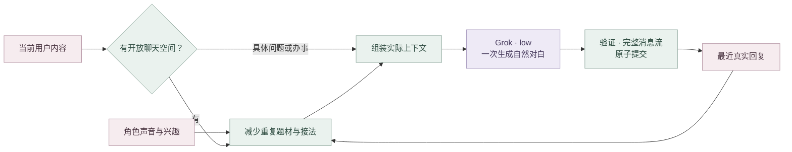

# 回复多样性修订 · 2026-10-11

用户指出上一轮回复本身不够 diverse。这里记录该反馈后的修改、候选失败与验收；之前的 `final-2026-10-11-*` 是上一轮交付，不是当前效果证明。

## 重复从哪里来

前一交付的32个成功回复中，25个有两条消息，常见结构是短反应加一件自己的小事。无匹配输入时声音示例固定取第一条，作者示范偏讨夸、开场物件和可爱的失误。角色状态退场能停止某个物件，但散步换成带书看叶子，仍然是同一类内容。应用此前没有从真实最近回复识别这种重复。

这里把多样性理解为：在接住用户的前提下，内容、言语行为和说话节奏都有选择。换物件、换形容词、多发气泡、随机变情绪，都不能单独证明改善。

## 实现

- 两位角色各十组不同兴趣/接话角度，声音示例与内容示例改成普通口语、具体偏好、玩笑和小坦白，减少连续金句和原则。
- 从最近六个真实助手轮次识别已经用过的题材与言语行为，分条消息按实际 turnId 合并，不把作者开场和用户转述当助手习惯。反复出现的内容和接近的示例软降权。
- 开放闲聊、低信息续聊、换题、明确亲近和主动机会可以获得一个可选写法。当前具体问题直接回答，不塞入随机撒娇/玩笑方向。用户指定的题材与风格优先，重试方向稳定。
- 一条说完整是正常选择；确有转折或追加才分两三条。连续两轮两气泡时，不再积极鼓励“嗯＋真正内容”的写法。条数仍由模型选择，应用不硬凑配额。
- 主动意图可以放下，不再把旧句当必须补完的任务；没人回应时不追讨刚才要过的夸奖，不用更多场景细节冒充进展。

方向是临时写作提示，不入用户记忆、关系、历史或情绪。词法标签只作近似提示，不能准确识别所有语义；没有多样性分数，也没有额外审稿模型调用。

## 候选失败也保留

`diversity-v1-*` 在门控回归发现遗漏后中断，合计5次上游调用、3次完成、2次中断。没有删除已生成结果。

`diversity-v2-*` 两角色各9次，全部完成。气泡有9次一条、9次两条，但这不是质量分数。实际发现更大的问题：问小店设计时 Yume 只表达亲近，没给设计；Nari 换题时只比喻“换题”动作，未提供新内容。观点又偏向“我更喜欢／规则／漂亮话”的文案。不能把该候选描述成已解决多样性。

v3 因此取消具体内容上的随机切入，明确换题必须给新主题内容，并再次收短声音示例。后续实际记录与限制列在验收记录中。

## 当前实际结果

v3 六模块哈希与运行代码一致：`165159b837657a418ed88d65f38e480117e16f7442fabd5d9157b7708541df71`（固定模块顺序）。141项后端测试与29项离线界面检查通过；当前版本30次真实调用全部完成，包括两角色各9次普通/独立开局、各5次主动轨迹、2次浏览器试聊。完整结果分别为 `evaluations/results/diversity-v3-2026-10-11-{yume,nari}.json`、`{yume,nari}-initiative.json` 与 `live-ui.json`。

可观察到的改善是回答更符合具体意思、换题提供了实际内容、题材从物件汇报向更多兴趣展开。例如小店货架是“没封口的信封、差一句歌词的歌单、差一个队友的开黑邀请”；Yume 也聊学剪辑和会议观察，Nari 聊周末、配角、夜间想象。气泡不再只能用短反应开头，但这不是质量评分。

仍有弱例：一次开放回答只有想陪聊；部分设计回答薄，偶发解释聊天策略；游戏意见偏硬。主动轨迹仍有主题黏连，Nari 一次不吱声/迟到的调侃偏催。不能宣称彻底解决多样性或软萌感。浏览器实际确认具体问题到一句话撒娇的切换和下一句草稿保留，截图为 `preview-diverse.png`，测试页已清理。

## 如何复核

`evaluations/diversity.mjs` 默认离线。`--live` 每角色9次：六轮连续低信息/续聊/换题/具体问题，随后相同开放输入的三个独立会话；完整请求、原始输出、usage、来源状态和六模块源码哈希都保存。`cute-presence.mjs --scenario initiative` 验证主动链，不添加假用户消息，不强制模型续聊。测试只用合成临时会话，不读取用户存档。

完整轨迹与版本验证见 [VERIFICATION.md](/Users/pencil/Documents/IntVideoGameEditor/experiments/character-chat/VERIFICATION.md)。功能测试不等于可爱评测，短脚本也不证明长期聊天质量；用户的实际体验仍是验收依据。
