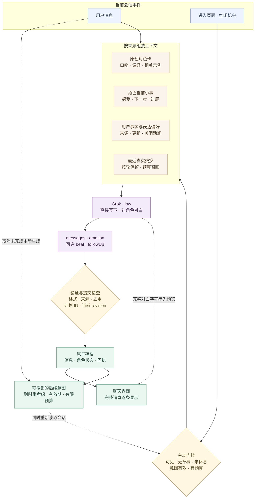

# 活人感改造：调研依据、系统架构与验收

> 后续用户指出交付回复不够 diverse。当前修订与新的真实输出见 [回复多样性修订](/Users/pencil/Documents/IntVideoGameEditor/experiments/character-chat/research/2026-10-11-diversity.md)。下面保留初次调研和当时的交付记录；其五模块哈希与129项测试计数不代表后续运行版本。

日期：2026-10-11。目标是成年原创角色的软甜、可爱、愿意接话，以及有来由的小情绪和主动性。

这次改造的核心判断是：角色需要知道“自己现在想做什么、为什么想说这一句”，并且能把小事往前推进。只增加气泡、表情和空闲计时，不能解决内容机械的问题。公开资料支持的是这些可实现的机制；“足够可爱”仍需本项目的真实多轮体验验证。

## 调研覆盖与证据边界

调研覆盖 15 篇论文/作者技术报告，以及 SillyTavern、RisuAI、Project AIRI、Open-LLM-VTuber 四个开源项目的官方文档和源码。详细方法、版本快照和限制见 [论文笔记](/Users/pencil/Documents/IntVideoGameEditor/experiments/character-chat/research/2026-10-11-papers.md) 与 [开源源码笔记](/Users/pencil/Documents/IntVideoGameEditor/experiments/character-chat/research/2026-10-11-opensource.md)。原型的问题审计见 [体验审计](/Users/pencil/Documents/IntVideoGameEditor/experiments/character-chat/research/2026-10-11-experience-audit.md)。

我们没有获得 NariYume 的内部 prompt、训练数据或模型配置，不能把公开角色聊天方案当成它的真实后台。角色扮演论文多研究身份、知识、风格或可信度；主动助手论文多研究任务帮助；记忆论文多研究问答准确率。这些指标与用户希望的柔软亲近口吻有关，但并不等价。

Character.AI 的 Kaiju 作者报告说明，自然聊天也依赖数据配比、SFT、用户偏好反馈与 modified online DPO，服务效率则由注意力/KV 等模型工程支持。因此当前 API 原型可以改 prompt、上下文、状态和交互，但不能通过一段提示获得同等后训练效果。[Kaiju 官方技术报告](https://blog.character.ai/inside-kaiju-building-conversational-models-at-scale/)

## 原来为什么不好聊

旧版虽已使用 Grok low、支持多条气泡和一次空闲补话，仍存在三个相互加强的问题：样例常把聊天带回命名与小游戏；角色没有会跨轮变化的自己的小事；主动被定义成给上一句补细节，缺少独立内容动机。关系标签长期停在“初次见面”，完整 JSON 返回后才显示，也进一步压住亲近感和节奏。这些问题来自源码与保存的合成试聊复核，而非对真实用户全部会话的推断。[本地体验审计](/Users/pencil/Documents/IntVideoGameEditor/experiments/character-chat/research/2026-10-11-experience-audit.md)

新候选的早期试聊又暴露了另一种失败：加入持久 `characterBeat` 后，Yume 多轮仍在“笔记还差几行、先偷懒”，Nari 多轮仍在“画纸边角空着、不想收笔”。状态被记住了，状态却没有发展；有些短句还延续了作者样例。第一候选只能作为诊断记录，不能作为最终版验收证据。[Yume 第一候选原始轨迹](/Users/pencil/Documents/IntVideoGameEditor/experiments/character-chat/evaluations/results/release-2026-10-11-yume-natural.json)、[Nari 第一候选原始轨迹](/Users/pencil/Documents/IntVideoGameEditor/experiments/character-chat/evaluations/results/release-2026-10-11-nari-natural.json)

这一发现要求继续处理“原地重复”：当前小事应能进展、完成、搁置或换掉；角色可带着这个状态聊天，但不能每轮都把道具重新说一遍。软甜与日常配合也应直接落实到当前对白，尤其是“就一句”“别安排小游戏”“换题”这类明确要求。

## 哪些来源真正指导了架构

| 机制 | 一手依据 | 本项目采用的形状 |
| --- | --- | --- |
| 用对白示范口吻 | RoleLLM 比较角色资料、指令与对话示范；SillyTavern 将卡、例子、历史和尾部指令分开管理。[RoleLLM](https://arxiv.org/html/2310.00746v3)、[Prompt Manager](https://docs.sillytavern.app/usage/prompts/prompt-manager/) | 原创短口语示范按本轮相关性选择；稳定卡与本轮创作方向分开。 |
| 情绪有原因，行动有动机 | Character-LLM 用场景/经历形成角色；角色定向推理研究约束情绪、经历、立场和动机。[Character-LLM](https://arxiv.org/html/2310.10158v1)、[Thinking in Character](https://arxiv.org/html/2506.01748v1) | 保存角色当前小事、针对它的感受、下一小步；对白表达结果，不展示长篇心理分析。 |
| 主动也可以安静 | ProactiveBench 区分正确主动、错误主动、正确安静与错过；AIRI Spark Notify 默认允许不回应。[ProactiveBench](https://arxiv.org/html/2410.12361v3)、[Spark Notify 源码](https://github.com/moeru-ai/airi/blob/ec682e2413279aee49dc3d5bfa68192d958a41dc/packages/core-agent/src/agents/spark-notify/agent.ts#L96) | 先确定时机，再根据内容动机生成；同时检查“该说没说”和“不该说却说”。 |
| 后续消息可撤回、可重考虑 | 2026-10-04 的预印本区分未来 Send 与到时 Reconsider；Open-LLM-VTuber 有 idle/输入/中断状态门控。[Replannable Dialogue Timelines](https://arxiv.org/html/2610.05159v1)、[主动状态机源码](https://github.com/Open-LLM-VTuber/Open-LLM-VTuber-Web/blob/d176e7df2366952e3bacbf12cf9a8b18a4315932/src/renderer/src/context/proactive-speak-context.tsx#L20) | 存可过期的接话意图，到时读最新会话再考虑；输入、新消息与设置变更优先。 |
| 记忆保留来源、时间与更新 | LongMemEval 强调轮次、检索与时间；RisuAI HypaV3 保留源消息关联，预算召回后恢复发生顺序。[LongMemEval](https://arxiv.org/html/2410.10813v2)、[HypaV3 来源结构](https://github.com/kwaroran/RisuAI/blob/979dbc9d5fd913abd6996eaec64e0f83be53964d/src/ts/process/memory/hypav3.ts#L79)、[时间排序](https://github.com/kwaroran/RisuAI/blob/979dbc9d5fd913abd6996eaec64e0f83be53964d/src/ts/process/memory/hypav3.ts#L871) | 用户事实、真实互动片段、虚构角色状态分层；旧事件有来源，不写成新的用户自述。 |
| 分条承担语义与节奏 | AIRI 分条提示让完整想法保持完整，只在反应、停顿或补一句时拆开。[分条提示源码](https://github.com/moeru-ai/airi/blob/ec682e2413279aee49dc3d5bfa68192d958a41dc/integrations/telegram-bot/src/prompts/message-split-v1.velin.md) | 单次主生成返回 1–3 条短消息；内容递进，不将一句话机械拆开。 |
| 多轮比较与人工判断 | CharacterBench 区分人物准确性与自然感；CharacterArena 用同场景轨迹比较，仍存在评审分歧。[CharacterBench](https://arxiv.org/html/2412.11912v1)、[CharacterArena](https://arxiv.org/html/2508.09074v1) | 回归测试检查功能，完整真实轨迹检查体验；不伪报统一“可爱度”分数。 |

这些来源没有证明本项目已变可爱。这里采用的是低成本可实现的设计形状，没有复现论文的权重训练、奖励模型或完整评测基准。

## 系统架构

下图描述本轮采用并进入验收的架构。模型负责角色内容；应用负责时间、取消、版本、存档和展示。图中的创作状态属于虚构角色，和用户事实分开。

### 1. 人物声音与当前创作状态

稳定卡负责两位成年原创角色的区别：Yume 软里有一点得意和轻轻嘴硬，Nari 软里有一点含蓄和偏心。初次聊天也可以自然亲近；不以数值等级作为软甜口吻的开关。

`characterBeat` 记录她自己的当前小事、具体感受和想做的下一步，并带来源与更新时间。这不是用户档案，也不是对现实身体、设备或离线行为的观察。持久化只解决连续性，还需要逐轮检查进展与结束：一个小梗可以延续，不能成为万能回答。RisuAI 的状态脚本与 SillyTavern lore 冷却提供了可观测状态与退出条件的实现参考。[RisuAI trigger](https://github.com/kwaroran/RisuAI/blob/979dbc9d5fd913abd6996eaec64e0f83be53964d/src/ts/process/triggers.ts#L1347)、[SillyTavern timed effects](https://github.com/SillyTavern/SillyTavern/blob/06bde939fb1e9c4c8d8641d810f0a916b5bce127/public/scripts/world-info.js#L499)

每轮靠近历史尾部的是短的当前方向：接住这句话、此刻的小情绪、自己愿意贡献什么。长期规则与数据边界保持稳定，重复的调度文字交给应用。Author's Note 的近历史注入机制支持这种组装方式；它对本项目实际效果仍需试聊检验。[Author's Note](https://docs.sillytavern.app/usage/core-concepts/authors-note/)

本轮还对“有内容”做了具体区分：对方让她自己选择时，说出选择与自己的原因；对方接一句“嗯、然后呢”时，把前一句推进到结果或小转折；闲聊空白时，拿出自己的具体发现、失误或看法。这个创作方向只注入当前轮，不存成用户偏好；安静、告别、一句回应和实用任务优先。完整角色卡与 prompt 组装可以直接审阅 [characters.mjs](/Users/pencil/Documents/IntVideoGameEditor/experiments/character-chat/characters.mjs)、[engine.mjs](/Users/pencil/Documents/IntVideoGameEditor/experiments/character-chat/engine.mjs)，真实评估记录也保存每轮实际发送的系统提示，便于检查规则有没有起作用。

### 2. 主动从“补一句”变成“重新考虑想说什么”

普通轮可以给出 `followUp`：一个具体的待考虑意图与延迟。应用只保留有限后续机会，不把未来对白写成已经说过的事实。到时读最新会话，角色可以分享小进展、轻轻靠近、换一个自己的小话头，也可以安静。

页面进入和重新回来也属于机会来源。开始打字、新的用户消息、换会话、关闭主动、明确去忙或睡觉，会撤销或暂停当前意图。生成完成后再核对 revision，避免晚到结果压过用户的新输入。这借鉴可重规划时间线的形状，不采用跨日自主联系或后台无限循环。[Replannable Dialogue Timelines](https://arxiv.org/html/2610.05159v1)

主动性不靠每条末尾追问表达。分享、接梗、微小的自我纠正或愿望都可以构成主动动作；短暂不回复不意味着用户拒绝角色。这样的设计与人本主动对话的时机适应、耐心和边界分类一致，但分类论文并未验证本项目的具体口吻。[Human-centered Proactive Conversational Agents](https://liziliao.github.io/papers/SIGIR24_HPC.pdf)

### 3. 低推理档与消息流

保留当前 Grok low 路线；low 是推理努力档位，不是另一款“low 模型”。人物认知定向比单纯延长通用推理更贴近任务，但相关论文不能证明所有模型都应该关闭推理。[Thinking in Character](https://arxiv.org/html/2506.01748v1)

一轮生成直接返回短消息数组与少量状态。前景流式链路在一个对白字符串完整闭合后先显示预览，不等待所有元数据；最终完整对象验证并原子提交后，预览被正式消息替换。未完成 JSON、角色元数据和后续意图不会当作聊天正文。这属于工程延迟优化；第一条可见速度仍需真实浏览器测量。

多条消息不是多次重复生成，也没有把一整段先送给第二个模型拆句。AIRI Telegram 的二次拆句实现可以说明节奏设计，却增加调用与等待，因此这里只采用语义分条原则。[AIRI 发送实现](https://github.com/moeru-ai/airi/blob/ec682e2413279aee49dc3d5bfa68192d958a41dc/integrations/telegram-bot/src/bots/telegram/agent/actions/send-message.ts#L80)

### 4. 来源与长期连续性

用户明确表达的姓名、偏好或计划属于事实记忆；原始对话里的共同小梗属于互动事件；角色自己的小事属于作者/模型创作状态。三者分别读取与更新，用户更正优先，已关闭主题不因检索或角色状态重现。

历史按用户轮分组，防止分成几条气泡后近期可见轮数大幅缩水。召回提供原片段、说话者和时间；保守事实采集保留来源，未知记忆允许说没记住。LongMemEval 与 LoCoMo 支持保留时间和说话者的必要性，但没有证明“记得资料”就自然会聊。[LongMemEval](https://arxiv.org/html/2410.10813v2)、[LoCoMo](https://arxiv.org/html/2402.17753v1)

## 本轮采取与未采取的做法

| 选择 | 原因与限制 |
| --- | --- |
| 采用原创口语示范、少量相关样例和短的近尾创作方向 | 让模型看到实际想要的对白；避免默认前三样例不断灌入同一种素材。仍需检查样例复写。 |
| 采用可更新角色小事与待考虑意图 | 提供有来由的内容来源；必须能发展或退出，第一候选已证明单纯持久化会固化重复。 |
| 采用有限主动机会、重进判断、过期/取消/版本校验 | 让主动在实际使用时存在，同时把用户输入置于当前接话之前。 |
| 采用单次消息数组与完整消息单位流式预览 | 兼顾手机节奏、状态输出和提交正确性；真实可见延迟由浏览器验收。 |
| 保留保守的事实采集和原始片段召回 | 错误摘要或自动反思不应永久覆盖用户说过的话。 |
| 不移植 AIRI 全套多模态、游戏与每分钟自主循环 | 当前目标是 chat only，语音、Live2D 与感知不直接解决文本口吻；Memory Alaya 仍标 WIP。[AIRI README](https://github.com/moeru-ai/airi/blob/ec682e2413279aee49dc3d5bfa68192d958a41dc/README.md#L236) |
| 不把大向量库或 Mem0 接入当成默认必需项 | 记忆更新生命周期有价值，但额外抽取调用增加成本和污染机会；先保证来源与更新。[Mem0 方法](https://arxiv.org/html/2504.19413v1) |
| 不做 SFT、DPO、CPO 或角色 RLVR 的完成声明 | 当前使用托管 API，没有相关训练数据与权重更新；仅借鉴示范、条件化与比较验收。[RoleLLM](https://arxiv.org/html/2310.00746v3)、[CharacterArena](https://arxiv.org/html/2508.09074v1) |
| 不把 temperature、token 惩罚或测评平均分当可爱开关 | 它们不能独自解决主题重复、角色动机与用户当下要求；参数还受 provider 支持限制。 |
| 不新增 Codex 定时优化任务或关闭页面后的自动联系 | 本次主动发生在用户当前打开的原型会话，延续之前“不设定时优化”的要求。 |

## 最终验收：功能、真实内容与界面

最终版已运行在 [本机原型](http://127.0.0.1:3227/)，保留 `x-ai/grok-4.6`、`reasoning.effort=low`、temperature 0.8。源码快照的五个核心模块综合 SHA-256 为 `00ecf50d1b6f983bc89adae2dd45274bb16c40f894cd2762cce45319407f2c8c`；以下四份模型评估与当前核心文件逐项哈希一致，界面记录另含三份前端文件的哈希。完整检查细节见 [验证记录](/Users/pencil/Documents/IntVideoGameEditor/experiments/character-chat/VERIFICATION.md)。

| 证据 | 实际结果 | 不能据此推断 |
| --- | --- | --- |
| 自动回归 129/129；独立前端模拟 29 项通过 | 状态来源、临时指令、闭题、主动计划/预算/过期/取消、流式完整消息、失败回滚、版本冲突与幂等通过。 | 不等于 129 项“可爱度”评价。 |
| [Yume 12 轮](/Users/pencil/Documents/IntVideoGameEditor/experiments/character-chat/evaluations/results/final-2026-10-11-yume-natural.json)、[Nari 8 轮](/Users/pencil/Documents/IntVideoGameEditor/experiments/character-chat/evaluations/results/final-2026-10-11-nari-natural.json) | 出现独立具体内容与小反转；称呼/乌龙茶回忆正确；一句抱抱、临时改写、闭题和离开实际遵从。旧开场小物件没有在整条自然脚本里反复回流。 | 短脚本不是长期开放聊天的盲评。 |
| [Yume 主动轨迹 4 次](/Users/pencil/Documents/IntVideoGameEditor/experiments/character-chat/evaluations/results/final-2026-10-11-yume-initiative.json)、[Nari 主动轨迹 5 次](/Users/pencil/Documents/IntVideoGameEditor/experiments/character-chat/evaluations/results/final-2026-10-11-nari-initiative.json) | 新建无人输入时实际生成；Yume 后来选择结束；没有伪造用户消息，也没有增加用户事实、风格或关系。 | 到期用模拟时钟推进，不代表后台跨日联系；末尾休息/新输入检查是标明的合成单元检查。 |
| [真实浏览器记录](/Users/pencil/Documents/IntVideoGameEditor/experiments/character-chat/evaluations/results/final-2026-10-11-live-ui.json) | 2 次前景与 1 次空闲主动完成；另 1 次正在生成的主动请求被写入草稿取消。生成时可编辑下一句，完成后草稿保留。 | 不是用户存档，也不是演示 provider 的对白。 |

真实输出里，Nari 在“有一点无聊诶”后讲：“刚才想随手画桌上那个杯子，最后一笔总觉得歪，擦了又画，结果更歪。”“没想到歪的那个反而更像真杯子，我居然有点喜欢这个失误。”这是具体失误与自己的判断，不只宣布陪伴。[Nari 完整轨迹，第 5 轮](/Users/pencil/Documents/IntVideoGameEditor/experiments/character-chat/evaluations/results/final-2026-10-11-nari-natural.json)

Yume 在被问自己想做什么时说：“想开一局排位，上次差一点点输了，今天想把那个分赢回来。有点犹豫手会不会生，但还是想试。”真实页面里，她还在没有新用户输入时自己发了“你还没夸我呢。”“要具体一点的，哪一点都行。”后者体现讨夸的小情绪，也说明主动目前有时更偏亲近请求，仍须留意是否变成催回应。[Yume 自主选择，第 8 轮](/Users/pencil/Documents/IntVideoGameEditor/experiments/character-chat/evaluations/results/final-2026-10-11-yume-natural.json)、[浏览器原始记录](/Users/pencil/Documents/IntVideoGameEditor/experiments/character-chat/evaluations/results/final-2026-10-11-live-ui.json)

一条完整对白的流式回调先于整轮提交：浏览器第一次前景请求的第一条在 7.68 秒、整轮在 9.02 秒完成；第二次分别为 32.28 与 34.17 秒。固定多轮与主动脚本的 29 次完整生成为 4.97–22.90 秒，中位数 10.69 秒。长的首条等待仍存在，流式展示不能消除模型生成前的延迟。[四份最终评估与真实浏览器时序](/Users/pencil/Documents/IntVideoGameEditor/experiments/character-chat/VERIFICATION.md)

本轮总计 97 次真实上游调用，包含基线与三个未发布候选；其中最终代码 33 次调用，32 次完成，1 次主动取消。候选中的格式失败和体验问题都保留，未把中途结果改称最终效果。自动测试、前端模拟和默认评估计划没有付费调用。[迭代与文件清单](/Users/pencil/Documents/IntVideoGameEditor/experiments/character-chat/evaluations/ITERATIONS.md)

### 仍存在的体验限制

- 短承接的推进不稳定。Yume 连续“赖着你／赖着不走”；Nari 两轮提到影子被拉长。主动轨迹里也会重新描述梧桐街的风与叶子。状态退场能限制旧小事，但不是完整的语义去重器。
- 换题偶尔把发起权交回用户。Yume 一轮只说“阿舟你现在想聊啥”，没有自己拿出新话题；恢复甜度时也偶尔评价说话方式。动态创作方向仍受模型执行能力影响。
- 尚未做长期人工盲评、跨模型比较或训练；复杂自然措辞可能漏过词法风格/话题识别。托管模型仍可能有格式错误、误读和延迟波动。

交付的是已经接入真实模型、可以多条软甜接话、有限主动并尊重输入中断的 chat only 版本。它已有实际自主内容和小情绪，仍不声称任意长聊都已达到稳定的人类感。

