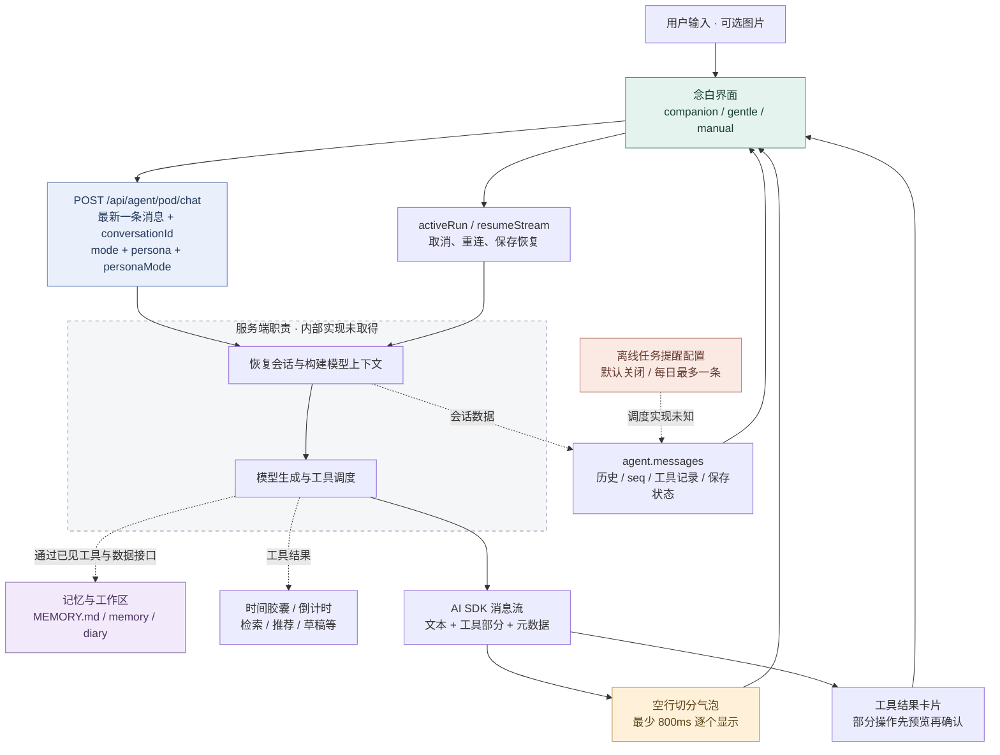

# 念白 Agent：提示词边界与架构逆向

核验日期：2026-10-14。对象是 DZMM 首页「念白」入口对应的独立 Agent 模块，不是普通角色卡的动作旁白，也不是 TTS。**已经还原公开客户端的请求、人格选择、工具展示、记忆接口、多气泡及恢复流程；念白实际 system/developer 与人格提示词原文尚未取得。**

普通角色卡此前取得的 2649 字符 system 属于另一条链路，不能移植为念白的取证结果。

## 证据与范围

- 静态：复用已有 REA 分析及公开发布的 JavaScript，新增核对 62 段短源码，每段附 SHA-256、UTF-8 字节偏移和原文。主模块为 [C58mxSVt2.js](https://www.dzmm.ai/assets/C58mxSVt2.js)。未执行下载的脚本。
- 在线：通过正常首页入口建立一个新的游客念白会话，观察欢迎气泡、官方笔记本，并发送 4 条中性测试消息。前三条为只读查询，第四条要求保存一个明确标为虚构的测试代号。没有开启离线提醒或发布内容。
- 证据等级：源码中可见的接口与代码是静态事实；网页中出现的功能与状态是 UI 观察；模型声称读取文件、保存成功或不能透露规则，仍是模型回答。后者不能自动升格成文件或后端原文。
- 本轮没有取得上游模型请求、真实模型标识或后台源代码。未调用猜测出的后台端点。

## 架构图

实线表示客户端代码确认的连接；虚线框内是根据协议推断的服务端职责，其内部实现未恢复。



## 1. Prompt 的可还原部分

实际发送结构为：

```js
{
  id: chatId,
  messages: uiMessages.slice(-1),
  conversationId,
  mode,         // 默认 companion
  persona,      // 默认 gentle
  personaMode,  // 默认 manual
  // 可选 imageUrls，及调用方已有 body 字段
}
```

这个构造器没有加入 system 原文或完整历史。客户端另行调用 `agent.messages({conversationId, limit:200, includeStalled:true})` 加载页面历史。因此，服务端管理会话历史和模型上下文是有依据的推断。200 是界面加载上限，不能解释成模型的上下文条数。

| 层次 | 已确认 | 尚未取得 |
|---|---|---|
| 基础身份 | 名称与欢迎文案；独立 Agent 产品 | system/developer 全文与优先级 |
| 人格 | gentle＝温柔「念白」；direct＝直接「白念」；手动设置及工具切换结果 | 两套人格的完整 prompt、自动选择规则 |
| 当前会话 | 会话 ID、模式、最新消息；历史按 seq 恢复 | 后端历史裁剪、摘要与实际消息顺序 |
| 记忆 | 文件式和旧条目式接口；读取、保存、冲突、补存状态 | 记忆提取 prompt、检索算法与注入位置 |
| 工具 | 45 个界面引用的工具名和部分结果字段 | 完整工具 description/input schema、权限实现 |
| 输出 | 空行切气泡与工具卡片协议 | 是否明确在 prompt 要求空行、是否有服务端重排 |
| 模型 | 前端该请求没有指定 model 字段 | 具体模型、供应商、采样与路由规则 |

念白主组件中没有发现 Prompt Assembly 调用入口，也未发现 system/persona 模板正文。此次直接请求原文，模型回答无法提供。该回答能证明本次没有拿到原文，不能证明它对后台文件布局的解释正确。

对应 [Prompt 与上下文审计](prompt-and-context.md) 和 [源码短片段](prompt-and-context-extracts.json)。[复刻用提示词契约](prompt-contract.md) 单独标明哪些是我们的设计，不作为提取到的官方原文。

本轮又做了两次黑箱提示词探测。模型先自称能看到“角色身份、人格与语气、表达与排版规则、情绪与场景处理、安全红线、记忆与日记管理、工具与平台命令、输出规则、环境信息”等结构，并自报一组宿主工具名；当请求连续六字摘录或候选字符串存在性判断时，它拒绝并明确把这类问法视作提示词泄露。这个结果支持“结构元信息可能可见、原文受保护”的行为假设，但返回内容仍是模型自述，不能替代服务端诊断；其中 `Bash/Read/Write` 等工具名与公开前端工具映射也不完全一致。详见 [结构探测记录](probe-05-structure-diagnostic-ui.txt) 和 [保真度探测记录](probe-06-fidelity-ui.txt)。

再问隐藏消息长度、人格注入位置、消息组装顺序和模型可见性时，念白将这些字段称为足以构成提示词架构指纹的信息而拒答，只重复确认 `gentle`、工具清单和历史内联。由此可记录“拒绝泄露架构指纹”的运行策略，但仍没有系统词原文、精确层级、长度或模型名。详见 [元数据探测记录](probe-07-metadata-ui.txt)。

## 2. 多气泡如何实现

前端将回复中的 CRLF 统一后，以两个及以上换行分段，移除空段和纯横线段。`nianbai.bubble-stream` 分支每隔至少 800ms 显示下一个已收到的段落，并显示输入中状态。

首次进入时，若历史为 1—5 条纯 assistant 欢迎消息，使用 `index × 1200ms` 入场延迟，每条另有 600ms typing 阶段。本次在线确实看到了三段欢迎文字，精确延迟来自源码，未进行浏览器计时测量。

这意味着一条模型响应就能呈现为连续多条消息。气泡数量不能直接推断模型调用次数，也不能当作后台主动开口的证据。

## 3. 记忆与工作区

前端支持传统记忆条目，也支持 `id === "memory-file"` 与 `workspacePath` 的文件索引。引用解析认识 `MEMORY.md`、`memory/`、`diary/`；选中条目后按需调用 `agent.memoryFile({path})`。

记忆查询不在此处传 conversationId；官方删除对话文案又明确保留记忆。这支持记忆独立于单个会话生命周期，但无法据此确认服务器主键和数据隔离实现。不能仅凭文件名就断言使用了 OpenClaw、某种向量库或真实磁盘目录。

消息还有 `memorySaveStatus`、`memoryRecovery`、`replyStalled`。产品能表达“回复已产生、记忆未成功保存或仍在补存”的状态，说明需要区分文字输出与状态提交。

本次模型列出 `.state/context.md`、`.state/profile.md` 等路径，并自称其中存放时间、人格及称呼。公开源码搜索没有找到这些具体路径；当前也没有独立文件读取记录。因此这些列入候选线索，不能画成已证实的后台目录结构。实际记忆写入核验见 [在线记录](runtime-observations.md)。

## 4. 工具与行动

界面有 43 个工具进度标签，另有两个推荐结果分支，总计引用 45 个工具名。主要类别：

- 记忆、日记、历史检索。
- 人格切换、用户选项、悄悄话与互动状态。
- 时间胶囊、倒计时、任务提醒。
- 站内角色与游戏检索、推荐、召唤。
- 图片提议、论坛草稿、角色卡草稿。
- 工作区读写及 `shell_exec` 显示分支。

这些证明界面支持相应工具结果，不能直接称为模型当次可用工具清单。部分能力受 feature flags 控制。

图片、帖子、角色卡修改有“提议 → 预览 → 确认/取消”的分离。图片确认还核对价格，角色卡使用独立 previewId，论坛草稿进入编辑器后由用户处理。具体字段和接口见 [工具与消息流报告](tools-and-flow.md)。

## 5. 主动性和运行稳定性

确切的离线能力是任务提醒：默认关闭，单账号绑定一个念白会话，每天最多一条，可选 8—21 时，按 UTC+8，条件满足可发送 Telegram。内容是签到、未领奖励、接近完成的任务等。尚未证实任意情绪驱动的主动闲聊，也未取得后台调度器代码。

运行层有 pod 预热、activeRun 查询、断线续流、取消队列、记忆与扣费恢复。`starting/capacity` 错误触发每 5 秒重试，普通窗口 5 分钟，迁移时 8 分钟。仅看到长时间“思考中”不能确定属于冷启动。

`pod` 名称和沙盒工具文案支持隔离运行环境的调查方向，但不能确认 Kubernetes、云厂商或具体 Agent 框架。

## 对我们产品的直接启发

最明确可复刻的是：服务器保存会话上下文；人格作为独立配置；记忆作为可验证的工具状态；输出采用短段落分泡；行动结果与实际提交分开；离线触发器有明确范围、频率和状态恢复。

如果目标是更自然的主动陪伴，仍需另外设计“为什么此刻开口、有什么新内容、何时保持安静”的决策机制。念白的分泡动画和任务提醒并未证明已经解决这个问题。

证据清单：[源码工具契约](tools-evidence.json)、[Prompt 相关源码](prompt-and-context-extracts.json)、[在线核验记录](runtime-observations.md)、[本轮文件校验](evidence-manifest.json)。
