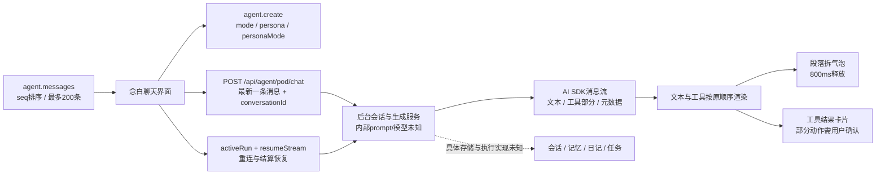

# 念白：工具、消息流、持久化与恢复的静态逆向

本记录只读分析已保存的 DZMM 公开前端产物，没有执行这些脚本、读取私人聊天、发送消息或调用后台操作。结论代表发布代码支持的路径；不代表相应功能已在当前账户开启或在某一轮实际运行。

证据：[tools-evidence.json](./tools-evidence.json)。每条记录带原文件 SHA-256、UTF-8 字节偏移、字节长度和短原文，编号 N01—N39。字节偏移为零起点。脚本可重新生成：[extract-tools-evidence.py](./extract-tools-evidence.py)。

## 核心结论

念白不是普通角色卡聊天换了一个名字。聊天入口按 `type === "agent"` 单独加载 `C58mxSVt2.js`，普通 AI 角色卡走另一个组件（N01、N02）。念白应用明确配置 `/api/agent/pod/chat`；请求仅携带最新一条消息和会话/人格选项，历史由后台接口另行加载（N04、N05）。这支持“后台拥有会话上下文”的设计判断，但不能据此得知后台如何构造系统词、裁剪上下文或调用哪个模型。

它的活人感至少有一部分能直接定位到前端：按双换行拆气泡，每次显示一个新气泡的间隔至少 800ms；开场多条 assistant 消息按 1200ms 错开入场，再显示 600ms 正在输入（N19—N22）。这能让一次模型响应看起来像连发多条，并不意味着每个气泡单独调用模型。

## 请求和消息流

1. Hook 默认 `mode:"companion"`、`persona:"gentle"`、`personaMode:"manual"`（N03）。这是代码默认值，不是已捕获的某次请求。
2. 首次发送前调用 `agent.create.mutate({mode, persona, personaMode})`。正在创建的 Promise 会复用，避免并发建会话（N07）。
3. 应用的自定义 transport 使用 JSON POST。最终 body 包含：`id`、`messages: messages.slice(-1)`、`conversationId`、`mode`、`persona`、`personaMode`；上传图片时另带 `imageUrls`（N04、N08）。**没有在这个应用级请求构造器里添加完整 system prompt。**
4. 历史调用 `agent.messages.query({conversationId, limit:200, includeStalled:true})`，按 `seq` 排序，保留 user/assistant/system。这里的 200 是前端历史加载上限，不能写成模型上下文上限（N05）。
5. 历史中的 `toolInvocations[{toolName,toolCallId,args,result}]` 转换为 SDK 的 `parts[{type:"tool-...",toolCallId,state:"output-available",input,output}]`。同一消息可同时含工具部分和文本（N06）。
6. UI 按文本、工具在消息中的顺序渲染；工具 envelope 读取 `toolCallId/name/input/output/state`，没有在这里定义后端工具参数验证 schema（N27）。
7. 本包带 AI SDK `6.0.105` 字符串。SDK 默认 `/api/chat` 被应用明确覆盖，不能拿默认地址充当真实产品接口（N09、N39）。SDK 支持的各种 reasoning/tool-approval chunk 同样不能单独证明念白使用全部能力。

## 工具接口：可以恢复到哪一层

前端含 **43 个工具进度标签**，另有 `recommend_cards`、`recommend_games` 结果渲染分支；共有 **45 个被界面引用的工具名**。另有 **37 个 workspace 命令显示标签**。完整枚举在证据 JSON 的 `tool_ui_inventory`、`workspace_command_labels`。这是**显示层契约**，不是已证明同时提供给模型的完整工具清单。

| 类别 | 已见工具名 | 可确认程度 |
|---|---|---|
| 长期记忆 | `memory_save/search/list/edit/write/delete` | 进度标签、部分结果字段、记忆面板接口 |
| 日记 | `diary/diary_write/diary_list/diary_read` | 标签、日记卡片、日记列表接口 |
| 对话检索 | `search_conversations/read_conversation/search_ai_chats` | 标签，AI 聊天搜索结果展示 |
| 人格与互动 | `switch_persona/set_timeout/user_choice/whisper/fortune` | 人格更新和多个专用结果卡片 |
| 时间功能 | `time_capsule/countdown/offline_task_reminders` | 时间胶囊/倒计时卡片、提醒设置接口 |
| 平台功能 | `check_credits/open_recharge/task_status/open_task_center/award_share_task/submit_feedback` | 进度或结果分支；充值结果可触发充值界面 |
| 内容发现 | `search_character_cards/recommend_cards/recommend_games/summon_character/summon_status` | 推荐和搜索结果、角色启动链接 |
| 创作者功能 | `list_my_cards/read_my_card/create_card_draft/edit_card_draft/generate_image/draft_forum_post` | 部分带预览、确认、取消流程 |
| 工作区 | `workspace_status/read/write/activity/shell_exec` | 显示标签和 trace 汇总；沙盒实现未见 |

### 可观察的结果字段

下面是渲染器访问的字段，**不等于完整后端 JSON Schema**。可选性和校验规则除非另述都不能从取值行为完整确定（N25—N27）。

| 工具 | UI 读取的结果字段 / 行为 |
|---|---|
| `switch_persona` | `switched`、`persona:"gentle"\|"direct"`；结果完成后同步界面人格（N18） |
| `memory_save/edit/delete` | `saved/edited/deleted`、`summary`、`reason` |
| `whisper` | `text` |
| `user_choice` | `question`、`options[{label,value}]`；点击实际把 **label** 当新聊天文字发回（N38） |
| `diary` | `saved`、`content`、`mood`；缺 content 时可回退至工具 input.content |
| `time_capsule` | `sealed`、`hint`、`unlockAt` |
| `countdown` | `created`、`label`、`minutesLeft/hoursLeft/daysLeft` |
| `set_timeout` | `timedOut`、`durationLabel`、`expiresAt`、`reason` |
| `web_search` | `results[{url,title,snippet}]` |
| `web_fetch` | `error`、`url`、`title` |
| `search_character_cards` | `results[{id,name,url,snippet,tags}]`、`totalHits` |
| `search_ai_chats` | `conversations[{chatId,url,characterName,messageCount}]`、`total` |
| `recommend_cards/games` | `results` 或 `available:true + games`；元素校验 `id/name/snippet?/intro?` |
| `summon_character` | `started`、`summonUrl` |
| `generate_image/draft_forum_post` | 先读取 `proposed/actionId`，再向 `agent.actions.get` 取完整 action view |
| `create_card_draft/edit_card_draft` | `needsConfirmation/previewId/changes/action/name/target`；预览行含 `field/label/kind/before/after` |

没有恢复出服务端的工具 description、完整 input schema、调用权限实现、timeout 语义或执行器代码。`shell_exec` 在这里仅对应“在沙盒里试试...”进度标签，不能据此断言其操作系统、沙盒厂商、命令许可范围或已执行 shell。

### 提议和真正执行是两步

- 出图/帖子先展示提议 action，UI 调 `agent.actions.get/confirm/cancel`（N35）。出图确认带 `expectedCreditsPerImage`；页面处理价格变化、路线变化、过期等结果。
- 论坛动作在打开编辑器前重新查询 action、核对当前用户，确认 `pending + forum_post`；随后把草稿放入论坛编辑器，供用户编辑发布。这里没有直接自动发布的证据（N36）。
- 角色卡 copilot 使用独立的 `studioCopilot.status/confirm/cancel` 和 `previewId`，先预览字段差异再确认（N37）。
- 功能还受到 `nianbai.image-gen/forum/studio-copilot/games/card-discovery/...` feature flags 控制。已发布代码里存在分支，不代表当前账号可用。

## 气泡节奏与“像人聊天”

- 文本先规范化 CRLF，按两个或以上换行切段，去掉空段及纯 `---` 分隔线（N19）。普通渲染路径也会拆成多个气泡。
- `nianbai.bubble-stream` 开启时，文本段数变多会按最少 800ms 间隔逐个露出，并继续显示“念白正在输入”（N20）。此处不是随机采样延迟，也不是后端定时发多轮消息。
- 初次进入且已有 1—5 条、全是 assistant 的欢迎记录，使用 `index*1200ms` 入场延迟；每条再有 600ms 的 typing 阶段。该首次入场处理还受一个会话 ID Set 控制（N21、N22）。
- 人格既可通过 UI `agent.persona.set` 手动切换，又能处理 `switch_persona` 工具结果。前端有 `gentle/direct` 两值；它们具体 prompt 和自动切换依据不在这里（N18）。
- `tool-trace` 可控制工作区 trace 显示；部分内部聚合工具成功后隐藏，只显示真实内容或简短完成信息。这样不会让每次记忆整理都刷一张醒目的工具卡。

## 记忆、持久化与主动提醒

**已见的持久化边界：** 前端使用后台 RPC 读取 messages、memories、memoryFile、diaryEntries、timeCapsules、countdowns；有删除/置顶记忆、开胶囊、删倒计时等独立 mutation（N05、N30）。在本 Agent 模块未发现 `localStorage` 或 `sessionStorage`。这不排除共享模块或浏览器其他层缓存，但不能把念白长期记忆归因于本模块本地存储。

记忆面板兼容两种呈现形式：旧版逐条记录；新版 `id === "memory-file"` 的索引内容加 `workspacePath`，按需调用 `agent.memoryFile({path})` 读取。解析器认识 `MEMORY.md`、`memory/`、`diary/` 引用及 `id/importance/pinned/createdAt/updatedAt/mood` 元数据；也接受 JSON 的 content/title 等（N31—N34）。**这强烈支持“文件式记忆接口”，但没有证明实际磁盘路径、数据库引擎、向量检索或记忆注入 prompt 的方式。**

生成完成回调会 invalidate 记忆、记忆文件、日记、倒计时、时间胶囊查询，令 UI 重新取新状态；冷启动错误有专门排除（N24）。消息 metadata 还有 `memorySaveStatus` 的 failed/unknown/conflict，`memoryRecovery` 的 pending/conflict，以及 replyStalled，说明用户可感知回复与记忆落库不同步（N06、N17）。不能仅凭文案推断后台事务具体实现。

离线任务提醒是确实存在的应用功能接口：`offlineTaskReminderSettings` / `setOfflineTaskReminderSettings`，绑定 conversationId。前端 schema 包含 enabled、hour（8—21 整数）、telegram；默认 `{enabled:false,hour:18,telegram:true}`，还出现 pending 提醒的 title/body/conversationId/messageId/nextAt 结构（N28、N29）。这是任务提醒接口，**还不能证明任意闲聊型自主开话题**，也未看到后端 scheduler/cron/队列如何触发。切回页面时可重新加载历史，以看到离线新增内容（N13）。

## 断流、并发与恢复

应用对恢复的处理明显多于一个基础聊天壳：

- `agent.activeRun({conversationId})` 查询在途运行，`recovering` 时同步历史并阻止新的发送；UI 提示正在核对保存/扣款结果（N11、N16）。
- 应用真实调用 `resumeStream()`；配置组合后，SDK 默认重连接口推导为 `GET /api/agent/pod/chat/{chatId}/stream`，204 表示没有流。**这是由代码推导的路径，不是抓到的 HTTP 记录**（N10、N11）。
- activeRun/恢复尝试使用 2s 起步指数退避、上限 32s，并受最大重试计数 6 控制（N11、N12）。
- `starting/capacity` 错误进入自动重试状态，每 5s 调 regenerate，保留同一条用户消息和原 body，通常总期限 5 分钟，migration 标志下 8 分钟（N12、N14）。是否产生重复扣款取决于后端幂等策略，前端不能证明。
- `visibilitychange/pageshow/online` 触发恢复判断；普通活动停滞门槛 10s，处于冷启动重试的门槛 75s，必要时先停本地流再恢复（N13）。
- 手动停止既发送 `agent.cancelRun`，又终止本地流；取消操作串成 Promise 链，下一次发送等待对应取消结果，避免旧运行和新消息交叠（N15）。
- 错误路径保留或恢复未成功发送的用户文字；busy、memory-recovering、maintenance、operation-pending、refresh-required 均有专门分支（N16、N17）。

## 未得到的内容

这轮没有取得念白服务端系统词、工具定义全文、模型 ID/供应商、每用户 pod 的真实部署方式、记忆检索算法或离线调度代码。`/pod/` 和“在沙盒里试试”只是接口命名/UI 证据，不能作为特定容器、云厂商或 Agent 框架的结论。普通角色卡的系统词也不能当作念白系统词使用。
