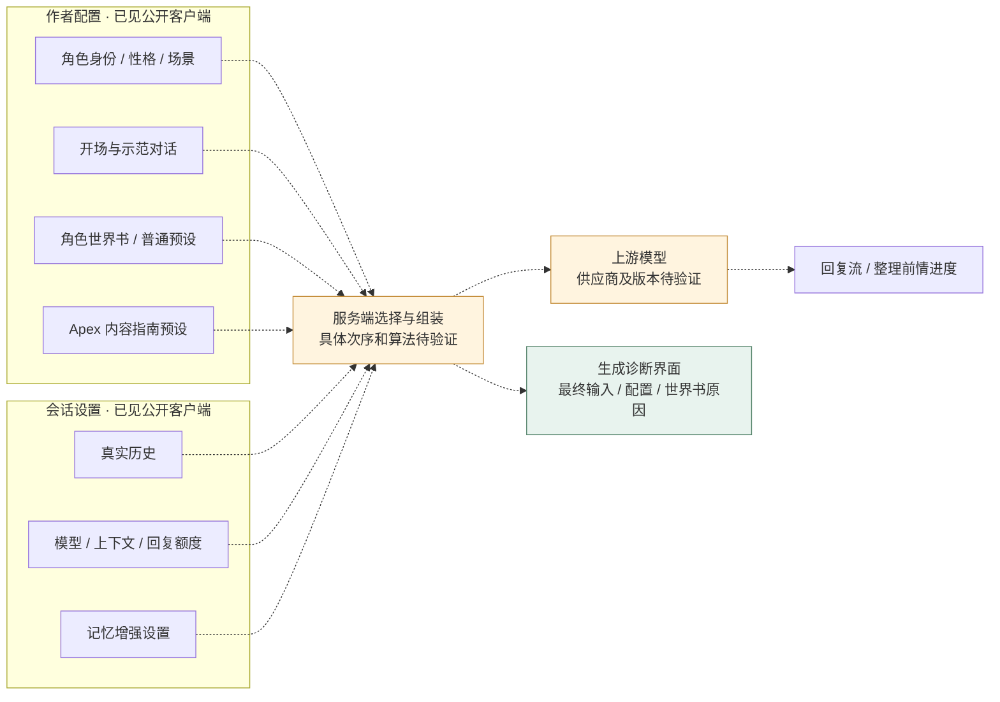

# REA 配置与 DZMM AI / 提示词工程调研

> 最新官方诊断核验（2026-10-14）：现已通过自有未上架测试卡取得 2649 字符的平台 system、完整四条组装输入及 5 份生成参数/token 记录。分词复验明显支持 DeepSeek 系计数特征，但实际型号与 provider 仍隐藏。下文为此前阶段记录；最新结论见 [官方诊断实测报告](/Users/pencil/Documents/IntVideoGameEditor/experiments/character-chat/research/dzmm-2026-10-14/verified-runtime-2026-10-14/results.md)。

> 后续实测更新（2026-10-14）：浏览器控制已恢复，已取得真实生成和提取候选；下文的“未生成/超时”是此前阶段记录。诊断权限中的 owner 已纠正为角色卡作者/所有者。详见 [本轮实验记录](/Users/pencil/Documents/IntVideoGameEditor/experiments/character-chat/research/dzmm-2026-10-14/prompt-extraction-2026-10-14/results.md) 与 [权限核验](/Users/pencil/Documents/IntVideoGameEditor/experiments/character-chat/research/dzmm-2026-10-14/prompt-extraction-2026-10-14/diagnostics-access-gate.md)。

核验时间：2026-10-14，Asia/Shanghai。

最新续查见 [第二轮结果](/Users/pencil/Documents/IntVideoGameEditor/experiments/character-chat/research/dzmm-2026-10-14/reverse-engineering-round2.md)：累计 15 个精选 JS 已解析，新增状态字段提示、精确风格门控、输出尾段协议及模型 fallback 边界；私有 prompt 与底模仍未取得。

REA 6.4.0 已安装、配置并实际用于本次分析。已取得 DZMM 当前公开前端、官方 Gamefy 文档全文，先对 9 个关键 JavaScript 文件完成静态解析并保存 48 项可重定位短段，随后补查第 10 个共享文件。**目前能够确认作者配置和客户端诊断结构；没有取得后台私有系统提示、真实底模映射或真实生成记录。**

## REA 已配置到什么程度

安装位置在 Codex 工具目录，项目依赖未改。Codex MCP 配置固定使用已存在的 Node 24.19.0，以避开系统 Node 25 不在 REA 支持范围的问题。`rea doctor` 返回 healthy，独立 stdio MCP 握手及 `tools/list` 实测得到 170 个工具。这证明服务器可启动；当前会话没有热加载新工具，本次通过 REA CLI 完成分析。下次重启或重新连接 Codex 后可载入 MCP 注册。

配置位置、备份和复查命令见 [安装记录](/Users/pencil/Documents/IntVideoGameEditor/experiments/character-chat/research/dzmm-2026-10-14/rea-installation.md)。安装依据为 [REA 官方安装说明](https://github.com/morluto/rea/blob/main/docs/installation.md)。

## 最重要的发现

| 层 | 本次公开源码能确认的设计 | 证据的限制 |
|---|---|---|
| 角色卡 | CCv3 格式；人格、场景、作者系统指令、示范/开场对话、世界书分开保存 | 空卡作者 `system_prompt` 为空，不代表后台系统提示为空 |
| 对话示例 | 多份有名字的场景；角色/内容消息；兼容多开场；指南鼓励展示不同情境和反应 | 未核验服务器如何选择和注入这些示例 |
| 普通预设 | 世界书条目支持关键词、常驻、启用、位置、顺序和预算 | 未复原全部后台匹配及组装次序 |
| Apex 专用预设 | `systemPromptContent`；公开说明称替换默认内容指南，保留身份与规则 | 默认指南和固定规则原文未取得 |
| 模型/记忆 | 模型与上下文目录、回复额度、深度思考、记忆增强设置；整理前情的客户端进度 | 产品说明与回调不能证明某种 RAG、摘要树或训练方法 |
| 生成诊断 | 最终输入、原始输入、模型/生成配置；世界书命中和排除原因 | 只看到了客户端读取与展示代码，没有调用诊断端点 |

角色卡依据：[角色编辑器](https://www.dzmm.ai/assets/CT6ZjuS1.js)；预设依据：[预设编辑器](https://www.dzmm.ai/assets/Dw5MrdXs2.js)；设置和诊断依据：[普通角色聊天组件](https://www.dzmm.ai/assets/Dm7jYsLH.js)。源码位置、哈希和短段集中在 [extracts.json](/Users/pencil/Documents/IntVideoGameEditor/experiments/character-chat/research/dzmm-2026-10-14/extracts.json)。

下图表示配置及观测关系。虚线表示服务端环节尚未核验，**不表示已经恢复最终 messages 的拼接顺序**。

## 找到了什么 prompt

找到了**公开供作者插入角色卡的系统指令模板**。编辑器读取 `components.writingGuide.system.template`，把模板追加到作者的 `system_prompt`，并防止重复插入。模板原文在官方中文资源里，分为剧情推进、文风、玩家自主、避免重复四块。它要求持续发生具体变化、保持角色风格、在玩家选择处停下、避免替玩家做决定和复述。来源：[编辑器插入逻辑](https://www.dzmm.ai/assets/CT6ZjuS1.js)、[官方中文模板](https://www.dzmm.ai/assets/Bv7Q1B9Q2.js)。

这份模板允许叙述，适用于互动故事。迁移到我们的本人直接聊天时，可借鉴推进、自主和防重复原则，输出继续遵守你要求的“只说角色实际说的话”。角色活动可以表达成“我刚到家”，动作括号、第三人称旁白和小说心理描写不应进入聊天表面。

公开模板、作者填写的系统指令、Apex 可替换内容指南、平台固定规则是不同层。本次没有把其中任何一个误标为后台完整私有 prompt。

## 底模现在能确定吗

不能。普通角色组件专门识别 `x-apex-sigma-0417` 别名族及其上下文后缀，并使用 `apex_dry` 默认风格。这是客户端内部标识，无法据此认定为 Grok、Claude、Gemini 或某个自训/微调模型。模型列表由动态目录提供，区分显示名、调用名、上下文和思考支持。[普通角色源码](https://www.dzmm.ai/assets/Dm7jYsLH.js)

后续已成功读取现行匿名公开目录：HTTP 200、44 个模型项、5 个系列，目录 defaultModel 为 `x-apex-surge-0505`。这补齐了在线目录数据，仍没有供应商/基础权重映射，也不代表用户测试会话的实际选择。见 [在线补查](/Users/pencil/Documents/IntVideoGameEditor/experiments/character-chat/research/dzmm-2026-10-14/live-findings.md)及其中的官方查询、采集记录。

也没有核验真实请求的 temperature、top_p、路由、系统提示优先级、长期记忆算法和离线主动调度。已有本地 `src/lib/dzmm-*` 是我们叙梦的独立实现，其 Grok 等配置不能作为原站模型证据。

## 真正有价值的入口：逐次生成诊断

普通角色聊天组件声明了两个诊断读取入口：

- `GET /api/chat/assembly?generationId=...`：展示 `finalInput`、`originalInput`、`config`、`generationConfig`；配置展示字段包含 `model`、`provider`、`source`、`assembly_mode` 和请求/追踪 ID。
- `GET /api/chat/lorebook-debug?generationId=...`：展示条目来源、关键词与次关键词、概率、重复内容、预算不足、无插入锚点等原因，以及预计 token、位置和预算。

来源：[普通角色诊断代码](https://www.dzmm.ai/assets/Dm7jYsLH.js)。目前仅确认这些代码存在。组装弹窗受 `canViewPromptAssemblyDebug` 权限控制，自己的会话也不保证能查看；世界书各来源区分“可看明细”和“仅汇总”，普通视图不展示条目名、关键词或内容。实际字段内容与账号可见范围仍需用户自己的正常测试生成记录核验；没有猜测生成 ID、读取其他用户的 prompt 或调用生成接口。

因此后续最有效的实测材料是**具备卡作者或特殊调试权限时，自己的中性测试会话对应的生成诊断**。它有机会核对最终输入和真实配置，优于仅根据回复风格猜底模。

## Gamefy 的做法，适用范围要独立

已取得当前 [官方文档全文](https://www.dzmm.ai/gamefy/llms-full.txt)，244166 bytes，版本 `50dd12a6ec4b`。它描述 H5 游戏 SDK 和服务端函数，不能直接外推普通角色聊天：

- 浏览器 completions 接受 user/assistant 消息，回调为累计文本；服务端流回调为增量。
- 动态目录区分调用名与显示名；默认可使用当前聊天模型设置，没有披露底模映射。
- JSON 生成后由应用解析、校验与确定性降级；防止迟到回复覆盖新状态。提示格式要求并不代替程序验证。
- 3000 是该 SDK 的输出 token 上限，8 MiB 是请求体限制，都不是长期记忆或模型上下文容量。

完整合同与出处见 [公开文档调研](/Users/pencil/Documents/IntVideoGameEditor/experiments/character-chat/research/dzmm-2026-10-14/public-research.md)。另外，念白 agent、普通角色聊天、Gamefy、Bot 是不同调用面：聊天入口确实按类型分支，agent 中通用 SDK 的 `/api/chat` 默认值不能归到普通角色真实接口。来源：[产品分支](https://www.dzmm.ai/assets/B28hEJCi.js)。

## 对我们的活人感原型，优先学什么

以下是本项目建议，不是 DZMM 后台已实现的声明：

1. **补齐每轮组装可观测性。**能看见角色、关系、记忆、示例、主动事项实际进入了什么，排除了什么。先分清模型能力、规则冲突、示例单一和记忆失效各自造成的影响。
2. **用情境反应教声音。**将被夸、对方累了、想独处、轻松吐槽、告别、忙碌、想分享小事分别设计；示例学习语气与判断，避免固定句及示例物件被当成真实经历。
3. **按相关性与因果选择上下文。**当前关系决定称呼和分寸，用户事实带来源，角色未完事项带进展；不是每轮把全部知识塞回去。
4. **评测多样性与主动连续性。**同一中性输入多次生成，比较开头、内容、长度、连续追问、旁白率和假记忆；主动开口需要自身事项有进展，并尊重忙碌、告别、正在输入与频控。可爱程度仍需要实际人评。

本次未修改 demo 的角色提示、会话数据或模型选择，没有设置任何定时优化。

## 后续补查：游客模式与普通角色请求链

用户随后选择先用游客模式。游客主页与消息列表已经通过正常浏览器界面读到，用户也已手动进入一般向成年日常角色的测试会话；随后自动截图、控件读取及同一浏览器中的轻量恢复入口仍超时。截至此补记未发出测试消息、未取得真实生成诊断。游客群聊/人与人私聊的禁言文案不能外推为 AI 角色聊天禁用。

普通角色组件精确声明的共享文件 [1OYk4JId.js](https://www.dzmm.ai/assets/1OYk4JId.js) 已补充取得。这个第 10 个精选文件确认了先前依赖缺口中的静态调用：普通角色发 `POST /api/chat`，随后订阅 `/api/chat/{chatId}/stream/{streamId}`。它与念白 SDK 的默认 URL 相同，但现在有普通角色的独立代码依据；仍没有核验这条请求链的实际运行与后台路由。

新文件还确认诊断入口要求 assistant 消息有 generationId，且未被编辑。正文 context 菜单和桌面悬停工具栏的标签为“世界书诊断”“查看组装上下文”。世界书诊断可由调试权限或角色卡作者/所有者身份开放；卡作者的组装诊断还需后台可见性探测返回 true。代码没有单独排除游客，实际权限仍待实测。

源码短段、SHA-256 和精确位置见 [新增入口定位记录](/Users/pencil/Documents/IntVideoGameEditor/experiments/character-chat/research/dzmm-2026-10-14/guest-ui-notes.md)。该补查与下方先前 9 个输入的 REA 统计分开记录，不把浏览器操作超时或静态接口声明当成实际生成成功。

新增文件也已完成一次独立 REA 分析：1 文件、96166 bytes、0 解析失败；application 为 complete（仅该输入），semantic 严格为 unknown，子类覆盖 partial，不能解释为完整语义。见 [新增 REA 摘要](/Users/pencil/Documents/IntVideoGameEditor/experiments/character-chat/research/dzmm-2026-10-14/rea-guest-summary.json)。累计 10 个输入文件、1077340 bytes；新增手工记录有 12 项短段，与原 48 项分开保存。

另已追踪普通请求 builder：角色卡通过 cardId 引用，预设通过 IDs 引用；会话设置、身份文本、近期 prompts 与操作输入分开。500–599 的旧消息窗口是客户端条数控制，不是长期记忆或最终 token 预算。见 [请求契约补查](/Users/pencil/Documents/IntVideoGameEditor/experiments/character-chat/research/dzmm-2026-10-14/request-contract-notes.md)，其中新增 14 项静态短段与旧记录分开保存。

## 证据与复核

REA 三次分析共静态解析 9 个文件、981174 bytes，0 个语法解析失败。工具报告的 application 覆盖：路由组 partial、共享组 partial、普通角色单文件 complete；三组 semantic 覆盖均 partial。这里的 complete 只针对输入的单个文件，不是全站恢复。CT6 语义结果受结果预算限制，C58 语义分析受 worker 堆内存限制；源码语法事实保留。未运行目标 JavaScript，静态关系不证明运行行为。

手工短段与 REA 图分析分开保存。48 项短段的来源文件哈希、字节范围与行号均已回验。初版采集器出现过 `assets/assets/` 的本地 URL 拼接错误，已纠正；早期失败记录不作为原站文件缺失的证据。

- [证据索引与完整性核对](/Users/pencil/Documents/IntVideoGameEditor/experiments/character-chat/research/dzmm-2026-10-14/evidence-index.json)
- [当前客户端详细发现](/Users/pencil/Documents/IntVideoGameEditor/experiments/character-chat/research/dzmm-2026-10-14/static-findings.md)
- [既有材料与本地实现审计](/Users/pencil/Documents/IntVideoGameEditor/experiments/character-chat/research/dzmm-2026-10-14/local-evidence-audit.md)
- [REA 路由摘要](/Users/pencil/Documents/IntVideoGameEditor/experiments/character-chat/research/dzmm-2026-10-14/rea-route-summary.json)、[共享组件摘要](/Users/pencil/Documents/IntVideoGameEditor/experiments/character-chat/research/dzmm-2026-10-14/rea-core-summary.json)、[普通角色摘要](/Users/pencil/Documents/IntVideoGameEditor/experiments/character-chat/research/dzmm-2026-10-14/rea-role-summary.json)

公开资源可能更新。复核应先对照采集时间和已保存的 SHA-256，避免把后来同一路径的内容当作本次证据。
