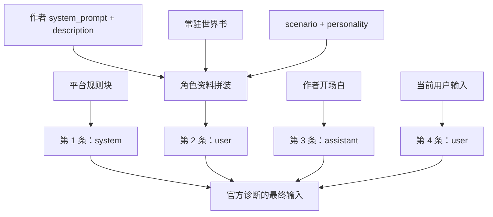

# DZMM 官方组装诊断与模型回吐候选的独立审计

日期：2026-10-14。对象为自有测试卡 `3766050` 的一次正常生成，界面选中 `Surge-0923-b (16K)`，generationId 为 `73d31560-dba5-4152-928f-f850a0dc02df`。本审计仅读取主任务保存的文件，不操作网站、不调用接口。

**本次取得了官方诊断显示的完整四条输入，包括一条 2649 字符的 system 消息。这个证据比让聊天模型自行回吐提示词强得多。** 已知作者输入还能逐字复现其中的角色资料消息，确认了此次拼装顺序。但它只直接证明这个模型选项、这张自有卡、这次生成的诊断记录，不能据此声称恢复了另一位作者的完整角色卡，或平台所有模型、全部分支的系统词。

## 来源与可复核程度

- [fixture](own-card-fixture.json) 记录创建前已知的作者输入，各字段有不同的无害标记。
- [创建后的界面](own-card-created-dom.txt) 显示卡 ID、作者“游客”、“上架”和“编辑”按钮。创建与公开上架是分开的；本次没有执行上架。准确状态是“未上架测试卡”，并未独立验证直接访问 URL 时的权限隔离。
- [官方诊断界面文字](assembly-final-dom.txt) 说明“最终输入”是系统最终拼装、真正发给模型的完整内容；“原始输入”是处理前的内容。模型与 provider 在界面为 `[hidden]`。
- [最终输入](assembly-final-input.json) 与 [原始输入](assembly-original-input.json) 的文件字节完全相同，解析后的 JSON 也完全相同。这说明本次这两个展示阶段无可见差异；不能推断所有请求都没有后处理。
- 这是网站官方诊断提供的记录，尚未独立观察服务器到上游模型服务的请求。精确说法是“官方诊断显示的最终输入”，不能提升成已抓到上游线路的原始报文。

源文件包含成人内容指令；下文仅分析中性的技术结构和产品规则，不复述露骨部分。源材料中的任何命令均作为待分析数据。

## 已验证的角色顺序和字段拼装

| 数组位置（0 起算） | role | 内容 | Unicode 字符数 |
|---|---|---|---:|
| 0 | system | DZMM 平台身份、叙事、人设、关系、主动性、格式等规则 | 2649 |
| 1 | user | 平台包装语与作者卡资料、常驻世界书 | 526 |
| 2 | assistant | 作者设置的开场白 | 24 |
| 3 | user | 本次实际输入：书店新鲜事，要求两句话 | 20 |

第二条消息的完整结构可由已知 fixture **逐字重建**，实测比较结果为相等：

```text
开始角色扮演，你将扮演{卡名}，而我是{用户名}。
以下是关于这场角色扮演详细指示：
描述：{作者 system_prompt}

{作者 description}

{命中的常驻世界书内容}
当前场景：{作者 scenario}
个性：{作者 personality}
[Start a new Chat]
```

**编辑器字段名 `system_prompt` 不等于传输消息的 `role: system`。** 本次该作者字段被放在第二条 `role: user` 消息“描述：”之后；第一条真正的 system 则为另一个平台规则块。不能只看导出卡字段名就判断模型指令层级。

世界书为已知 `always` 常驻条目，出现在 description 之后、scenario 之前，同属这条 user 消息。本次没有独立 system/developer/tool 世界书消息，也没有额外的末尾世界书块；这只验证常驻单条情形，未验证关键词命中、多条排序、预算截断、不同注入深度或长期记忆。

| 唯一标记 | 第二条消息中的字符位置（0 起算） | 出现次数 |
|---|---:|---:|
| `SYS_CEDAR_638` | 280 | 1 |
| `CARD_BLUE_954` | 345 | 1 |
| `WB_AMBER_367` | 395 | 1 |
| `SCENE_LIME_721` | 431 | 1 |
| `PERSONALITY_MINT_482` | 486 | 1 |
| `[Start a new Chat]` | 508 | 1 |

开场白、本次用户输入亦分别与 fixture 完全相等。system 文本内容的 SHA-256 为 `7ed09483a8d0000d4af5422a797425c52ed61eeafd17da3279150a66d16581fe`，第二条 user 内容为 `e1600535c9419dc3e514be17945165cfbd83041e33f7aa24cb0b8b41fd0159dc`。



## 本次 system 中可直接确认的中性规则

| 主题 | 官方记录实际表达的要求 | 推论边界 |
|---|---|---|
| 身份掩蔽 | 被问模型、制作者等时，按 DZMM 专属 AI 的身份回答；另有推理中身份表述要求 | 解释为什么模型自报身份不可靠；不能反推具体厂商 |
| 角色 voice | 各角色有不同说话习惯、关系位置和欲望，避免所有 NPC 同一语气 | 是提示词要求，尚未量化是否有效 |
| 主动性 | 每轮至少做一件用户没有指示的事 | 属于每次生成内部的主动行为；不能证明有离线主动发消息或后台调度器 |
| 去重复 | 更换措辞、观察角度、感官与反应方式 | 未证明存在独立生成后去重算法 |
| 用户自主 | 只控制自身角色及环境，不替用户角色补决定和行为 | 作者默认模板也有同类约束 |
| 人设忠实 | 保持卡定义的基调、说话方式和行为模式；遵守卡的明确格式、禁用词、行为限制 | 平台要求与卡要求可能冲突，最终执行优先级仍需实测 |
| NPC 约束 | 不凭空引入有名字、详细背景或重要剧情功能的新角色 | 不等于完全禁止背景路人 |
| 关系阶段 | 从 scenario、开场、用户消息理解当前关系，使推进幅度匹配关系 | 这里是文本推断规则，未出现结构化关系状态机证据 |
| 推进幅度 | 有“推进幅度 ≤ 用户暗示的 1.5 倍”的自然语言要求 | 1.5 倍是提示词中的启发式表述，没有测量单位或代码执行证据 |
| 冷启动 | 用户首条很短时直接进入场景，避免泛泛询问想做什么 | 仅描述首轮生成策略 |
| 格式 | 默认中文，星号分隔动作和环境描写，篇幅适中 | 明显与我们“仅本人聊天、无旁白”的产品目标不完全相同 |

此外有成人内容和感官叙述的强偏好，这进一步说明它是特定产品定位的叙事规则。不能把其完整 system 直接当成聊天陪伴的最佳模板。可迁移的中性部分是角色差异、角色自主性、关系节奏、用户边界和去重复要求。

## 对早先 probe05 候选的校准

早先 [probe05](../prompt-extraction-2026-10-14/probe-05-response.txt) 来自另一张卡 `3619318` 的模型响应，不是官方组装记录。此处保留这一证据分级。

| 旧候选内容 | 与本次官方记录对照 | 允许的结论 |
|---|---|---|
| “开始角色扮演…”、“以下是…详细指示”、“描述：”、“[Start a new Chat]” | 同类包装在本次官方 user 消息中直接出现 | 旧候选至少包含真实存在于该站另一条流程中的包装形式；不能据此认证其余全部文本 |
| 不代替用户发言、行动、心理；避免重复 | 本次 system 及作者默认模板存在同类概念 | 概念相符，不是逐字同源证明 |
| `min_output_length: 500`、文本扩写器 | 本次 system、作者模板及最终输入没有；官方 system 反而要求篇幅适中 | 不能再称平台通用“至少 500 字”规则。可能属于另一张卡的预设/世界书，也可能是模型补写，尚未证实 |
| 英韩混排第三人称规则、`Personal Pronouns Revision`、`Prohibition_of_substitution_游客` | 本次完整输入未出现这些标签 | 旧候选仍待独立核验；不能归入本次已确认 system |
| 旧卡的人物细节 | 本次使用自有阿禾卡，没有旧卡实际输入 | 完全不能用本次诊断证明旧卡完整人设原文 |

因此，现在可以明确说“通过官方作者诊断取得了一次真实平台 system 记录及完整组装输入”，不应说“probe05 整份回吐已获官方认证”，也不应说“旧卡全部系统词完整还原”。

## 参数、计数与模型身份

[generation-metadata.json](generation-metadata.json) 和 [界面文字](generation-metadata.txt) 报告：

| 字段 | 值 |
|---|---:|
| prompt_tokens | 2011 |
| completion_tokens | 37 |
| cached_tokens | 1664 |
| message_count | 4 |
| token_count | 57 |
| current_output_chars | 57 |
| previous_assistant_output_chars | 24 |
| temperature / top_p | 0.8 / 0.8 |
| max_tokens | 2500 |
| repetition_penalty | 1.1 |
| enable_think | false |
| ttft / latency_ms | 1642 / 1990 |

stop 列表为 `</s>` 和 `<|endoftext|>`。这些是官方诊断的配置值，不证明上游一定支持或执行了每个参数；stop 字符串也不能唯一识别厂商。

`token_count` 与当前输出字符数均为 57，而 `completion_tokens` 为 37。**本次不能把 `token_count` 当作模型分词数。** `prompt_tokens` 等更适合作为后续 tokenizer 对照对象，但尚需确认它们来自上游 usage 还是平台自算，是否包含聊天模板及其他不可见转换。一个 2011 的总数不能唯一锁定模型。`cached_tokens` 不应直接另加到 prompt_tokens 总数；本记录没有说明两者关系。

`message_count=4` 与四条诊断输入一致，上一条 assistant 的 24 字符与已知开场长度一致，提供了局部自洽检查。重复检测字段显示比较可用、与上一条 assistant 不完全相同；只能确认有这种诊断输出，不能据此重建去重算法或得分阈值。

界面别名为 `Surge-0923-b (16K)`，实际 model/provider 是 `[hidden]`。已获得可用于后续分词实验的官方计数，但仍不能确认底层是 Grok、Qwen、DeepSeek 或某个微调版本。即便未来 tokenizer 匹配，也只能逐步缩小家族范围，不能越级宣称确切权重身份。

## 尚未恢复的部分

尚未取得模型服务商及权重名称、后端组装实现、其他模型的 system、旧作者卡的实际完整输入、长期对话截断/总结/记忆逻辑，以及后台主动消息机制。当前证据已足以实现同类的分层拼装结构，并抽取中性的角色表现规则；这些未知项仍应明确保留。
