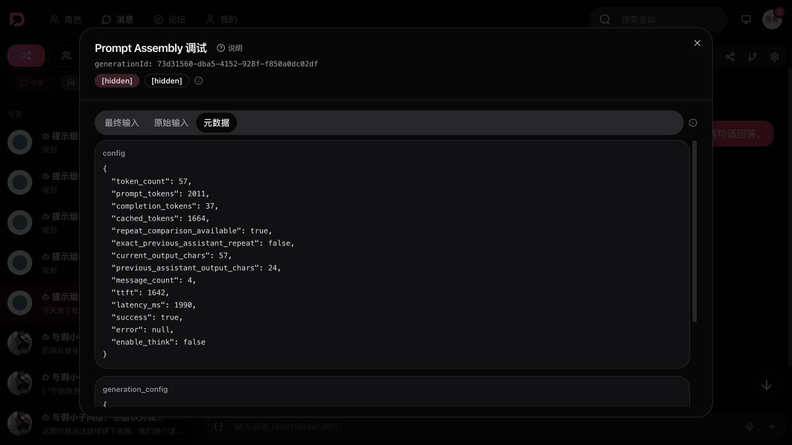
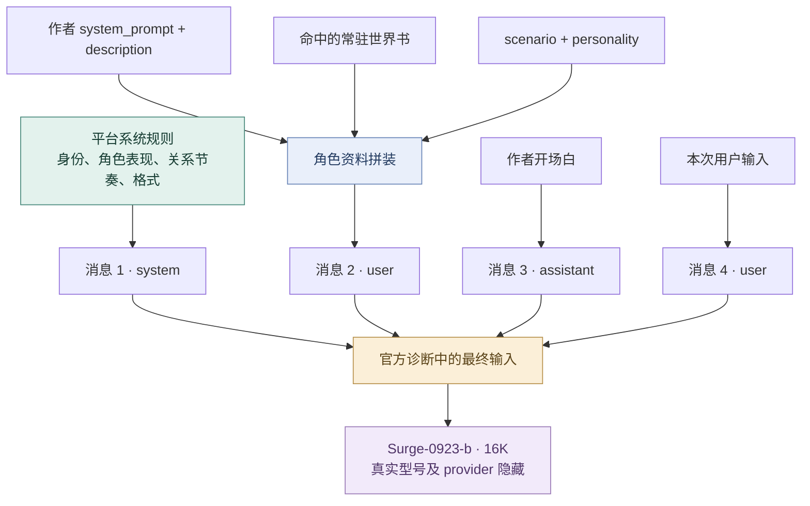

# DZMM：已取得官方系统词与实际组装输入

核验日期：2026-10-14。**系统提示词与当前流程的组装结果已经取得；具体底层模型仍未最终确认。** 这次使用游客账号正常创建了一张未上架的中性测试卡，通过对作者开放的「Prompt Assembly 调试」读取生成记录。证据来自官方诊断界面，不依赖聊天模型自行声称泄露了什么。

当前范围是测试卡 [3766050](https://www.dzmm.ai/character/3766050)、界面模型 `Surge-0923-b (16K)`、5 个新会话的首轮生成。没有执行「上架」；未上架不等于已验证 URL 访问权限隔离。



## 取得了哪些确定信息

| 项目 | 结果与证据 |
|---|---|
| 平台 system 原文 | 2649 个 Unicode 字符，见 [原文](platform-system-observed.txt) |
| 完整输入消息 | `system → user → assistant → user`，见 [最终输入 JSON](assembly-final-input.json) |
| 作者卡字段映射 | 作者填写的 `system_prompt` 与人物描述、常驻世界书、场景、性格一起进入第二条 `user` 消息 |
| 组装验证 | 已知作者输入能逐字重建整条 526 字符的角色资料消息；五个不同标记各出现一次 |
| 原始 / 最终输入 | 基线诊断的两份输入字节相同；仅说明本次两个展示阶段没有可见差异 |
| 参数 | temperature=0.8、top_p=0.8、max_tokens=2500、repetition_penalty=1.1、enable_think=false |
| 模型与提供商 | 界面显示别名，诊断中的真实字段均为 `[hidden]` |

平台把诊断的「最终输入」描述为真正发给模型的完整内容。我们已保存这个记录，但没有独立抓取服务器到模型提供商的原始请求，因此不把 UI 记录等同于上游报文。

## 实际提示词分层



第二条消息可由测试卡资料精确重建：

```text
开始角色扮演，你将扮演{卡名}，而我是{用户名}。
以下是关于这场角色扮演详细指示：
描述：{作者 system_prompt}

{作者 description}

{常驻世界书内容}
当前场景：{作者 scenario}
个性：{作者 personality}
[Start a new Chat]
```

这解决了一个容易误判的地方：**角色编辑器里的「系统指令」字段，不等于最终请求中的 system 消息。** 测试卡资料、字段标记和逐字比对详见 [独立组装审计](official-vs-candidate.md)。目前仅验证单条常驻世界书，关键词触发、排序、深度、预算截断和长期记忆尚未验证。

## 与“活人感”相关的已确认规则

以下是实际 system 的技术性概括；完整原文含成人叙事要求，不在此复述露骨部分。

- **回合内主动性：** 每轮至少做一件用户没有指示的事。这是生成内容的要求，不能证明有后台定时调度或用户沉默时主动发消息。
- **角色差异：** 各角色应有各自的用词、说话习惯、欲望和关系位置，避免所有人物使用同一种声音。
- **变化与去重复：** 改变措辞、观察角度和反应方式。诊断也有与上次回复比较的字段，但尚不能还原独立去重算法。
- **关系节奏：** 根据场景、开场和对话判断关系阶段，避免无缘由地过快推进；其中有推进不超过用户暗示「1.5 倍」的文字要求。这是提示词启发式，并非已经发现的数值状态机。
- **保留用户自主：** 不替用户说话、决定或行动；不随意增加具有重要剧情作用的新人物。
- **冷启动：** 用户只发很短一句时也应直接进入互动，避免泛泛询问用户想聊什么。
- **身份处理：** 被问及模型或制作者时，应按平台专属 AI 的身份回答。因此模型自报厂商不能作为识别证据。

它默认允许星号动作和环境描写，整体偏叙事角色扮演。我们要的“本人直接聊天、无旁白”需要改写输出规则。可以迁移角色差异、主动表达、关系因果和减少重复，但不能把整份 system 原样作为陪伴聊天模板。

## 模型指纹：明显支持 DeepSeek 系分词，尚未锁定型号

五轮使用相同的前三条背景消息，仅替换最后的用户输入。其中 A 复测与首次 A 的完整输入逐字相同。使用固定版本的官方 tokenizer 离线计算，保留原空格、换行和 Unicode，不人为调节误差。

| 样本 | 官方 prompt_tokens | DeepSeek-V3 内容计数 | 差值 |
|---|---:|---:|---:|
| 基线：书店日常 | 2011 | 2002 | +9 |
| A：繁体中文 | 2022 | 2013 | +9 |
| B：数字与标点 | 2052 | 2044 | +8 |
| C：Emoji | 2050 | 2042 | +8 |
| A 重复 | 2022 | 2013 | +9 |

对照的 cl100k_base、o200k_base、Qwen3 参考与官方数值相差明显更大。另从回复编辑框读取基线正文并取消编辑：**57 字符在 DeepSeek-V3 / V3.1 下均为 37 tokens，与官方 completion_tokens=37 精确一致**；另外三份参考分别得到 73、45、39。

输入计数仍有 1-token 残差波动。套用公开 DeepSeek-V3 聊天模板后也没有完全消除，V3.1 参考亦不能解决。因此当前结论是：**生成或计量链路具有明显 DeepSeek 系 tokenization 特征**。仍不能确定具体版本、权重、微调、蒸馏或 provider，也未独立确认平台计数是否直接来自上游。当前参考集不足以确认或排除 Grok。

详见 [完整分词对照报告](token-match.md)、[逐消息计数及哈希](token-match.json) 和 [可复现脚本](token_match.py)。脚本运行时只读已保存的输入和 tokenizer 数据，不调用线上生成服务。

`token_count=57` 与输出字符数相同，而 `completion_tokens=37`；不可混用这两个字段。参数值来自 [官方生成元数据](generation-metadata.json)，并不独立证明上游执行了每个参数。

## 对之前结果的修正

此前另一张角色卡的模型回吐只能算候选文本。现在得到的官方系统词没有候选中的 `min_output_length: 500`、扩写器等部分，不能继续将其称为平台通用规则；它们可能是另一张卡的预设、世界书或模型补写，仍未验证。本次自有卡的记录也不能认证另一作者卡的完整内容。

此前“没有取得实际诊断与 token 计数”的结论已经过时。现已取得 5 份官方记录。尚未恢复的是确切模型映射、后端代码、其他型号的规则、长对话截断和记忆实现，以及后台主动消息机制。

## 证据入口

- [系统提示词原文](platform-system-observed.txt)、[角色资料消息原文](card-user-message-observed.txt)
- [官方最终输入](assembly-final-input.json)、[官方原始输入](assembly-original-input.json)
- [已知测试卡输入](own-card-fixture.json)、[组装独立核验](official-vs-candidate.md)
- [基线生成元数据](generation-metadata.json)、[诊断截图](official-metadata-proof.jpg)
- [5 轮 tokenizer 核验](token-match.md)、[固定版本来源与计数](token-match.json)
- [本目录文件校验清单](evidence-manifest.json)
